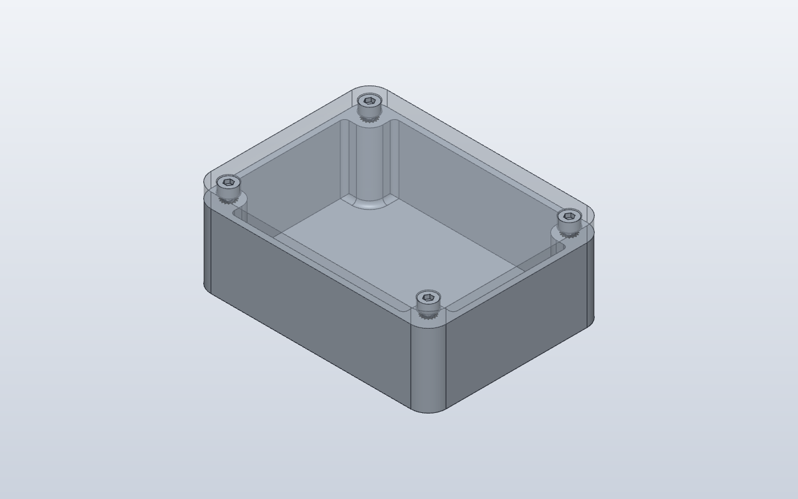
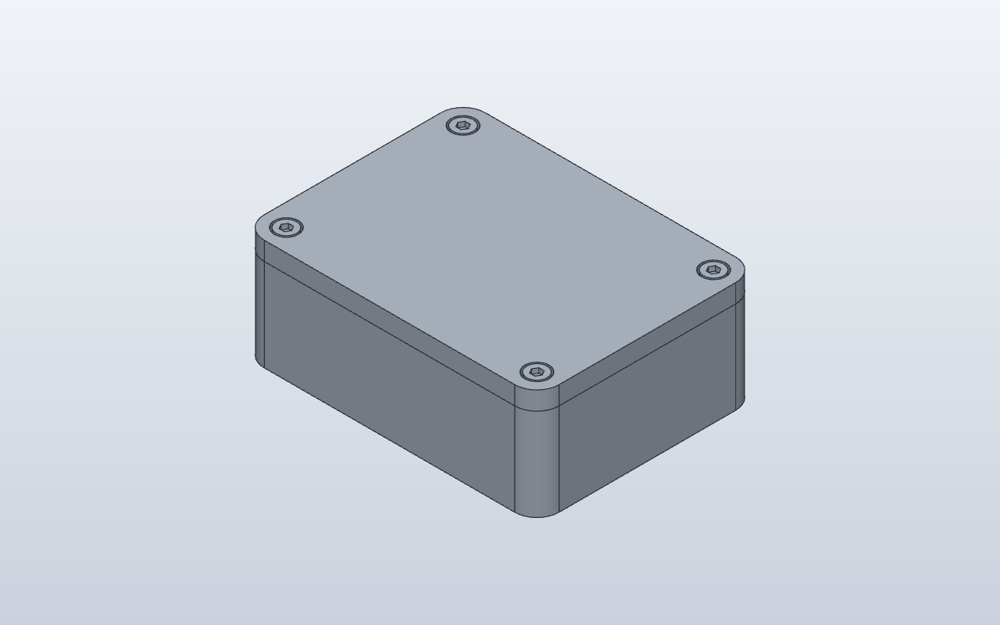
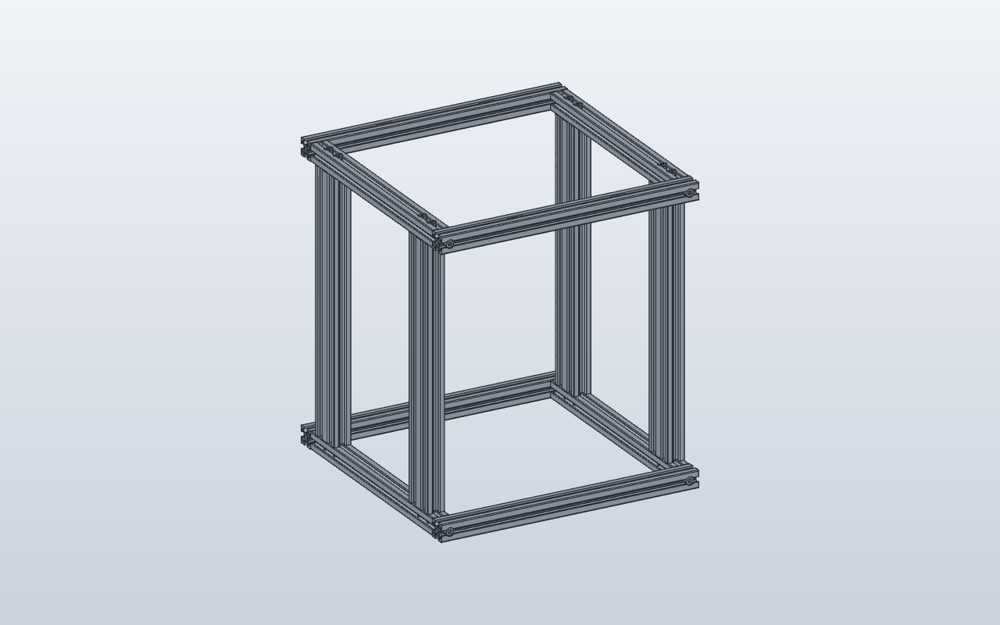
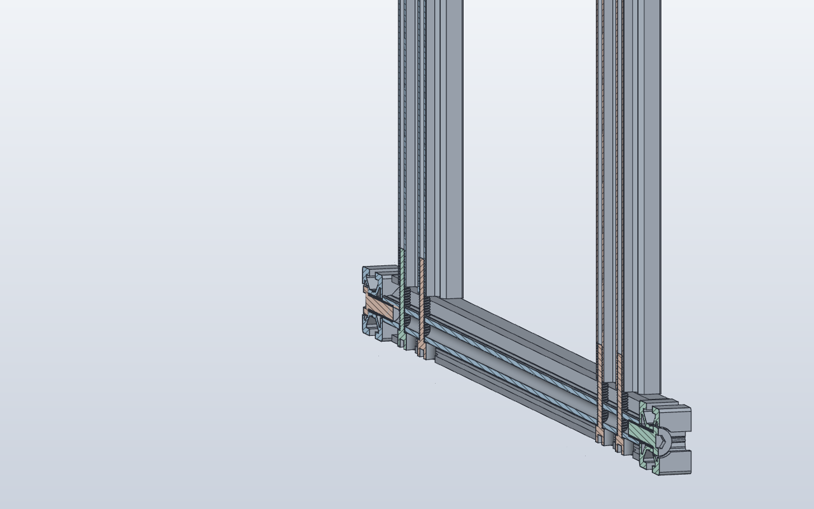
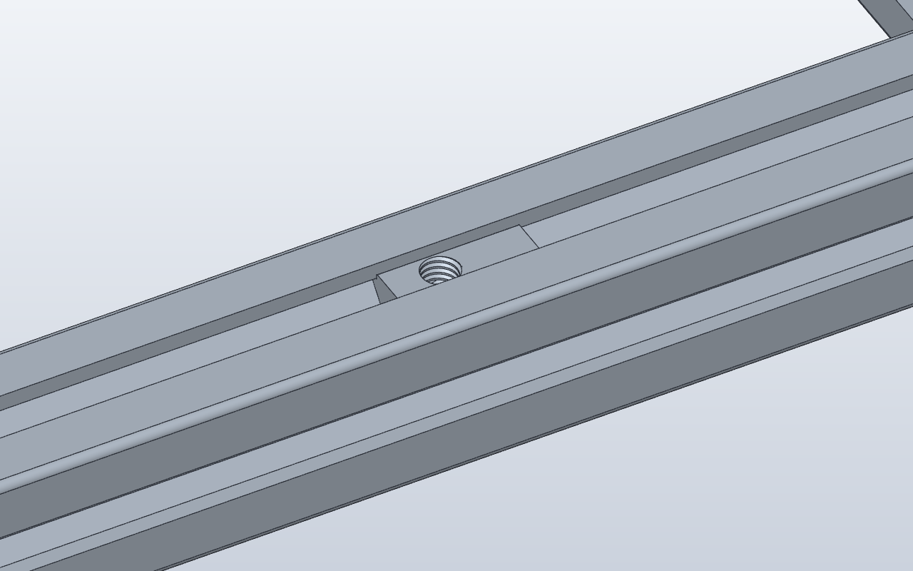
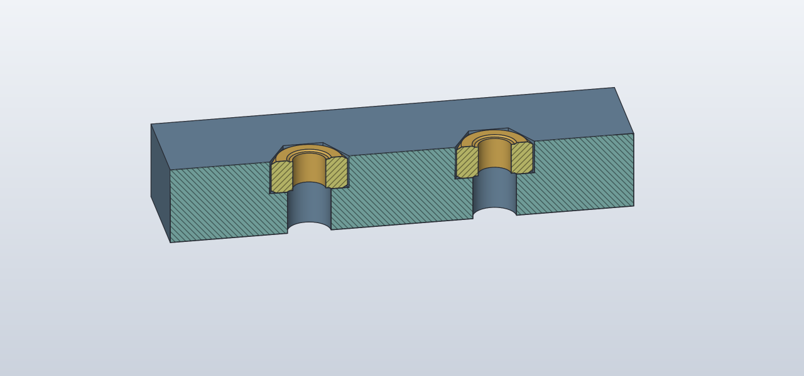
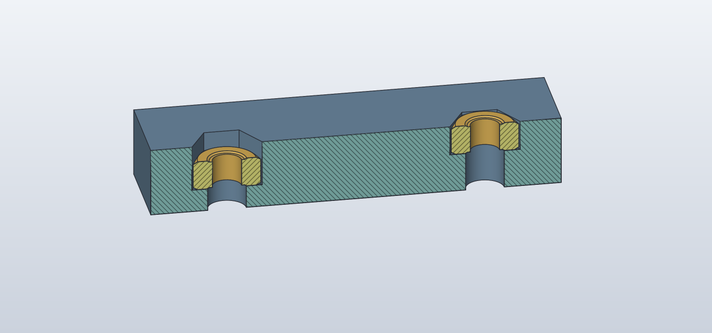

# Developer reference

TechSquid's plugins for [SolidCraft](https://github.com/tangency-labs/solidcraft). Each one is a WebAssembly component (`craft:plugin@0.1.0`, capability `commands@0.1`), the same package shape as [solidcraft-gears](https://github.com/tangency-labs/solidcraft-gears). A plugin changes the model only by running SolidCraft commands.

## Plugins

| Plugin | Id | Family | What it builds |
|---|---|---|---|
| [Screws](plugins/techsquid-screws/README.md) | `techsquid-screws` | Fasteners | Metric machine screws to ISO standards on selected sketch points (socket, button, countersunk, hex, pan and cheese heads, set screws and threaded rod), with any drive, and optionally the clearance, counterbored, countersunk or tapped hole |
| [Heat-set inserts](plugins/techsquid-inserts/README.md) | `techsquid-inserts` | Fasteners | CNC Kitchen heat-set inserts, metric and UN: the straight or stepped hole drilled into the part, and the knurled insert as its own body |
| [Hexagon nuts](plugins/techsquid-nuts/README.md) | `techsquid-nuts` | Fasteners | ISO 4032 hexagon nuts on selected sketch points, and optionally a hexagonal pocket with a bolt hole |
| [Extrusions](plugins/techsquid-extrusions/README.md) | `techsquid-extrusions` | Extrusions | 20 mm series T-slot (MISUMI 5 series) and V-slot (OpenBuilds) rails, 2020 to 2080 and 4040, cut to any length, with tapped ends and screw holes so they screw together, and the MISUMI M5 slot nuts that go in them |
| [Bearings](plugins/techsquid-bearings/README.md) | `techsquid-bearings` | Bearings and clutches | Six sourced OpenBuilds and MISUMI radial bearings, plus 55 CSK presets with editable envelopes, keyway configuration and source references |
| [V-wheels](plugins/techsquid-v-wheels/README.md) | `techsquid-v-wheels` | Wheels | Five OpenBuilds products, bare or composed with bearings and an internal shim |

Each plugin's README links to its detailed reference for dialog fields, standards and naming. Each release has one zip per plugin.

## Preparing a release

Keep the workspace version, Cargo lockfile and every plugin manifest on the same version. Add release notes at `release-notes/v<version>.md`, including breaking changes and migration steps, then run the build and relevant checks before tagging the release commit. A pushed `v*` tag builds packages and checksums and creates or updates an unpublished GitHub release draft using those notes. Review and publish that draft separately; rerunning the workflow leaves an already published release untouched.

A draft can also be prepared from a pushed release branch before its tag exists. Set its target to the release commit and upload the versioned packages and example designs. Merge the release preparation before publishing.

## Fasteners

Threads themselves are a host command. `solid.thread` cuts or annotates a cylindrical face from a designation such as `M6` or `M8x1`. The screw plugin places the screw and passes that designation through. The insert and nut plugins use `solid.hole` for the bore. Each plugin does the fastener geometry, and the host owns the thread form.

The three fastener plugins share field names (`size`, `custom_size`, `create`, `sketch`, `sketch_point`, `thread_modeled`) and a naming scheme for bodies: the kind of part, then its size, as in `Screw M3 x 12 socket`.

## Extrusions

A fixed-length rail is one sketch of lines and arcs, extruded once. Sketch-driven mode uses the same section in a native straight-path sweep; start, end and side machining planes reference the source path rather than generated faces. Its section comes from `crates/extrusions`, which builds it from a slot shape and a grid of 20 mm cells. The T-slot is checked against MISUMI's STEP models and the V-slot against OpenBuilds' DXF files; the plugin's reference lists each source and its test.

A rail can be built with its ends tapped M5 and with screw holes across it, so rails screw together with no bracket: see the plugin's README.

A slot nut is one section too, extruded along the slot and tapped. `make-t-nut`, the plugin's second entry, hangs it under the lips of a slot, on a point on the rail's face. Its shape is MISUMI's STEP model of the pre-assembly nut HNTT5-5 or the post-assembly nut HNTP5-5.

## Architecture

A plugin id is its folder, Cargo package and installed package name. Plugins own
workflow fields and their catalog adapters. Shared identity and protocol stay in
`parts`; host state and reusable definitions stay in `plugin-kit`. Domain crates
own compiled dimensions and geometry. The insert catalog stays in its only consumer.
Wheel and bearing packages share factories through Rust dependencies, not runtime
plugin calls.

Each concern has one owner. Short package READMEs link to their
full reference guides and shared architecture docs. Generated catalog tables are
checked against domain data; independent source measurements remain separate test
evidence. Test transports belong in `harness.py`/`headless.py`, not individual suites.
Every saved example has a build recipe and is checked for geometry, catalog identity
and BOM metadata. Rust build output, packages and Python caches are ignored.

The plugins have no build dependency on the adjacent SolidCraft source checkout;
runtime insertion needs the [host inspection fields](docs/parts-library.md#host-requirements).
The [bearing coverage checklist](docs/bearing-coverage.md) records the app parity
baseline and source evidence still needed before adding purchasable variants.

## Build

You need Rust with the `wasm32-unknown-unknown` target, [`wasm-tools`](https://github.com/bytecodealliance/wasm-tools), and Python 3 for packaging the guides.

```
cargo test
./build.sh
```

### Internal part definitions

`crates/parts` owns the host-independent product and representation identities and
internal list/describe/resolve types. Domain providers own configurations, source
measurements and assembly members. These descriptors remain the single source for
insertion and reuse; packages do not export a `catalog` entry or query handler.
See the [internal contract](docs/catalog-contract.md) and [shared library](docs/parts-library.md).

`tools/catalog-tool` generates catalog-owned insertion choices and reference tables
from the same data. Run `cargo run -p catalog-tool -- --write` after changing them;
`./build.sh` runs `--check` and refuses drift. Workflow controls remain hand-authored.
The package and guest both use that manifest. The generator must not add API entries.

The internal resolver's `catalog_selection` precondition pins the protocol version,
catalog revision and representation for provider round-trip tests. The ordinary
insertion dialogs resolve directly from their inputs. There is no installed query
route for obtaining a resolved selection; discovery is deferred until the host has
a suitable presentation contract.

Run `SOLIDCRAFT_CLI=/path/to/solidcraft-cli python3 tests/plugin_entries_test.py`
after building. It checks that every package offers only insertion workflows,
removed catalog calls preserve the model/selection/undo state, no dormant guest
handler can be enabled by redeclaring the entry, and non-XY insertion still works.
Rust tests retain the internal provider query and round-trip coverage.
`catalog_reuse_test.py` checks the existing families' identity and verified reuse;
`parts_library_test.py` validates real assemblies and composed reuse.

`cargo test` checks the parameter rules and the commands each run sends. `./build.sh` wraps each core module as a component and leaves one `dist/<id>/` for every folder under `plugins/`.

## Test against the host

`tests/cli_test.py` needs the package from `./build.sh` and an unsigned
`solidcraft-cli` meeting the [host requirements](docs/parts-library.md#host-requirements).
The occurrence-context regressions need both new inspection fields; a
0.42 or 0.43 build from before host PR #17999 is insufficient.

```
SOLIDCRAFT_CLI=/path/to/solidcraft-cli python3 tests/cli_test.py
```

It inspects each package. A screw run must build an M3, an insert run must build the M3 × 5.7 insert, a nut run must build an ISO 4032 M6, an extrusion run must build a 120 mm V-slot 2040, and a bad `head` must be refused as invalid input. The signed macOS build of SolidCraft 0.41.0 has the hardened runtime and no JIT entitlement, so loading a component kills `solidcraft-cli` (`SIGKILL`, code signature invalid). Inspect still succeeds there, and the test skips a run check when the CLI dies that way.

### Rail hole references

Run `SOLIDCRAFT_CLI=/path/to/solidcraft-cli python3 tests/rail_references_test.py` after building the packages. It edits the driving circle centers on all four rail faces and checks the actual access and clearance walls, recess depth and volume before and after reopening, including rotated copies, a wide V-slot rail and a tapped rail built away from the origin.

Sketch-driven mode was verified with SolidCraft 0.42.0. Run
`SOLIDCRAFT_CLI=/path/to/solidcraft-cli python3 tests/sketch_rails_test.py` after building.
It covers every profile with independent path lengths, translation and tilt edits,
modeled end taps, end-relative cross-holes, selection, repeated runs, save/reopen,
and the 16-rail limit. Run `python3 tests/sketch_selection_test.py` for the focused
duplicate-name regression: it checks the selected rail’s position and length and
rejects lines from different sketch IDs even when their names match.
The plugin estimates its command count before creation;
complex machining can require smaller batches. Its execution allowance also covers
fixing copied section geometry, while the host's 256-call and 30-second limits remain.

[Sketch-driven rails](examples/sketch-driven-rails.json) is a six-rail example with
editable `Rail_X`, `Rail_Z`, `Rail_Rise` and `Rail_Tilt` parameters. Rebuild and verify it
with `python3 tests/examples_test.py --update examples/sketch-driven-rails.steps.json`.


### Nut pocket references

The naming regression builds multi-pocket batches beside existing names in another
component, including case variants and reserved suffixes, then saves, reopens and
inserts another batch. It checks distinct profile/cut names and their native links.

The same suite checks two consecutive insertions through translated copies and
rotated nested assemblies using a face-attached sketch, with and without nuts.
It verifies the active path, mounting coordinates, actual nut positions and seat
joints, then checks failed-operation rollback and save/reopen. Shared seat tests
also verify that temporary body inspection restores selection after an error.
The same cases run with 100 translated or rotated nested copies and assert that
both consecutive insertions use the same host-call budget as the one-copy case.
Shared unit tests cover multiple requested seats among 600 distant copies,
overlapping candidates, bounds tolerance and failed bounds inspection.

Run `SOLIDCRAFT_CLI=/path/to/solidcraft-cli python3 tests/nut_references_test.py` after building the packages. It checks a standalone point and a circle, moves the point, changes the source plane's offset and orientation, edits pocket depth, and reopens the design. Pocket centers, bolt-hole axes, floor depths and exact cut volumes must agree, and the source sketch keeps its existing profiles. The same edits check pocketed nuts with cosmetic and modeled threads: rigid seat joints and the actual nut bodies must follow the floor, axis and hex rotation. Separate runs reuse a modeled nut definition on an initially tilted plane without displacing the first nut. A horizontal layout covers the previously failing move from -14 to -22 mm, larger horizontal and vertical moves across the origin, and pocket-width and depth edits followed by reopening.

### Screw seat references

The copied-tapped-seat regression preserves the existing unsupported-case refusal
and checks full rollback, so shared face inspection cannot attach to another copy.
A thin-plate countersink regression keeps its cone/bore junction attached even
when the screw's origin lies just below the plate's bounds.

Run `SOLIDCRAFT_CLI=/path/to/solidcraft-cli python3 tests/screw_references_test.py` after building. It checks clearance, counterbored, countersunk and tapped holes with cosmetic and modeled threads. Point and circle moves, plane changes, parameter-driven recess depths, reused definitions, carrier movement and save/reopen must preserve each seat and the actual screw body's axial/radial mass-center offsets and volume. Tapped cases also cover layouts created before the solid, sketches attached to faces, and insertion from outside the sketch's component. `crates/fasteners/src/seat.rs` shares face inspection and rigid-joint creation with the nut plugin; each plugin resolves its own seating geometry before adding hardware. Tapped screws use construction axes through the source points, normal to each sketch's supporting plane or attached face. The axes are inserted immediately after their source sketches, in the same component, with the original history marker and active component restored afterwards. The solid need not exist at that history position, and later thread cuts cannot split the support face. Clearance and recessed screws use named round ends so their seats follow recess edits.

## Examples

The [main showcase](examples/plugin-showcase.json) combines all six packages in a
small rail rack and hardware display. `plugin-showcase.steps.json` rebuilds it with
the current workflows, including standalone bearings and wheel cores sharing their
bearing definitions. The example test checks each package's definition count and
compares saved purchasing/representation records as well as geometry.





A PCB enclosure. The base is a shelled block with a boss in each corner, filleted where it meets the walls and the floor. One `make-insert` run drills the four bosses and builds four M3 × 5.7 inserts on the points of a sketch on the rim. One `make-screw` run on the points of a sketch on the 5 mm lid drills M3 clearance holes, each with a recess for the screw head, and sets an M3 × 6 socket head screw into each recess, its head flush with the lid. The screws and inserts have modeled threads.







A 300 mm square frame, 340 mm tall, held together by screws alone, the way a Creality Ender 5 frame is. Five `make-extrusion` runs place twelve rails, already cut for their joints: cross rails with both ends tapped and four screw holes for the posts, side rails with a screw hole at each end, and four V-slot 2040 posts with both ends tapped, standing in the corners. Four `make-screw` runs place 24 M5 socket head screws on the slot floors. Sixteen M5 x 25 go through the cross rails and 11 mm into the ends of the posts. Eight M5 x 20 go through the side rails and 6 mm into the ends of the cross rails, short enough to stop before the post screws that cross those ends. Two `make-t-nut` runs put four M5 post-assembly nuts in the top slots and two M5 pre-assembly nuts in a slot of two posts. Every thread is cut. The only bodies that overlap are the screws and the tapped bores they are in, by the little that two threads cut out of step do.

### Pocketed nuts that follow edits

[Open the edited design](examples/nut-pockets.json) or read the [captioned command sequence](examples/nut-pockets.steps.json). The existing `nut` example stays a standalone M3 nut for the plugin guide's portrait; this companion shows how the pockets and hardware behave in a part.



Before the edits, two M6 nuts sit flush in a 12 mm plate. The left center is a sketch point and the right is a circle center. Both pockets are 5.2 mm deep. The section passes through their bolt-hole axes; the gold parts are the nuts.



The next steps move the centers from x = -14 and 14 to -22 and 22 mm, then change `left_pocket_depth` from 5.2 to 8 mm. The left nut moves down with its floor and ends 2.8 mm below the plate's top. The right nut stays flush. Both bolt holes remain centered under the nuts. Cosmetic threads keep this example quick to rebuild.

The saved design is the final state. To try another edit, open **Nut centers**, move `left` or `right.center`, and finish the sketch. Change the `left_pocket_depth` parameter to move only the left pocket floor and nut. **Left nut pocket** reads that parameter; its seat joint reads the floor, so there is no second offset to adjust. Opening the saved design does not require the plugin.

Each linked hex corner has a directed construction radius derived from the same across-flats dimension. This keeps the hex from folding during a large center move while leaving its width editable. Previously generated pockets keep their old sketch constraints; regenerate those pockets to get the improved construction.

Build and verify both the saved geometry and its alignment with:

```sh
SOLIDCRAFT_CLI=/path/to/solidcraft-cli python3 tests/examples_test.py --update examples/nut-pockets.steps.json
SOLIDCRAFT_CLI=/path/to/solidcraft-cli python3 tests/examples_test.py examples/nut-pockets.steps.json
```

The checks compare actual pocket floors, bolt-hole axes, nut bounding boxes, seat-joint frames, and zero interference. The checked-in design must match a fresh build in both volume and position. The before picture comes from the first nine commands, ending with the depth parameter linked at 5.2 mm; the after picture comes from the complete sequence. Both use a section at y = 0, retaining the positive-Y half, with this camera and colors:

```sh
solidcraft-cli snapshot --in examples/nut-pockets.json --out examples/nut-pockets.png --width 1280 --height 600 --camera '{"target":[0,0,6],"yaw":0.18,"pitch":0.45,"distance":70}' --section y=0,flip --no-grid --no-axes --quality fine --body 'Plate:color=#708da5' --body 'Nut M6:color=#d7af57'
```

Nine standalone examples show the plugins’ parts and editing modes. Each plugin's README has a picture rendered from them, kept beside the README in `plugins/<id>/`:

| Example | Plugin | What it builds | Picture |
|---|---|---|---|
| `screws` | `techsquid-screws` | Ten M5 x 16 screws in a row: every head, every drive, and the point and cup tips | `screws.png` |
| `insert` | `techsquid-inserts` | One M3 × 5.7 insert on the origin | `insert.png` |
| `nut` | `techsquid-nuts` | One M3 nut on the origin | `nut.png` |
| `rails` | `techsquid-extrusions` | Every T-slot and V-slot size, 40 mm long, standing on end | `rails.png` |
| `sketch-driven-rails` | `techsquid-extrusions` | Paired T-slot 2020/4040 and V-slot 2080 rails with editable paths, end taps and cross-holes | `sketch-driven-rails.png` |
| `slot-nuts` | `techsquid-extrusions` | A pre-assembly and a post-assembly nut in the top slot of a T-slot 2020 | `slot-nuts.png` |
| `bearings` | `techsquid-bearings` | Six sourced radial bearings: open, sealed and shielded | `bearings.png` |
| `csk-clutches` | `techsquid-bearings` | Eight CSK envelopes: reference, repeated custom keyways, small keyed presets and a custom envelope | `csk-clutches.png` |
| `v-wheels` | `techsquid-v-wheels` | Five wheel cores, each with two bearings and an internal shim | `v-wheels.png` |

The sketch-driven example uses three plugin runs on one fully constrained six-line
sketch. The paired rails have different lengths; the 2020 pair has modeled M5 taps,
and the 4040 and 2080 pairs have cosmetic taps. Change `Rail_Tilt` from `-35 mm`
to `35 mm`, `Rail_Rise` from `150 mm` to `190 mm`, and the layout origin to
`Rail_X = 90 mm`, `Rail_Z = 40 mm` to try a combined move, resize and reverse tilt.
The cross-hole offsets stay 25 mm and 55 mm from the path ends.

A new plugin gets an example like these and a picture in its README.

Each example comes as two files:

- `examples/pcb-enclosure.json` is the design. Open it in SolidCraft (File > Open). It is saved by SolidCraft 0.42, so an older SolidCraft may refuse it as a newer file. SolidCraft rebuilds it as it opens, which takes a few seconds for the modeled threads. The plugins have already run, so opening it needs none of them installed.
- `examples/pcb-enclosure.steps.json` builds that design, one SolidCraft command per step, with a `caption` saying what each step does. It is not a design file, so SolidCraft does not open it. A plugin step is a `plugin.run` with `"path": "dist/<id>"` and `"approval": "@approval"`. The approval changes with every build, so the test inspects each package and fills it in. `expect` holds what the finished design must measure.

```
SOLIDCRAFT_CLI=/path/to/solidcraft-cli python3 tests/examples_test.py
```

It builds every `*.steps.json` and checks the body count (each placement of a fastener or a rail is a body, measured where it is placed) and the bounding boxes. Bearing examples explicitly count their intentional closure surfaces and compare their areas; other bodies must be closed. On the enclosure it checks the insert hole, the clearance hole and the head recess on each corner, and one insert and one screw on each corner. On the frame it checks the box and the volume of every rail, screw and slot nut, and that the only bodies that overlap are the 24 screws and the tapped bores they are in. On the small examples it checks the box and the volume of every part. For every example it checks that the saved design reopens, and that the design next to it matches the fresh build body for body. After a plugin or an example changes, `--update` writes that design from the fresh build. The same signed macOS build skips here as well, because every example runs a plugin.

The pictures are rendered from the designs:

```sh
solidcraft-cli snapshot --in examples/plugin-showcase.json --out examples/plugin-showcase.png --width 1600 --height 1000 --camera '{"target":[0,-12,5],"yaw":0.12,"pitch":0.6,"distance":280}' --no-grid --no-axes --quality fine --body 'Insert M5 x 9.5:color=#c9943a'
```

```sh
solidcraft-cli snapshot --in examples/bearings.json --out plugins/techsquid-bearings/bearings.png --width 1600 --height 550 --camera '{"target":[1.5,0,0],"yaw":0.1,"pitch":0.75,"distance":110}' --no-grid --no-axes --quality fine
solidcraft-cli snapshot --in examples/csk-clutches.json --out plugins/techsquid-bearings/csk-clutches.png --width 1600 --height 800 --camera '{"target":[0.75,25,0],"yaw":0.05,"pitch":0.9,"distance":150}' --no-grid --no-axes --quality fine
solidcraft-cli snapshot --in examples/v-wheels.json --out plugins/techsquid-v-wheels/v-wheels.png --width 1600 --height 600 --camera '{"target":[-2,0,0],"yaw":0.05,"pitch":0.75,"distance":80}' --no-grid --no-axes --quality fine
```

The bearing and wheel previews are native CAD captures. Their appearances show
seals, shields and illustrative clear/black wheel variants; no image synthesis is
used. Bearing closure surfaces are intentionally open, as the references explain.


```
solidcraft-cli snapshot --in examples/pcb-enclosure.json --out examples/pcb-enclosure.png --width 1280 --height 800 --camera '{"target": [0, 0, 15], "yaw": -0.785, "pitch": 0.615, "distance": 150}' --no-grid --no-axes --body Lid:opacity=0.3 --quality fine
solidcraft-cli snapshot --in examples/pcb-enclosure.json --out examples/pcb-enclosure-closed.png --width 1280 --height 800 --camera '{"target": [0, 0, 15], "yaw": -0.785, "pitch": 0.615, "distance": 150}' --no-grid --no-axes --quality fine
solidcraft-cli snapshot --in examples/rail-frame.json --out examples/rail-frame.png --width 1280 --height 800 --camera '{"target": [0, 0, 170], "yaw": 0.5, "pitch": 0.4, "distance": 800}' --no-grid --no-axes --quality fine
solidcraft-cli snapshot --in examples/rail-frame.json --out examples/rail-frame-joint.png --width 1280 --height 800 --camera '{"target": [140, 105, 30], "yaw": 0.3, "pitch": 0.15, "distance": 190}' --no-grid --no-axes --quality fine --section x=140,flip
solidcraft-cli snapshot --in examples/rail-frame.json --out examples/rail-frame-nuts.png --width 1280 --height 800 --camera '{"target": [62, -140, 336], "yaw": 0.5, "pitch": 0.7, "distance": 75}' --no-grid --no-axes --quality fine
solidcraft-cli snapshot --in examples/screws.json --out plugins/techsquid-screws/screws.png --width 1600 --height 700 --camera '{"target": [0, 0, -5], "yaw": 0, "pitch": 0.6, "distance": 92}' --no-grid --no-axes --quality fine
solidcraft-cli snapshot --in examples/insert.json --out plugins/techsquid-inserts/insert.png --width 1280 --height 800 --camera '{"target": [0, 0, -2.85], "yaw": 0.5, "pitch": 0.55, "distance": 14}' --no-grid --no-axes --quality ultra
solidcraft-cli snapshot --in examples/nut.json --out plugins/techsquid-nuts/nut.png --width 1280 --height 800 --view iso --no-grid --no-axes --quality fine
solidcraft-cli snapshot --in examples/sketch-driven-rails.json --out plugins/techsquid-extrusions/sketch-driven-rails.png --width 1280 --height 800 --camera '{"target": [245, 0, 140], "yaw": 0.35, "pitch": 0.4, "distance": 650}' --no-grid --no-axes --quality fine
solidcraft-cli snapshot --in examples/rails.json --out plugins/techsquid-extrusions/rails.png --width 1280 --height 800 --camera '{"target": [80, 0, 20], "yaw": 0.3, "pitch": 0.8, "distance": 330}' --no-grid --no-axes --quality fine
solidcraft-cli snapshot --in examples/slot-nuts.json --out plugins/techsquid-extrusions/slot-nuts.png --width 1280 --height 800 --camera '{"target": [0, 0, 14], "yaw": 0.45, "pitch": 0.6, "distance": 95}' --no-grid --no-axes --quality fine --body "T-slot 2020 x 80:opacity=0.3"
```

`tests/geometry_test.py` checks what the plugins cut. It builds a plate, runs a plugin on two sketch points, and compares the plate's volume with the figure worked out by hand: insert holes, screw clearance, counterbored, countersunk and tapped holes, nut pockets, and the head shapes and drive recesses of loose screws. A rail is checked the other way round: its volume must be the area of its section, worked out by hand from the slot sizes, times its length. A tapped or drilled rail is checked against the plain one, a screw hole by the metal it takes out, and a drilled rail, a tapped post and two screws are put together to check that each screw passes the first rail without touching it. A slot nut is put in the slot of a rail: it must be the size MISUMI draws, sit under the lips, touch nothing, and leave the rail and any nut built before it as they were.

```
SOLIDCRAFT_CLI=/path/to/solidcraft-cli python3 tests/geometry_test.py
```

It needs a `solidcraft-cli` that can run a plugin, so on the signed macOS build it reports SKIP.

## Wheel and bearing source geometry

The `bearings` and `wheels` crates own radial-bearing and wheel supplier products
and their exterior geometry. The `bearings::csk` module separately owns editable
CSK design specifications. The [OpenBuilds ledger](docs/sources/openbuilds.md) records wheel profiles,
assembly references and the 105ZZ width correction. The [MISUMI ledger](docs/sources/misumi.md)
records rounded ring profiles, closures and the open B626's visible balls. Both
retain source hashes and independent measurements. No source STEP files or
Downloads paths are runtime dependencies. Radial profiles and closure surfaces use
`plugin-kit::revolve`; screws and bearings share its arc/line section drawing code.

Build and check the native reference geometry with:

```bash
cargo build -p wheels --example reference_geometry
cargo build -p plugin-kit --example inspect_content
SOLIDCRAFT_CLI=/path/to/unsigned/solidcraft-cli python3 tests/wheel_geometry_test.py
SOLIDCRAFT_CLI=/path/to/unsigned/solidcraft-cli python3 tests/bearing_geometry_test.py
SOLIDCRAFT_CLI=/path/to/unsigned/solidcraft-cli python3 tests/csk_geometry_test.py
```

The test compares wheels to independently imported STEP measurements, verifies
bearing rings and recessed closure surfaces, checks wheel/rail contact against the
built Extrusions plugin, and checks saved geometry through the current-content
inspector. Run `./build.sh` first for the rail check. A zero-thickness closure is an intentional exterior
representation, not a seal cross-section or a mass model. The assembly and cross-plugin reuse checks live in `tests/parts_library_test.py`.
The bearing suite separately verifies MISUMI ring volumes against the STEP ledgers,
bore/shoulder radii, closure recesses and colours, the open bearing's race depths,
section vertices and eight spheres, and purchase/reuse
behavior through the installed workflow.

The CSK suite checks all 55 reference envelopes, custom dimensions and keyway
presence, separate geometry and reference metadata, BOM quantities, definition
reuse, invalid-input rollback and save/reopen. It uses the built Bearings package;
run `./build.sh` first. The [CSK walkthrough](examples/csk-clutches.md) explains the
example’s seven BOM rows and independent volume expectations. Rebuild and check it
with:

```bash
python3 tests/examples_test.py --update examples/csk-clutches.steps.json
python3 tests/examples_test.py examples/csk-clutches.steps.json
```

## Components

All fixed parts use [one shared library](docs/parts-library.md) for canonical identity,
current-content inspection, reuse and placement. Component names are presentation;
purchasing identity and geometry representation are separate. Modified definitions
are preserved, and later insertions create clean replacements. The former creator
and command-hash implementation has been removed.

The reply's `component` identifies the placed definition, `reused` and occurrence
IDs. Its `library` report includes host-call count and modified candidates preserved.
Screws with holes and nuts with pockets retain their native seat joints. Loose
parts remain free to move. The original active component is restored after a run.

## Releases

Pushing a tag like `v0.1.0` runs `.github/workflows/release.yml`, which builds the plugins and attaches `<id>-0.1.0.zip` for every plugin under `plugins/`, such as `techsquid-screws-0.1.0.zip`, each with a `.sha256`. The tag has to match `workspace.package.version` and every `plugins/*/plugin.json`.

## License

MIT, see [LICENSE](LICENSE).
