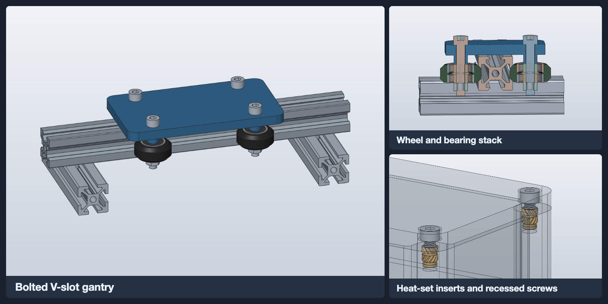

# TechSquid plugins for SolidCraft

Build the hardware and frames your designs need without modeling every part from scratch. These plugins bring configurable fasteners, heat-set inserts, aluminium extrusions, bearings and V-slot wheels into [SolidCraft](https://github.com/tangency-labs/solidcraft), with matching holes and pockets where you need them.

[Explore the V-slot gantry](examples/v-slot-gantry/) · [Browse all examples](examples/)

Version 0.3 insertion requires the [updated host inspection API](docs/parts-library.md#host-requirements).
Saved example designs open without the plugins.
[0.3.0 release notes](release-notes/v0.3.0.md)

## Plugin List

| Plugin | Make |
|---|---|
| [Screws](plugins/techsquid-screws/README.md) | Metric screws, set screws and threaded rod, with optional clearance or tapped holes |
| [Heat-set inserts](plugins/techsquid-inserts/README.md) | CNC Kitchen metric and UN inserts and their mounting holes |
| [Hexagon nuts](plugins/techsquid-nuts/README.md) | ISO 4032 nuts, with optional pockets and bolt holes |
| [Extrusions](plugins/techsquid-extrusions/README.md) | Fixed-length or sketch-driven T-slot and V-slot rails, tapped ends, screw holes and slot nuts |
| [Bearings](plugins/techsquid-bearings/README.md) | Radial bearings by size, closure or dimensions, plus 55 customizable CSK presets with editable keyways and recorded references |
| [V-wheels](plugins/techsquid-v-wheels/README.md) | Five OpenBuilds wheel products, bare or assembled with two bearings and an internal shim |

Pick one or more sketch points in the view, choose your dimensions, and run the plugin. Fixed-length hardware is organized into reusable components, and cuts remain with the part they modify. For sketch-driven extrusions, pick straight sketch lines to create independent rails that follow later path edits. Choose modeled threads for detail or cosmetic threads for faster rebuilds.

The [bearing coverage tracker](docs/bearing-coverage.md) records the sourced products covering the main app's nominal bearing sizes and the optional variants still to consider.

Packages expose their insertion tools only. Parts share definitions, identity, verified reuse and composition through one [parts-library foundation](docs/parts-library.md). Catalog discovery is internal; there are no Catalog menu entries or public discovery API. [Developer reference](DEVELOPMENT.md) covers builds, tests and example rendering.

## License

[MIT](LICENSE)
