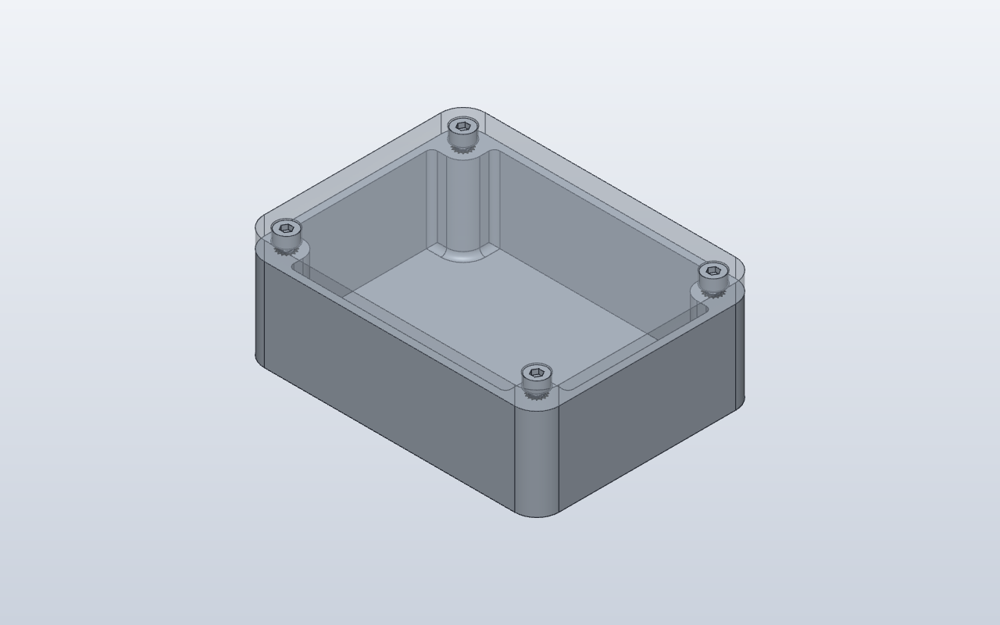

# TechSquid SolidCraft Plugins

TechSquid's plugins for [SolidCraft](https://github.com/tangency-labs/solidcraft). Each one is a WebAssembly component (`craft:plugin@0.1.0`, capability `commands@0.1`), the same package shape as [solidcraft-gears](https://github.com/tangency-labs/solidcraft-gears). A plugin changes the model only by running SolidCraft commands.

## Plugins

| Plugin | Id | Family | What it builds |
|---|---|---|---|
| [Screws](plugins/techsquid-screws/README.md) | `techsquid-screws` | Fasteners | Metric machine screws to ISO standards on selected sketch points (socket, button, countersunk, hex, pan and cheese heads, set screws and threaded rod), with any drive, and optionally the clearance, counterbored, countersunk or tapped hole |
| [Heat-set inserts](plugins/techsquid-inserts/README.md) | `techsquid-inserts` | Fasteners | CNC Kitchen heat-set inserts, metric and UN: the straight or stepped hole drilled into the part, and the knurled insert as its own body |
| [Hexagon nuts](plugins/techsquid-nuts/README.md) | `techsquid-nuts` | Fasteners | ISO 4032 hexagon nuts on selected sketch points, and optionally a hexagonal pocket with a bolt hole |
| [Aluminium extrusions](plugins/techsquid-extrusions/README.md) | `techsquid-extrusions` | Extrusions | 20 mm series T-slot (MISUMI 5 series) and V-slot (OpenBuilds) rails, 2020 to 2080 and 4040, cut to any length and placed on selected sketch points |

Each plugin's README covers installing it, its dialog fields, the standards it follows and the names it gives bodies and features. Each release has one zip per plugin. To install a plugin, unzip its folder into SolidCraft's plugins folder.

## Fasteners

Threads themselves are a host command. `solid.thread` cuts or annotates a cylindrical face from a designation such as `M6` or `M8x1`. The screw plugin places the screw and passes that designation through. The insert and nut plugins use `solid.hole` for the bore. Each plugin does the fastener geometry, and the host owns the thread form.

The three fastener plugins share field names (`size`, `custom_size`, `create`, `sketch`, `sketch_point`, `thread_modeled`) and a naming scheme for bodies: the kind of part, then its size, as in `Screw M3 x 12 socket`.

## Extrusions

A rail is one sketch of lines and arcs, extruded once. Its section comes from `crates/extrusions`, which builds it from a slot shape and a grid of 20 mm cells. The T-slot is checked against MISUMI's STEP models and the V-slot against OpenBuilds' DXF files; the plugin's README lists each source and its test.

## Layout

```
Cargo.toml                 workspace
crates/plugin-kit/         what every plugin shares: the host runner and wasm guest, dialog fields, placement, components, and names
crates/fasteners/          designations, metric sizes, standard heads, ISO 4032 nuts, ISO 273 clearance holes, drives, and the hex profile
crates/extrusions/         the 20 mm T-slot and V-slot shapes, and the section of a rail built from them
wit/plugin.wit             copy of SolidCraft's craft:plugin@0.1.0
plugins/techsquid-screws   screw entry and its parameters
plugins/techsquid-inserts  heat-set insert entry, catalog, and parameters
plugins/techsquid-nuts     ISO 4032 hexagon nut entry and its parameters
plugins/techsquid-extrusions  T-slot and V-slot rail entry and its parameters
build.sh                   the packages land in dist/<id>/, one per plugin
examples/                  designs built with the plugins: <name>.json opens in SolidCraft, <name>.steps.json builds it
tests/cli_test.py          runs the built package through solidcraft-cli
tests/geometry_test.py     checks by volume what each plugin cuts and builds
tests/examples_test.py     builds every example through solidcraft-cli and measures it
```

A plugin id is the folder name under `plugins/` and the folder you install. Preferences matches those. Each plugin owns its entry and the fields a person sets. Every plugin id starts with `techsquid-`, because SolidCraft plugin ids share one namespace. Code any plugin can use lives in `crates/plugin-kit`; fastener geometry lives in `crates/fasteners` and rail sections in `crates/extrusions`, and a new family of plugins gets its own crate beside them. The insert catalog stays in the insert plugin.

## Build

You need Rust with the `wasm32-unknown-unknown` target and [`wasm-tools`](https://github.com/bytecodealliance/wasm-tools).

```
cargo test
./build.sh
```

`cargo test` checks the parameter rules and the commands each run sends. `./build.sh` wraps each core module as a component and leaves one `dist/<id>/` for every folder under `plugins/`.

## Test against the host

`tests/cli_test.py` needs the package from `./build.sh` and a `solidcraft-cli` with the plugin host (SolidCraft 0.41 or newer).

```
SOLIDCRAFT_CLI=/path/to/solidcraft-cli python3 tests/cli_test.py
```

It inspects each package. A screw run must build an M3, an insert run must build the M3 × 5.7 insert, a nut run must build an ISO 4032 M6, an extrusion run must build a 120 mm V-slot 2040, and a bad `head` must be refused as invalid input. The signed macOS build of SolidCraft 0.41.0 has the hardened runtime and no JIT entitlement, so loading a component kills `solidcraft-cli` (`SIGKILL`, code signature invalid). Inspect still succeeds there, and the test skips a run check when the CLI dies that way.

## Examples




A PCB enclosure. The base is a shelled block with a boss in each corner, filleted where it meets the walls and the floor. One `make-insert` run drills the four bosses and builds four M3 × 5.7 inserts on the points of a sketch on the rim. The 5 mm lid gets M3 clearance holes, each with a recess for the screw head, and four `make-screw` runs put an M3 × 6 socket head screw on each recess floor. The screws and inserts have modeled threads.

Each example comes as two files:

- `examples/pcb-enclosure.json` is the design. Open it in SolidCraft (File > Open). It is saved by SolidCraft 0.42, so an older SolidCraft may refuse it as a newer file. SolidCraft rebuilds it as it opens, which takes a few seconds for the modeled threads. The plugins have already run, so opening it needs none of them installed.
- `examples/pcb-enclosure.steps.json` builds that design, one SolidCraft command per step, with a `caption` saying what each step does. It is not a design file, so SolidCraft does not open it. A plugin step is a `plugin.run` with `"path": "dist/<id>"` and `"approval": "@approval"`. The approval changes with every build, so the test inspects each package and fills it in. `expect` holds what the finished design must measure.

```
SOLIDCRAFT_CLI=/path/to/solidcraft-cli python3 tests/examples_test.py
```

It builds every `*.steps.json` and checks the body count (each placement of a fastener is a body, measured where it is placed), the bounding boxes, the insert hole, the clearance hole and the head recess on each corner, one insert and one screw on each corner, that the saved design reopens, and that the design next to it matches the fresh build body for body. After a plugin or an example changes, `--update` writes that design from the fresh build. The same signed macOS build skips here as well, because every example runs a plugin.

The pictures are rendered from the design:

```
solidcraft-cli snapshot --in examples/pcb-enclosure.json --out examples/pcb-enclosure.png --width 1280 --height 800 --view iso --no-grid --no-axes --body Lid:opacity=0.3 --quality fine
solidcraft-cli snapshot --in examples/pcb-enclosure.json --out examples/pcb-enclosure-closed.png --width 1280 --height 800 --view iso --no-grid --no-axes --quality fine
```

`tests/geometry_test.py` checks what the plugins cut. It builds a plate, runs a plugin on two sketch points, and compares the plate's volume with the figure worked out by hand: insert holes, screw clearance, counterbored, countersunk and tapped holes, nut pockets, and the head shapes and drive recesses of loose screws. A rail is checked the other way round: its volume must be the area of its section, worked out by hand from the slot sizes, times its length.

```
SOLIDCRAFT_CLI=/path/to/solidcraft-cli python3 tests/geometry_test.py
```

It needs a `solidcraft-cli` that can run a plugin, so on the signed macOS build it reports SKIP.

## Components

Each fastener and each rail is a component of its own. This section describes fasteners; a rail is placed the same way, in an `Extrusions` folder instead of `Fasteners`. The holes, pockets and other cuts stay in the part they cut, as features of the component that was active, so the part keeps them when the hardware is hidden or deleted.

- **One definition, many placements.** A run builds the fastener once, at its component's origin, and places it on every point. Four M3 x 12 socket screws are one component, `Screw M3 x 12 socket`, placed four times, so the thread is modeled once. Inside its component the fastener stands with the point on the origin and its outer side up +Z; each placement turns that onto the sketch.
- **Reused across runs.** A later run places the existing definition again when it would build exactly the same body. The plugin keeps a hash of the commands that build it under `dev.threadcraft` in the component's metadata, with the plugin's id. A different build, such as a cosmetic thread where the first one is modeled, gets a definition of its own.
- **A Fasteners folder.** Every placement goes in one `Fasteners` component in the design, made the first time it is needed. It is a phantom, so the bill of materials counts what it holds and has no row of its own.
- **A bill of materials.** Each definition is `purchased`, its part number is its name and its description the standard it follows (`ISO 4762`, `ISO 4032`) or the insert it is (`CNC Kitchen heat-set insert M3 × 5.7`). `assembly.bom` on the example lists 4 inserts and 4 screws.
- **The active component stays.** Fasteners are placed in the design whichever component is active, and the component that was active before the run is active again afterwards.
- **Moving them.** A placement is free, not grounded, and can be moved, hidden or given joints on its own.

The reply's `component` says which definition was placed (`component`), whether it was `reused`, and the `occurrences` made.

## Releases

Pushing a tag like `v0.1.0` runs `.github/workflows/release.yml`, which builds the plugins and attaches `<id>-0.1.0.zip` for every plugin under `plugins/`, such as `techsquid-screws-0.1.0.zip`, each with a `.sha256`. The tag has to match `workspace.package.version` and every `plugins/*/plugin.json`.

## License

MIT, see [LICENSE](LICENSE).
