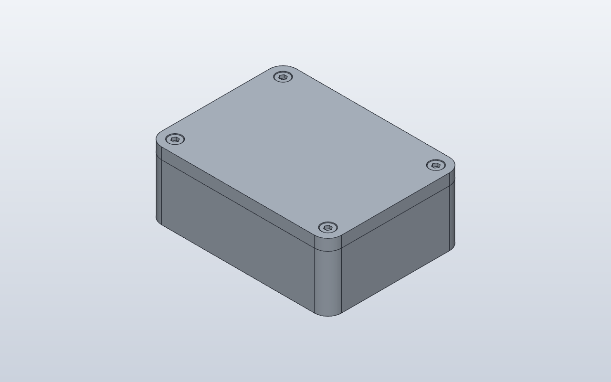

# SolidCraft Threadcraft

Plugins for [SolidCraft](https://github.com/tangency-labs/solidcraft). Each one is a WebAssembly component (`craft:plugin@0.1.0`, capability `commands@0.1`), the same package shape as [solidcraft-gears](https://github.com/tangency-labs/solidcraft-gears). A plugin changes the model only by running SolidCraft commands.

Threads themselves are a host command. `solid.thread` cuts or annotates a cylindrical face from a designation such as `M6` or `M8x1`. The screw plugin places the screw and passes that designation through. The insert plugin uses `solid.hole` for the bore. Each plugin does the fastener geometry; the host owns the thread form.

| Package | Entry | What it builds |
|---|---|---|
| `plugins/threadcraft-screws` | `make-screw` | A screw on every selected sketch point: the top of the shank meets the point, the head stands on the outer side, then `solid.thread`. Optionally the clearance, counterbored, countersunk or tapped hole for it |
| `plugins/threadcraft-inserts` | `make-insert` | The hole for a heat-set insert at every selected sketch point, drilled into the part, and the insert as its own body with a threaded bore |
| `plugins/threadcraft-nuts` | `make-nut` | An ISO 4032 hexagon nut on every selected sketch point: the bearing face sits on the point, the nut stands on the outer side, then `solid.hole` taps the bore. Optionally a hexagonal pocket for it with a bolt hole |

## Layout

```
Cargo.toml                 workspace
crates/threadcraft/        designations, metric sizes, standard heads, ISO 4032 nuts, ISO 273 clearance holes, the hex profile, placement, and the host runner
wit/plugin.wit             copy of SolidCraft's craft:plugin@0.1.0
plugins/threadcraft-screws screw entry and its parameters
plugins/threadcraft-inserts heat-set insert entry, catalog, and parameters
plugins/threadcraft-nuts  ISO 4032 hexagon nut entry and its parameters
build.sh                   the packages land in dist/threadcraft-screws/, dist/threadcraft-inserts/, and dist/threadcraft-nuts/
examples/                  designs built with the plugins, one JSON script each
tests/cli_test.py          runs the built package through solidcraft-cli
tests/examples_test.py     builds every example through solidcraft-cli and measures it
```

A plugin id is the folder name under `plugins/` and the folder you install. Preferences matches those. Each plugin owns its entry and the fields a person sets. Shared geometry lives in `crates/threadcraft`. The insert catalog stays in the insert plugin.

## Supported standards

Pick the head and the drive in the dialog and the screw follows the standard in that row: head size, head shape, drive size and depth, and thread length. Sizes outside a row still build with custom dimensions.

| Fastener | Dialog choice | Standard | Sizes | From the standard | Source | Test |
|---|---|---|---|---|---|---|
| Socket head cap screw | Socket head, Standard or Hex socket | ISO 4762 / DIN 912 | M1.6 to M64 | head, key size and depth, thread length | ARAMFIX data sheet "DIN 912"; [fasteners.eu](https://www.fasteners.eu/standards/DIN/912/) | yes |
| Button head screw | Button head, Standard or Hex socket | ISO 7380-1:2011 | M3 to M16 | head and its dome, key size and depth, thread length | the standard, Table 1 | yes |
| Countersunk socket screw | Countersunk, Standard or Hex socket | ISO 10642:2004 | M3 to M20 | head (90° cone), key size and depth, thread length | the standard, Table 1 | yes |
| Countersunk Phillips screw | Countersunk, Phillips | ISO 7046-1:2011 | M1.6 to M10 | head with its land, recess number, depth and width, thread length | the standard, Table 1 | yes |
| Countersunk slotted screw | Countersunk, Slotted | ISO 2009:2011 | M1.6 to M10 | head with its land, slot, thread length | the standard, Table 1 | yes |
| Pan head Phillips screw | Pan head, Standard or Phillips | ISO 7045:2011 | M1.6 to M10 | head and its dome, recess number, depth and width, thread length | the standard, Table 1 (the 1994 edition has the same values) | yes |
| Pan head slotted screw | Pan head, Slotted | ISO 1580:2011 | M1.6 to M10 | head and its rounded edge, slot, thread length | the standard, Table 1 | yes |
| Cheese head slotted screw | Cheese head, Standard or Slotted | ISO 1207:2011 | M1.6 to M10 | head, slot, thread length | the standard, Table 1; ARAMFIX data sheet "DIN 84" | yes |
| Socket set screw | Set screw, Standard or Hex socket | ISO 4026:2003 | M1.6 to M24 | key size, socket depth by length, flat point and its chamfer, socket end chamfer (90°, or 120° on the shaded short lengths) | the standard, Table 1 and Figure 1; [fasteners.eu](https://www.fasteners.eu/standards/iso/4026/) agrees | yes |
| Hex head screw | Hex head | ISO 4017 | M1.6 to M64 | head; the chamfer is the ISO 4032 nut's | [fasteners.eu ISO 4017](https://www.fasteners.eu/standards/ISO/4017/) | yes |
| Slotted set screw | Set screw, Slotted | ISO 4766 | M1 to M12 | slot | [fasteners.eu ISO 4766](https://www.fasteners.eu/standards/ISO/4766/) | yes |
| Cup point set screw | Set screw, Tip: Cup, Standard or Hex socket | ISO 4029:2003 | M1.6 to M24 | cup mouth and its 120° cup, 45° chamfer round it, key size, socket depth by length, socket end chamfer | the standard, Table 1 and Figure 1 | yes |
| Torx recess | any head, Torx | ISO 10664:1999 for the contour, ISO 14579 for the size and depth | T6 to T100 | across the lobes and valleys, lobe and valley radii; socket per thread and depth | ISO 10664:1999, Table 1 and annex A; [fasteners.eu ISO 14579](https://www.fasteners.eu/standards/ISO/14579/) | yes |
| Phillips recess | any head, Phillips | ISO 4757:1983 type H for the tool, ISO 7045 and ISO 7046-1 for the size, depth and width | PH0 to PH4 | wing thickness, bottom width, wing and point angles; recess number, penetration and width at the face | ISO 4757:1983, Table 1 and figure; ISO 7045:2011 and ISO 7046-1:2011, Table 1 | yes |
| Hexagon nut | Hex nut | ISO 4032 (replaces DIN 934, which is wider at M10, M12, M14) | M1.6 to M64 | width, height, chamfer, countersink | [fasteners.eu ISO 4032](https://www.fasteners.eu/standards/ISO/4032/) | yes |
| Clearance hole | Nut pocket bolt hole | ISO 273, medium | M1 to M64 | hole diameter | ISO 273:1979, Table 1 | yes |
| Heat-set insert | Heat-set insert | CNC Kitchen catalog | M1.6 to M10, #2-56 to 3/8-16, G1/8 | insert, straight and stepped hole | CNC Kitchen [Dimensions & Design Guidelines](https://www.cnckitchen.com/s/CNCKitchen_Heat-Set-Insert-Dimensions-and-Design-Guidelines.pdf) (M1.6 and the short M6 and M8 are not in it); [cnckitchen.com](https://www.cnckitchen.com/blog/tips-and-tricks-for-heat-set-inserts) for the stepped hole | yes |

"Test: yes" means a unit test repeats the table from the source named, so the code and the source cannot drift apart unnoticed. The pan and countersunk rows follow the ISO documents, not the older DIN 7985, DIN 965 and DIN 963, which differ from them in head size, recess number and depth; fasteners.eu prints those DIN tables under the ISO numbers too, so it is not used for these rows. A countersunk screw's length is the overall length, head included, the way ISO 10642, ISO 2009 and ISO 7046-1 list it; every other head's length is measured under the head. Thread length follows the line each standard draws in its length table between screws threaded to the head and screws with a plain shank. ISO 4026 and ISO 4029 were reissued in 2026; the set screw rows follow the 2003 editions.

Each table in `crates/threadcraft/src/` names its source in a comment.

## Build

You need Rust with the `wasm32-unknown-unknown` target and [`wasm-tools`](https://github.com/bytecodealliance/wasm-tools).

```
cargo test
./build.sh
```

`cargo test` checks the parameter rules and the commands each run sends. `./build.sh` wraps each core module as a component and leaves `dist/threadcraft-screws/`, `dist/threadcraft-inserts/`, and `dist/threadcraft-nuts/`.

## Test against the host

`tests/cli_test.py` needs the package from `./build.sh` and a `solidcraft-cli` with the plugin host (SolidCraft 0.41 or newer).

```
SOLIDCRAFT_CLI=/path/to/solidcraft-cli python3 tests/cli_test.py
```

It inspects each package. A screw run must build an M3, an insert run must build the M3 × 5.7 insert, a nut run must build an ISO 4032 M6, and a bad `head` must be refused as invalid input. The signed macOS build of SolidCraft 0.41.0 has the hardened runtime and no JIT entitlement, so loading a component kills `solidcraft-cli` (`SIGKILL`, code signature invalid). Inspect still succeeds there, and the test skips a run check when the CLI dies that way.

## Examples




`examples/pcb-enclosure.json` builds a PCB enclosure. The base is a shelled block with a boss in each corner, filleted where it meets the walls and the floor. One `make-insert` run drills the four bosses and builds four M3 × 5.7 inserts on the points of a sketch on the rim. The 5 mm lid gets M3 clearance holes, each with a recess for the screw head, and four `make-screw` runs put an M3 × 6 socket head screw on each recess floor.

An example is a list of steps, one SolidCraft command each, in the shape SolidCraft's own demo recordings replay: `caption` is the text shown for the step. A plugin step is a `plugin.run` with `"path": "dist/<id>"` and `"approval": "@approval"`. The approval changes with every build, so the test inspects each package and fills it in. `expect` holds what the finished design must measure.

```
SOLIDCRAFT_CLI=/path/to/solidcraft-cli python3 tests/examples_test.py
```

It runs every example and checks the body count, the bounding boxes, the insert hole, the clearance hole and the head recess on each corner, one insert and one screw on each corner, and that the saved design reopens. The same signed macOS build skips here as well, because every example runs a plugin.

A second body from the same plugin is named `Insert 2`, `Screw 3` and so on. Each plugin reads the body names in the design first and asks for one that is free, because a taken name makes the host number the body `BodyN`, and that number changes when the design is rebuilt.

`tests/geometry_test.py` checks what the plugins cut. It builds a plate, runs a plugin on two sketch points, and compares the plate's volume with the figure worked out by hand: insert holes, screw clearance, counterbored, countersunk and tapped holes, nut pockets, and the head shapes and drive recesses of loose screws.

```
SOLIDCRAFT_CLI=/path/to/solidcraft-cli python3 tests/geometry_test.py
```

It needs a `solidcraft-cli` that can run a plugin, so on the signed macOS build it reports SKIP.

## Field names

The three plugins share one set of names: `size` and `custom_size` (inserts: `custom_thread`), `create`, `sketch` and `sketch_point`, `thread_modeled`. The earlier names still read, so an older script keeps working: `designation`, `custom_designation`, `custom_height` on a nut, and `modeled` on an insert.

## Releases

Pushing a tag like `v0.1.0` runs `.github/workflows/release.yml`, which builds the plugins and attaches `threadcraft-screws-0.1.0.zip`, `threadcraft-inserts-0.1.0.zip`, and `threadcraft-nuts-0.1.0.zip`, each with a `.sha256`. The tag has to match `workspace.package.version` and every `plugins/*/plugin.json`.

## License

MIT, see [LICENSE](LICENSE).
