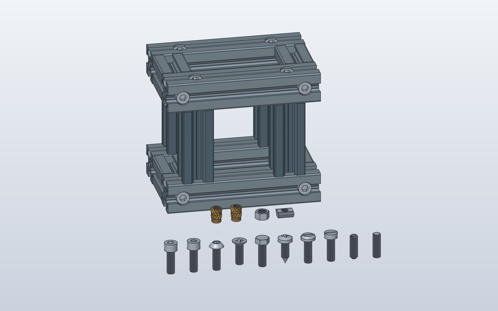

# TechSquid plugins for SolidCraft

Build the hardware and frames your designs need without modeling every part from scratch. These plugins bring configurable fasteners, heat-set inserts, and aluminium extrusions into [SolidCraft](https://github.com/tangency-labs/solidcraft), with matching holes and pockets where you need them.

[Open the showcase example](examples/plugin-showcase.json)

## Plugin List

| Plugin | Make |
|---|---|
| [Screws](plugins/techsquid-screws/README.md) | Metric screws, set screws and threaded rod, with optional clearance or tapped holes |
| [Heat-set inserts](plugins/techsquid-inserts/README.md) | CNC Kitchen metric and UN inserts and their mounting holes |
| [Hexagon nuts](plugins/techsquid-nuts/README.md) | ISO 4032 nuts, with optional pockets and bolt holes |
| [Extrusions](plugins/techsquid-extrusions/README.md) | Fixed-length or sketch-driven T-slot and V-slot rails, tapped ends, screw holes and slot nuts |

Place parts on one or more sketch points, choose your dimensions, and run the plugin. Fixed-length hardware is organized into reusable components, and cuts remain with the part they modify. For sketch-driven extrusions, select straight sketch lines to create independent rails that follow later path edits. Choose modeled threads for detail or cosmetic threads for faster rebuilds.

Try the [sketch-driven rail example](examples/sketch-driven-rails.json), or read the [extrusion guide](plugins/techsquid-extrusions/README.md#sketch-driven-rails) for profile choices, machining and batch limits.

## License

[MIT](LICENSE)
