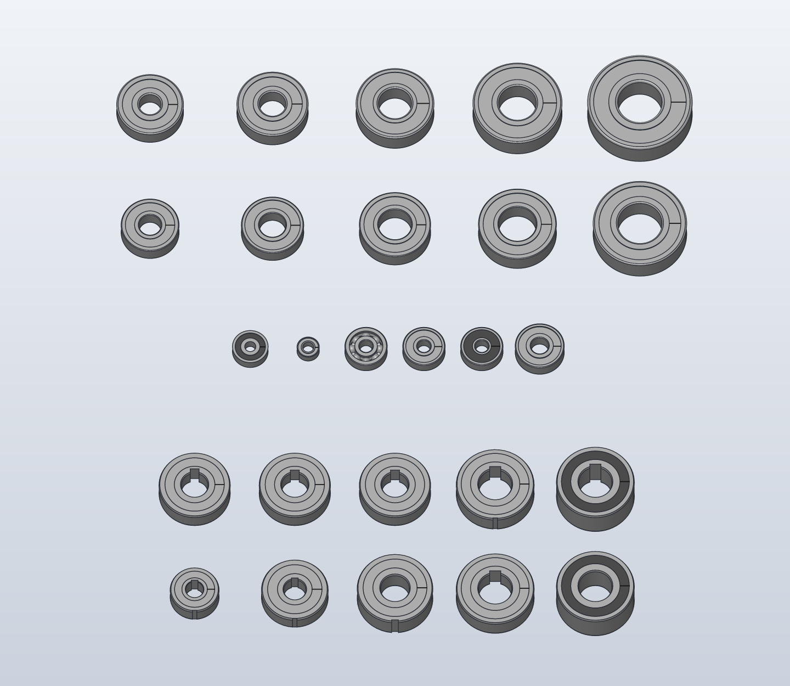
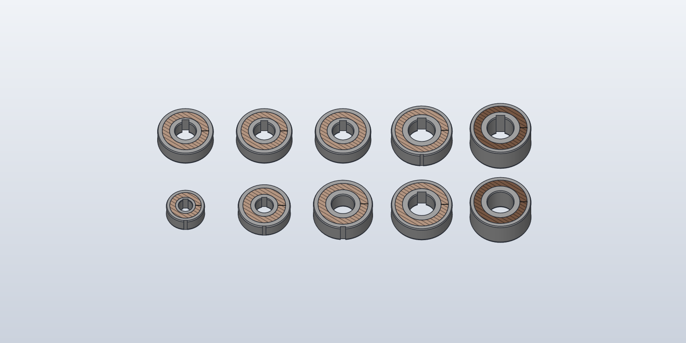

# Bearings and clutches

The radial lineup shows the OpenBuilds bearings and the MISUMI open, shielded and sealed products at a common scale. B626 exposes the balls and raceways. The third radial row begins with the supplier-neutral sealed 105 and ends with MISUMI B6203DDU. Both use estimated exteriors. The recipe selects B6203DDU by its 17 mm bore, 40 mm outside diameter and sealed closure. The two rows below it show keyed, sealed and custom CSK clutch profiles.

[Open the SolidCraft design](bearings-and-clutches.json) · [Read the build recipe](bearings-and-clutches.steps.json)

## CSK references and overrides

| Row | Left to right |
|---|---|
| Upper | CSK12P reference, two CSK12P copies with a 1.2 mm inner keyway, CSK15PP, CSK15P-2RS |
| Lower | CSK8PP, CSK10PP, a fully custom outer-keyed part, CSK15P, CSK15-2RS |

The recipe finds CSK15PP with **By dimensions**, a 15 mm bore, an 11 mm width and an enabled outer keyway.

In **Plugins > CSK clutch**, select CSK12P and set **Inner keyway depth** to 1.2 mm to reproduce the shared override. The reference uses a 1.8 mm depth. The custom part has a 13 mm bore, 34 mm OD, 12 mm width and a 3 mm wide, 1 mm deep outer keyway.

The two identical CSK12P overrides share a definition and count as two in the BOM. The replay checks the placement and geometry of every ring and closure face, along with the saved identities and reference metadata. The [Bearings reference](../../plugins/techsquid-bearings/REFERENCE.md) explains the dimensions, metadata and source limits.
