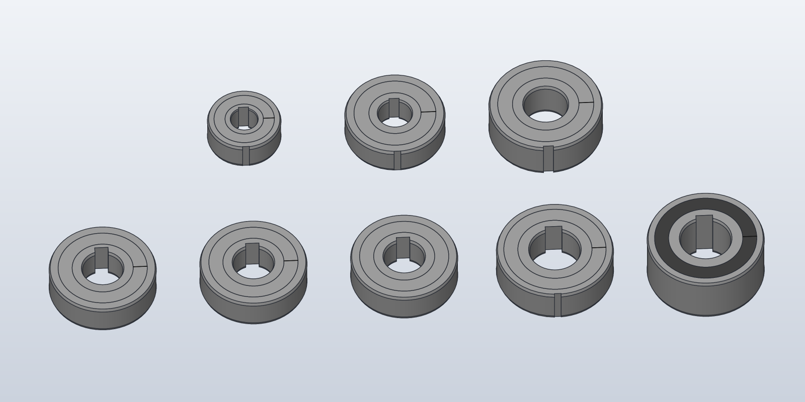

# CSK geometry and references

[Open the saved design](csk-clutches.json) in SolidCraft, or inspect its
[captioned build steps](csk-clutches.steps.json). Opening the design does not
require the plugin. Rebuilding it requires the built Bearings package and the
[documented host API](../docs/parts-library.md#host-requirements).



The lower row, from left to right:

| Position | Designation | Envelope, bore × OD × width (mm) | Keyways, width × depth (mm) |
|---|---|---|---|
| 1 | CSK12P | 12 × 32 × 10 | Inner 4 × 1.8, reference values |
| 2 | CSK12P custom | 12 × 32 × 10 | Inner 4 × 1.2 |
| 3 | CSK12P custom | 12 × 32 × 10 | Inner 4 × 1.2, same definition as position 2 |
| 4 | CSK15PP | 15 × 35 × 11 | Inner 5 × 1.2; outer 2 × 0.6 |
| 5 | CSK15P-2RS | 15 × 35 × 16 | Inner 5 × 1.2 |

Use **Bearings > make-csk**. Blank keyway fields retain the selected preset's
reference values. For positions 2–3, select `CSK12P` and enter `1.2` for inner
keyway depth. The corresponding workflow parameters are:

```json
{
  "size": "CSK12P",
  "inner_keyway_depth": 1.2
}
```

The upper row adds CSK8PP (8 × 22 × 9), CSK10PP (10 × 30 × 9), and a fully
custom 13 × 34 × 12 mm envelope with only a 3 × 1 mm outer keyway.

Bore, OD, width and either keyway can be changed. P starts with an inner slot,
PP with both, and plain CSK with neither. Set a keyway to Enabled and supply width
and depth to add it, or set it to None and clear overrides to remove it.
For the final part, use:

```json
{
  "size": "Custom",
  "bore": 13,
  "diameter": 34,
  "width": 12,
  "outer_keyway": "Enabled",
  "outer_keyway_width": 3,
  "outer_keyway_depth": 1
}
```

Custom mode has no catalog designation or reference. A changed preset keeps its
baseline and records that it was customized.
Keyways pass through the full width. Inner slots default to +Y, outer slots to -Y,
as in the supplied PP references; each angle is editable. Depth is measured from
the bore or OD apex, not from a mating shaft's keyway. These dimensions do not
specify a complete fit or tolerance system.

## Expected BOM

The saved design has eight occurrences and seven definitions. Its flat BOM has:

| Definition | Quantity | BOM part number | Classification |
|---|---:|---|---|
| CSK12P reference | 1 | Unassigned | Normal |
| CSK12P custom | 2 | Unassigned | Normal |
| CSK15PP | 1 | Unassigned | Normal |
| CSK15P-2RS | 1 | Unassigned | Normal |
| CSK8PP | 1 | Unassigned | Normal |
| CSK10PP | 1 | Unassigned | Normal |
| Custom outer-keyed envelope | 1 | Unassigned | Normal |

The two custom occurrences share a definition and count together. Reference
drawings do not assign manufacturers or suppliers. The specification metadata
retains actual dimensions, a stable design identity, the reference baseline and
customization status after save/reopen. Purchasing assignment is
[future work for a shared component workflow](../docs/parts-library.md#future-component-purchasing-workflow)
after creation; `make-csk` has no purchasing or part-number inputs.

## What the example verifies

The reproducible recipe checks eight components containing sixteen solid rings
and sixteen closure faces. It checks placed bounding boxes, ring volumes from
independent section integration, closure areas, and seven reusable definitions.
Saved-example checks compare geometry, identities and source metadata against a
fresh build. The CSK suite covers all 55 presets and checks measured shoulders,
chamfers, closures, custom geometry, BOM quantities and rejected inputs.

CSK15PP has directly measured exterior dimensions. The other variants in this
example use shared or interpolated sections from the supplied 8/12/15/40 mm STEP
files; their metadata explicitly says estimated. Rings have edge chamfers and
closures are flush, as in the references. The CSK15P-2RS closure faces are dark;
unsealed variants use grey covers. Neither colour assigns a material. Hidden
sprags, raceways, balls and seal cross-sections are not modeled.
Torque ratings do not change the CAD shape and are not assigned
to these generic specifications. Equal designation or envelope dimensions alone
do not establish supplier interchangeability. See the [CSK source ledger](../docs/sources/csk.md)
and [workflow reference](../plugins/techsquid-bearings/REFERENCE.md) for source
differences and supported combinations.
