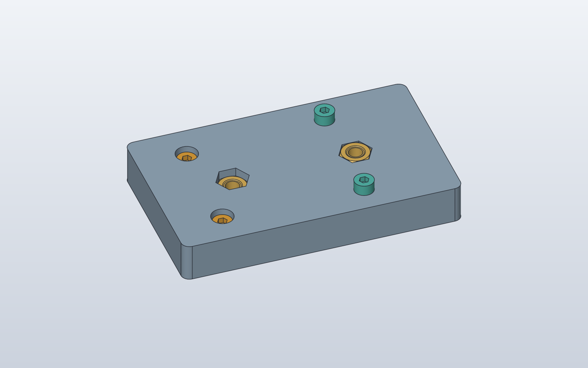
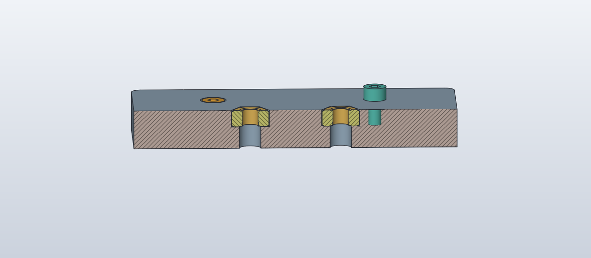
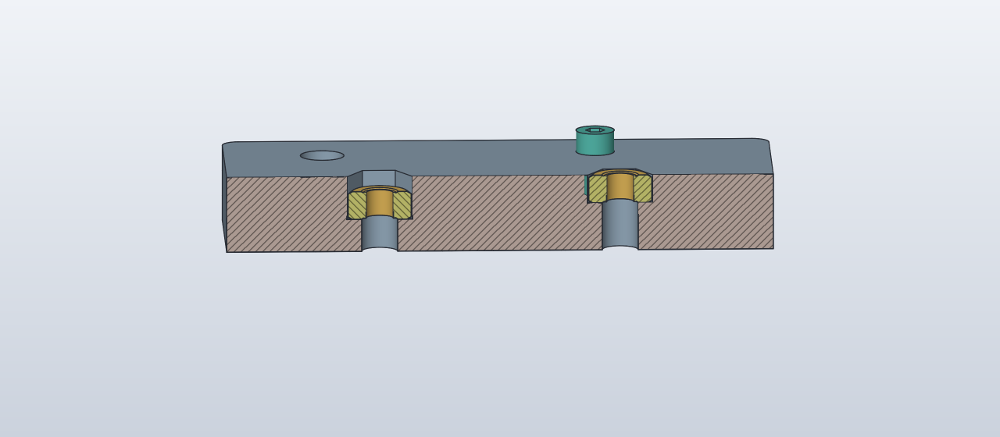

# Editable mounting plate

This plate holds two recessed M4 screws, two M4 screws in tapped holes, and two captive M6 nuts. The six rigid seat joints follow the geometry that locates the hardware.

[Open the SolidCraft design](editable-mounting-plate.json) · [Read the build recipe](editable-mounting-plate.steps.json)

The design opens at the edited values. Use **Change Parameters** to switch between the initial and saved values.

| Parameter | Initial | Saved | What moves |
|---|---:|---:|---|
| `counterbore_x` | 25 mm | 32 mm | The recessed pair moves along X. |
| `counterbore_y` | 15 mm | 18 mm | The recessed pair spreads apart. |
| `tapped_x` | 25 mm | 18 mm | The tapped pair moves along X. |
| `tapped_y` | 15 mm | 20 mm | The tapped pair spreads apart. |
| `recess_depth` | 4 mm | 6 mm | The recessed screws follow the counterbore floors. |
| `plate_thickness` | 12 mm | 14 mm | The top face, layout sketches and fastener seats rise. |
| `left_pocket_depth` | 5.2 mm | 8 mm | The left nut follows the pocket floor. |

Open **Nut centers** to move the sketch point `left` and the circle center `right.center`. The replay moves them from X = −14 and 14 mm to X = −22 and 22 mm. Both bolt holes follow their nut centers.

The replay checks the bore locations, seat frames and actual hardware after the edits and verifies all six joints in the saved file. Threads are cosmetic for fast edits.
