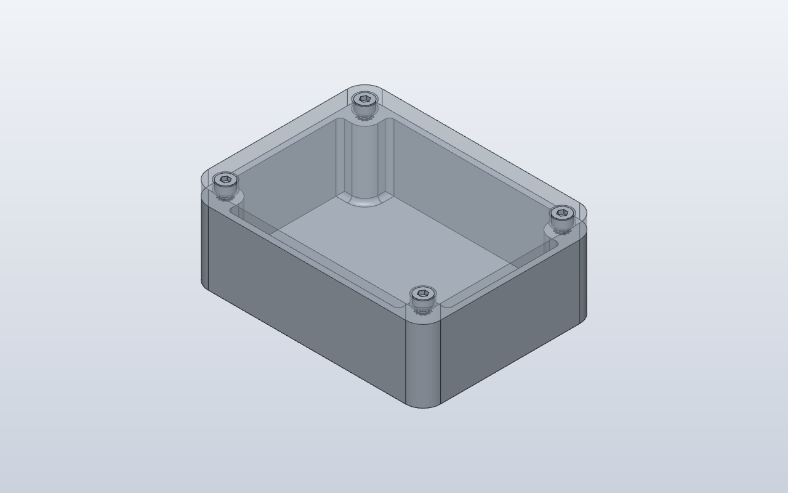
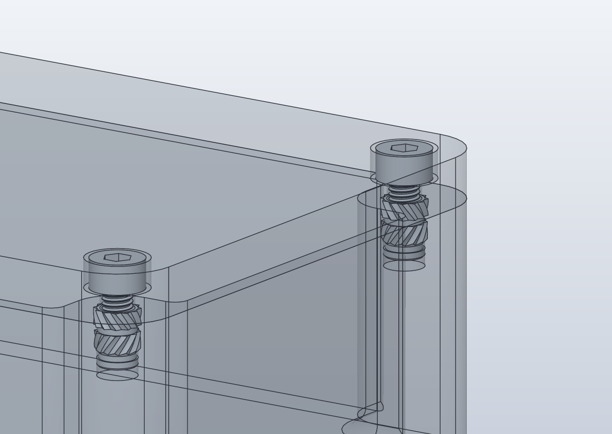
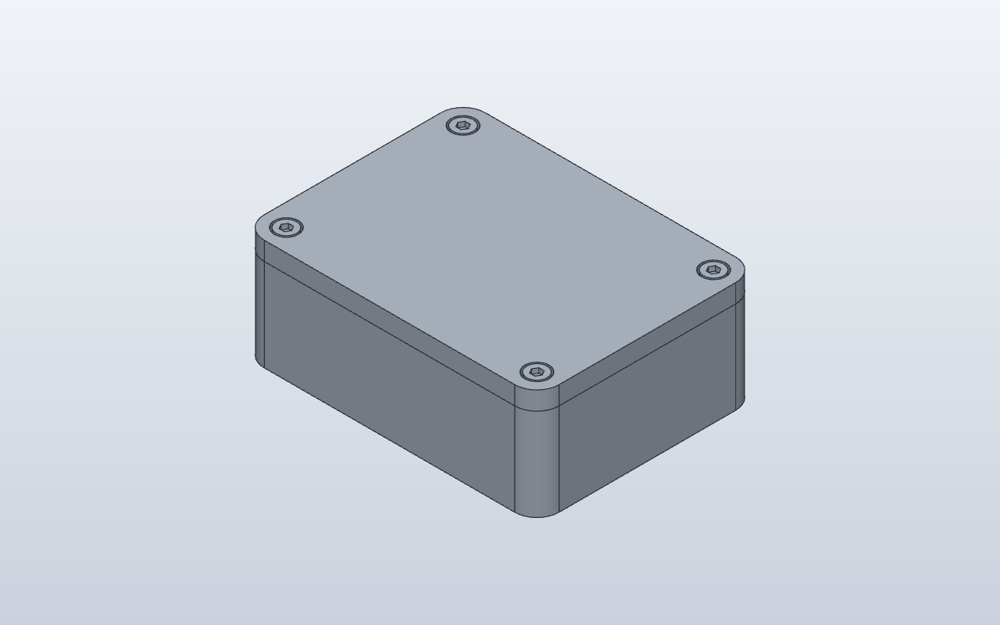

# PCB enclosure

Four heat-set inserts sit in blind holes in the enclosure base. The lid screws pass through clearance holes with recesses that bring their heads flush with the lid.

[Open the SolidCraft design](pcb-enclosure.json) · [Read the build recipe](pcb-enclosure.steps.json)

One insert plugin run drills all four bosses and places the M3 x 5.7 inserts. One screw plugin run drills the 5 mm lid and places the M3 x 6 socket-head screws. Both use modeled threads.

The replay checks the blind hole, clearance bore, head recess, insert and screw at every corner.
