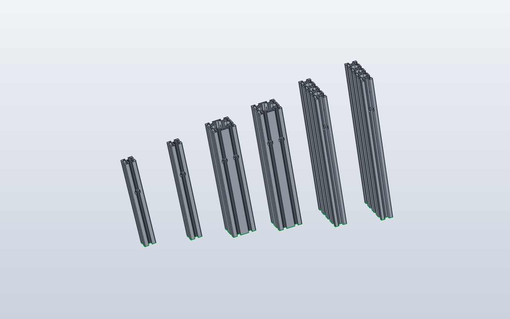

# Sketch-driven rails

Three plugin runs place six independent rails on a single fully constrained sketch. The T-slot 2020 pair has modeled M5 end taps. The T-slot 4040 and V-slot 2080 pairs have cosmetic end taps.

[Open the SolidCraft design](sketch-driven-rails.json) · [Read the build recipe](sketch-driven-rails.steps.json)

Try moving and resizing the layout in **Change Parameters**. Change **Rail_Tilt** from −35 mm to 35 mm, **Rail_Rise** from 150 mm to 190 mm, **Rail_X** to 90 mm, and **Rail_Z** to 40 mm. Each rail follows its own path and the cross-holes stay 25 mm and 55 mm from its ends. For further edits, keep the horizontal endpoint dimensions positive.

The replay compares the six saved rail envelopes. The [sketch-driven rail tests](../../tests/sketch_rails_test.py) verify that the holes and taps follow edits and survive reopening.
