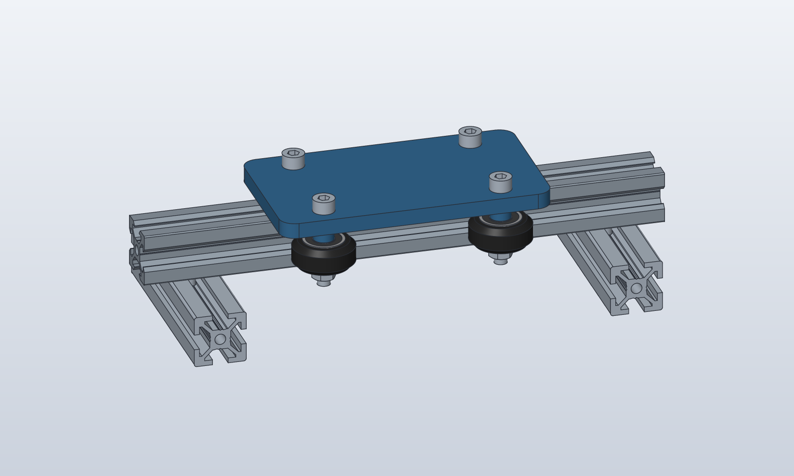
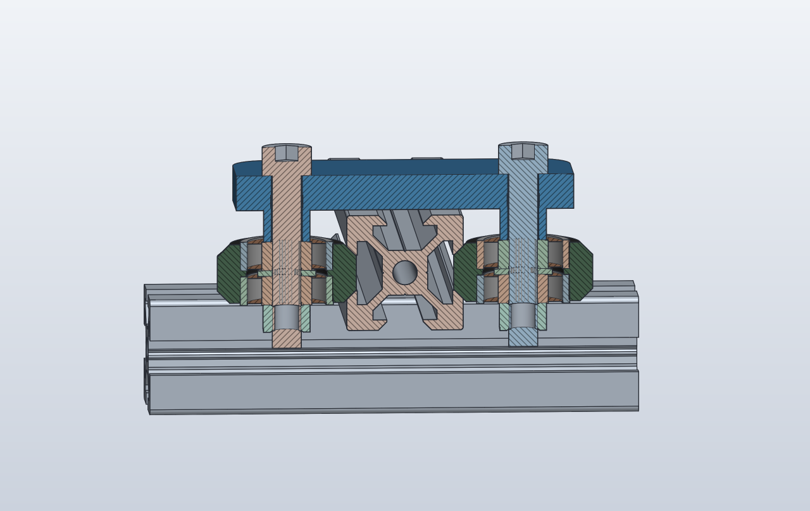
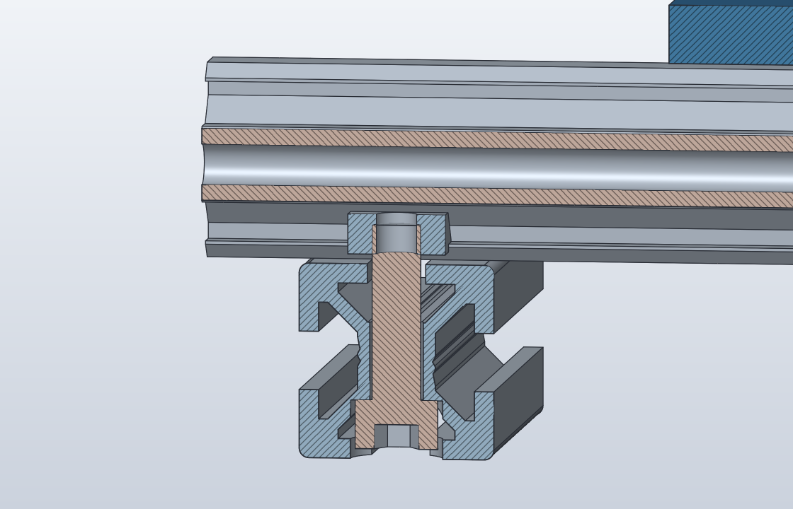

# V-slot gantry

A 200 mm V-slot 2020 track bolts to two cross-drilled T-slot 2020 feet. Four Solid V Wheel cores carry a custom gantry plate on the opposed V-grooves. Each core contains two 625 2RS bearings and one internal shim.

[Open the SolidCraft design](v-slot-gantry.json) · [Read the build recipe](v-slot-gantry.steps.json)

The plate has four Ø5.5 mm axle holes and integral standoffs that seat on the upper bearing inner rings. M5 x 30 socket-head screws pass through the stack and into M5 hex nuts. The wheel centers sit 20.32 mm either side of the track centerline, giving a 40.64 mm row spacing at nominal contact.

Each foot takes one M5 x 18 screw from below. One screws into a pre-assembly nut slid in from the end of the track. The other uses a post-assembly nut dropped in through the slot.

The replay measures the axle bores and wheel stacks, checks four wheel-to-track contacts and limits interference to the six mating cosmetic threads. The flat BOM counts one plate, one track, two feet, four wheels, eight bearings, four shims, six screws and six nuts.
