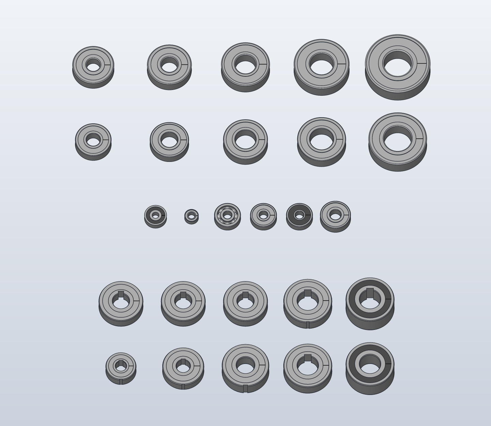

# Bearings

Place radial bearings by size, closure or mounting dimensions, or create a CSK one-way clutch with editable keyways in [SolidCraft](https://github.com/tangency-labs/solidcraft). The [supported-parts table](#supported-bearings-and-csk-presets) gives the supplier number and exterior measurement basis for each choice.

The preview shows the measured radial bearings, two estimated exteriors and ten CSK occurrences,
all at the same scale. Left to right:

- **Back row:** MISUMI B6200ZZ through B6204ZZ.
- **Second row:** MISUMI B6000ZZ through B6004ZZ.
- **Third row:** sealed 105, OpenBuilds 625 2RS and 105ZZ, MISUMI B626, B626ZZ, B626DDU, B608ZZ and B6203DDU.
- **Front two rows** show reference and customized CSK clutches. The walkthrough identifies each placement.

Dark faces depict seals; gray closure faces depict shields or dust covers. The open
B626 shows its balls and raceways. [Open the combined example](../../examples/bearings-and-clutches/)
in SolidCraft, or see the [full supported-parts table](#supported-bearings-and-csk-presets)
and [source references](REFERENCE.md#sources).

## Install

Download `techsquid-bearings-0.3.0.zip` from the repository's releases. In SolidCraft, choose **Plugins > Install plugin…** and select the zip. Check the [host requirements](../../docs/parts-library.md#host-requirements) before installing version 0.3.

## Use

Choose a workflow:

- **Plugins > Bearing** (`make-bearing` in scripts) defaults to 608 Shielded. Choose a base size and closure, or select **By dimensions** and enter the dimensions you know. A 17 mm bore and 40 mm outside diameter select 6203. Open is available for 626.
- **Plugins > CSK clutch** (`make-csk` in scripts) starts at CSK12P. Choose a designation or use **By dimensions** to find one by bore, outside diameter or width. A 15 mm bore, 11 mm width and **Match outer keyway** set to **Enabled** select CSK15PP, which has a measured exterior. Edit a preset’s dimensions and keyways, or choose **Custom** to define a clutch from scratch.

CSK parts have no assigned manufacturer, supplier or BOM part number. Drawing
references remain separate from geometry. Custom and unsourced parts still count
in the BOM. Purchasing assignment is
[future work for a shared component workflow](../../docs/parts-library.md#future-component-purchasing-workflow)
after creation.

In either dialog, pick sketch points or circles for **Placement** in the view; a
circle, or a click inside one, means its centre. Points or circles already selected when the dialog opens
fill the field. With nothing picked, the part sits at the origin. Its centre plane
sits on the point and its axle follows the sketch normal.

Each radial bearing’s rings and closure faces belong to one component. The sealed 105 counts in the BOM without a supplier number. Later insertions reuse an unchanged definition, including bearings already inside V-wheel assemblies. Edited definitions are preserved; a new insertion builds a clean replacement. New occurrences remain free to move or join to your assembly.

The built-in bearing tool provides a simple ring envelope. This plugin shows measured or estimated exterior ring and closure boundaries, with visible balls and raceways in open B626. CSK keyways cut the appropriate ring. Cover and seal faces follow the measured flush boundaries; dark seal colours are illustrative. Hidden sprags, raceways and seal cross-sections are omitted. The CAD does not simulate one-way motion or predict mass. It does not use the built-in **Change Part Size** workflow.

See the [reference](REFERENCE.md) for dimensions, part numbers, placement fields and representation limits. Shared internal definitions drive the insertion choices and verified reuse; no Catalog entry is exposed. The example designs open without the plugin installed.

## CSK example

The [CSK walkthrough](../../examples/bearings-and-clutches/#csk-references-and-overrides) shows reference keyways, a repeated override and a fully custom outer-keyed part.

## Supported bearings and CSK presets

CSK presets are reference geometry, with no purchasing identity. Envelope dimensions, closure style and keyways can be customized. Custom mode has no catalog baseline; its exterior proportions are estimated. The Exterior column describes ring boundaries and edge chamfers, not internal construction.

<!-- catalog-table:start -->

| Designation | Supplier | Part number | Bore × OD × width (mm) | Closure / mounting | Exterior |
|---|---|---|---|---|---|
| 625 2RS | OpenBuilds | 30 | 5 × 16 × 5 | Rubber seals, both sides | Measured |
| 105ZZ | OpenBuilds | 800 | 5 × 10 × 4 | Metal shields, both sides | Measured |
| B626 | MISUMI | B626 | 6 × 19 × 6 | Open, visible balls | Measured |
| B626ZZ | MISUMI | B626ZZ | 6 × 19 × 6 | Metal shields, both sides | Measured |
| B626DDU | MISUMI | B626DDU | 6 × 19 × 6 | Rubber seals, both sides | Measured |
| B608ZZ | MISUMI | B608ZZ | 8 × 22 × 7 | Metal shields, both sides | Measured |
| B6000ZZ | MISUMI | B6000ZZ | 10 × 26 × 8 | Metal shields, both sides | Measured |
| B6001ZZ | MISUMI | B6001ZZ | 12 × 28 × 8 | Metal shields, both sides | Measured |
| B6002ZZ | MISUMI | B6002ZZ | 15 × 32 × 9 | Metal shields, both sides | Measured |
| B6003ZZ | MISUMI | B6003ZZ | 17 × 35 × 10 | Metal shields, both sides | Measured |
| B6004ZZ | MISUMI | B6004ZZ | 20 × 42 × 12 | Metal shields, both sides | Measured |
| B6200ZZ | MISUMI | B6200ZZ | 10 × 30 × 9 | Metal shields, both sides | Measured |
| B6201ZZ | MISUMI | B6201ZZ | 12 × 32 × 10 | Metal shields, both sides | Measured |
| B6202ZZ | MISUMI | B6202ZZ | 15 × 35 × 11 | Metal shields, both sides | Measured |
| B6203ZZ | MISUMI | B6203ZZ | 17 × 40 × 12 | Metal shields, both sides | Measured |
| B6204ZZ | MISUMI | B6204ZZ | 20 × 47 × 14 | Metal shields, both sides | Measured |
| B625ZZ | MISUMI | B625ZZ | 5 × 16 × 5 | Metal shields, both sides | Estimated |
| 105 sealed | Unassigned | — | 5 × 10 × 4 | Rubber seals, both sides | Estimated |
| B608DDU | MISUMI | B608DDU | 8 × 22 × 7 | Rubber seals, both sides | Estimated |
| B6000DDU | MISUMI | B6000DDU | 10 × 26 × 8 | Rubber seals, both sides | Estimated |
| B6001DDU | MISUMI | B6001DDU | 12 × 28 × 8 | Rubber seals, both sides | Estimated |
| B6002DDU | MISUMI | B6002DDU | 15 × 32 × 9 | Rubber seals, both sides | Estimated |
| B6003DDU | MISUMI | B6003DDU | 17 × 35 × 10 | Rubber seals, both sides | Estimated |
| B6004DDU | MISUMI | B6004DDU | 20 × 42 × 12 | Rubber seals, both sides | Estimated |
| B6200DDU | MISUMI | B6200DDU | 10 × 30 × 9 | Rubber seals, both sides | Estimated |
| B6201DDU | MISUMI | B6201DDU | 12 × 32 × 10 | Rubber seals, both sides | Estimated |
| B6202DDU | MISUMI | B6202DDU | 15 × 35 × 11 | Rubber seals, both sides | Estimated |
| B6203DDU | MISUMI | B6203DDU | 17 × 40 × 12 | Rubber seals, both sides | Estimated |
| B6204DDU | MISUMI | B6204DDU | 20 × 47 × 14 | Rubber seals, both sides | Estimated |
| CSK8 | Unassigned | — | 8 × 22 × 9 | Unkeyed ([reference](https://www.formsprag.com/-/media/Project/Altramotion/shared/files/Literature/brand/formsprag-clutch/catalogs/p-1352-fc.pdf)) | Measured |
| CSK8P | Unassigned | — | 8 × 22 × 9 | Inner keyway ([reference](https://www.peakbearings.com/keywaysize.htm)) | Estimated |
| CSK8PP | Unassigned | — | 8 × 22 × 9 | Inner and outer keyways ([reference](https://www.peakbearings.com/keywaysize.htm)) | Estimated |
| CSK8-2RS | Unassigned | — | 8 × 22 × 9 | Unkeyed; one lip seal ([reference](https://www.formsprag.com/-/media/Project/Altramotion/shared/files/Literature/brand/formsprag-clutch/catalogs/p-1352-fc.pdf)) | Estimated |
| CSK8P-2RS | Unassigned | — | 8 × 22 × 9 | Inner keyway; one lip seal ([reference](https://dkc-as.dk/wp-content/uploads/2015/05/DKC-FRIL%C3%98BSLEJER-ENVEJSLEJER-FREEWHEEL-BEARINGS-ONEWAY-CLUTCHES-needle-clutch-brg.pdf)) | Estimated |
| CSK10 | Unassigned | — | 10 × 30 × 9 | Unkeyed ([reference](https://www.ywsbearing.com/25x52x15mm-internal-and-external-keyway-without-groove-One-way-bearing-CSK25PP-BB25-CSK6205-CSK25P-CSK25-pd46892679.html)) | Estimated |
| CSK10P | Unassigned | — | 10 × 30 × 9 | Inner keyway ([reference](https://www.ywsbearing.com/25x52x15mm-internal-and-external-keyway-without-groove-One-way-bearing-CSK25PP-BB25-CSK6205-CSK25P-CSK25-pd46892679.html)) | Estimated |
| CSK10PP | Unassigned | — | 10 × 30 × 9 | Inner and outer keyways ([reference](https://www.ywsbearing.com/25x52x15mm-internal-and-external-keyway-without-groove-One-way-bearing-CSK25PP-BB25-CSK6205-CSK25P-CSK25-pd46892679.html)) | Estimated |
| CSK12 | Unassigned | — | 12 × 32 × 10 | Unkeyed ([reference](https://www.formsprag.com/-/media/Project/Altramotion/shared/files/Literature/brand/formsprag-clutch/catalogs/p-1352-fc.pdf)) | Estimated |
| CSK12P | Unassigned | — | 12 × 32 × 10 | Inner keyway ([reference](https://www.formsprag.com/-/media/Project/Altramotion/shared/files/Literature/brand/formsprag-clutch/catalogs/p-956-fc-sections/mcc-p-956-fc-en-us_csk_p_csk_pp.pdf)) | Estimated |
| CSK12PP | Unassigned | — | 12 × 32 × 10 | Inner and outer keyways ([reference](https://www.peakbearings.com/keywaysize.htm)) | Estimated |
| CSK12-2RS | Unassigned | — | 12 × 32 × 14 | Unkeyed; 2RS ([reference](https://www.formsprag.com/-/media/Project/Altramotion/shared/files/Literature/brand/formsprag-clutch/catalogs/p-1352-fc.pdf)) | Measured |
| CSK12P-2RS | Unassigned | — | 12 × 32 × 14 | Inner keyway; 2RS ([reference](https://www.formsprag.com/-/media/Project/Altramotion/shared/files/Literature/brand/formsprag-clutch/catalogs/p-956-fc-sections/mcc-p-956-fc-en-us_csk_p_csk_pp.pdf)) | Estimated |
| CSK15 | Unassigned | — | 15 × 35 × 11 | Unkeyed ([reference](https://www.formsprag.com/-/media/Project/Altramotion/shared/files/Literature/brand/formsprag-clutch/catalogs/p-1352-fc.pdf)) | Estimated |
| CSK15P | Unassigned | — | 15 × 35 × 11 | Inner keyway ([reference](https://www.formsprag.com/-/media/Project/Altramotion/shared/files/Literature/brand/formsprag-clutch/catalogs/p-956-fc-sections/mcc-p-956-fc-en-us_csk_p_csk_pp.pdf)) | Measured |
| CSK15PP | Unassigned | — | 15 × 35 × 11 | Inner and outer keyways ([reference](https://www.formsprag.com/-/media/Project/Altramotion/shared/files/Literature/brand/formsprag-clutch/catalogs/p-956-fc-sections/mcc-p-956-fc-en-us_csk_p_csk_pp.pdf)) | Measured |
| CSK15-2RS | Unassigned | — | 15 × 35 × 16 | Unkeyed; 2RS ([reference](https://www.formsprag.com/-/media/Project/Altramotion/shared/files/Literature/brand/formsprag-clutch/catalogs/p-1352-fc.pdf)) | Measured |
| CSK15P-2RS | Unassigned | — | 15 × 35 × 16 | Inner keyway; 2RS ([reference](https://www.formsprag.com/-/media/Project/Altramotion/shared/files/Literature/brand/formsprag-clutch/catalogs/p-956-fc-sections/mcc-p-956-fc-en-us_csk_p_csk_pp.pdf)) | Estimated |
| CSK15PP-2RS | Unassigned | — | 15 × 35 × 16 | Inner and outer keyways; 2RS ([reference](https://static.s123-cdn-static-d.com/uploads/1952747/normal_5eb6121f4e1cf.pdf)) | Estimated |
| CSK17 | Unassigned | — | 17 × 40 × 12 | Unkeyed ([reference](https://www.formsprag.com/-/media/Project/Altramotion/shared/files/Literature/brand/formsprag-clutch/catalogs/p-1352-fc.pdf)) | Estimated |
| CSK17P | Unassigned | — | 17 × 40 × 12 | Inner keyway ([reference](https://www.formsprag.com/-/media/Project/Altramotion/shared/files/Literature/brand/formsprag-clutch/catalogs/p-956-fc-sections/mcc-p-956-fc-en-us_csk_p_csk_pp.pdf)) | Estimated |
| CSK17PP | Unassigned | — | 17 × 40 × 12 | Inner and outer keyways ([reference](https://www.formsprag.com/-/media/Project/Altramotion/shared/files/Literature/brand/formsprag-clutch/catalogs/p-956-fc-sections/mcc-p-956-fc-en-us_csk_p_csk_pp.pdf)) | Estimated |
| CSK17-2RS | Unassigned | — | 17 × 40 × 17 | Unkeyed; 2RS ([reference](https://www.formsprag.com/-/media/Project/Altramotion/shared/files/Literature/brand/formsprag-clutch/catalogs/p-1352-fc.pdf)) | Estimated |
| CSK17P-2RS | Unassigned | — | 17 × 40 × 17 | Inner keyway; 2RS ([reference](https://www.formsprag.com/-/media/Project/Altramotion/shared/files/Literature/brand/formsprag-clutch/catalogs/p-956-fc-sections/mcc-p-956-fc-en-us_csk_p_csk_pp.pdf)) | Estimated |
| CSK17PP-2RS | Unassigned | — | 17 × 40 × 17 | Inner and outer keyways; 2RS ([reference](https://static.s123-cdn-static-d.com/uploads/1952747/normal_5eb6121f4e1cf.pdf)) | Estimated |
| CSK20 | Unassigned | — | 20 × 47 × 14 | Unkeyed ([reference](https://www.formsprag.com/-/media/Project/Altramotion/shared/files/Literature/brand/formsprag-clutch/catalogs/p-1352-fc.pdf)) | Estimated |
| CSK20P | Unassigned | — | 20 × 47 × 14 | Inner keyway ([reference](https://www.formsprag.com/-/media/Project/Altramotion/shared/files/Literature/brand/formsprag-clutch/catalogs/p-956-fc-sections/mcc-p-956-fc-en-us_csk_p_csk_pp.pdf)) | Estimated |
| CSK20PP | Unassigned | — | 20 × 47 × 14 | Inner and outer keyways ([reference](https://www.formsprag.com/-/media/Project/Altramotion/shared/files/Literature/brand/formsprag-clutch/catalogs/p-956-fc-sections/mcc-p-956-fc-en-us_csk_p_csk_pp.pdf)) | Estimated |
| CSK20-2RS | Unassigned | — | 20 × 47 × 19 | Unkeyed; 2RS ([reference](https://www.formsprag.com/-/media/Project/Altramotion/shared/files/Literature/brand/formsprag-clutch/catalogs/p-1352-fc.pdf)) | Estimated |
| CSK20P-2RS | Unassigned | — | 20 × 47 × 19 | Inner keyway; 2RS ([reference](https://www.formsprag.com/-/media/Project/Altramotion/shared/files/Literature/brand/formsprag-clutch/catalogs/p-956-fc-sections/mcc-p-956-fc-en-us_csk_p_csk_pp.pdf)) | Estimated |
| CSK20PP-2RS | Unassigned | — | 20 × 47 × 19 | Inner and outer keyways; 2RS ([reference](https://static.s123-cdn-static-d.com/uploads/1952747/normal_5eb6121f4e1cf.pdf)) | Estimated |
| CSK25 | Unassigned | — | 25 × 52 × 15 | Unkeyed ([reference](https://www.formsprag.com/-/media/Project/Altramotion/shared/files/Literature/brand/formsprag-clutch/catalogs/p-1352-fc.pdf)) | Estimated |
| CSK25P | Unassigned | — | 25 × 52 × 15 | Inner keyway ([reference](https://www.formsprag.com/-/media/Project/Altramotion/shared/files/Literature/brand/formsprag-clutch/catalogs/p-956-fc-sections/mcc-p-956-fc-en-us_csk_p_csk_pp.pdf)) | Estimated |
| CSK25PP | Unassigned | — | 25 × 52 × 15 | Inner and outer keyways ([reference](https://www.formsprag.com/-/media/Project/Altramotion/shared/files/Literature/brand/formsprag-clutch/catalogs/p-956-fc-sections/mcc-p-956-fc-en-us_csk_p_csk_pp.pdf)) | Estimated |
| CSK25-2RS | Unassigned | — | 25 × 52 × 20 | Unkeyed; 2RS ([reference](https://www.formsprag.com/-/media/Project/Altramotion/shared/files/Literature/brand/formsprag-clutch/catalogs/p-1352-fc.pdf)) | Estimated |
| CSK25P-2RS | Unassigned | — | 25 × 52 × 20 | Inner keyway; 2RS ([reference](https://www.formsprag.com/-/media/Project/Altramotion/shared/files/Literature/brand/formsprag-clutch/catalogs/p-956-fc-sections/mcc-p-956-fc-en-us_csk_p_csk_pp.pdf)) | Estimated |
| CSK25PP-2RS | Unassigned | — | 25 × 52 × 20 | Inner and outer keyways; 2RS ([reference](https://static.s123-cdn-static-d.com/uploads/1952747/normal_5eb6121f4e1cf.pdf)) | Estimated |
| CSK30 | Unassigned | — | 30 × 62 × 16 | Unkeyed ([reference](https://www.formsprag.com/-/media/Project/Altramotion/shared/files/Literature/brand/formsprag-clutch/catalogs/p-1352-fc.pdf)) | Estimated |
| CSK30P | Unassigned | — | 30 × 62 × 16 | Inner keyway ([reference](https://www.formsprag.com/-/media/Project/Altramotion/shared/files/Literature/brand/formsprag-clutch/catalogs/p-956-fc-sections/mcc-p-956-fc-en-us_csk_p_csk_pp.pdf)) | Estimated |
| CSK30PP | Unassigned | — | 30 × 62 × 16 | Inner and outer keyways ([reference](https://www.formsprag.com/-/media/Project/Altramotion/shared/files/Literature/brand/formsprag-clutch/catalogs/p-956-fc-sections/mcc-p-956-fc-en-us_csk_p_csk_pp.pdf)) | Estimated |
| CSK30-2RS | Unassigned | — | 30 × 62 × 21 | Unkeyed; 2RS ([reference](https://www.formsprag.com/-/media/Project/Altramotion/shared/files/Literature/brand/formsprag-clutch/catalogs/p-1352-fc.pdf)) | Estimated |
| CSK30P-2RS | Unassigned | — | 30 × 62 × 21 | Inner keyway; 2RS ([reference](https://www.formsprag.com/-/media/Project/Altramotion/shared/files/Literature/brand/formsprag-clutch/catalogs/p-956-fc-sections/mcc-p-956-fc-en-us_csk_p_csk_pp.pdf)) | Estimated |
| CSK30PP-2RS | Unassigned | — | 30 × 62 × 21 | Inner and outer keyways; 2RS ([reference](https://www.formsprag.com/-/media/Project/Altramotion/shared/files/Literature/brand/formsprag-clutch/catalogs/p-956-fc-sections/mcc-p-956-fc-en-us_csk_p_csk_pp.pdf)) | Estimated |
| CSK35 | Unassigned | — | 35 × 72 × 17 | Unkeyed ([reference](https://www.formsprag.com/-/media/Project/Altramotion/shared/files/Literature/brand/formsprag-clutch/catalogs/p-1352-fc.pdf)) | Estimated |
| CSK35P | Unassigned | — | 35 × 72 × 17 | Inner keyway ([reference](https://www.formsprag.com/-/media/Project/Altramotion/shared/files/Literature/brand/formsprag-clutch/catalogs/p-956-fc-sections/mcc-p-956-fc-en-us_csk_p_csk_pp.pdf)) | Estimated |
| CSK35PP | Unassigned | — | 35 × 72 × 17 | Inner and outer keyways ([reference](https://www.formsprag.com/-/media/Project/Altramotion/shared/files/Literature/brand/formsprag-clutch/catalogs/p-956-fc-sections/mcc-p-956-fc-en-us_csk_p_csk_pp.pdf)) | Estimated |
| CSK35-2RS | Unassigned | — | 35 × 72 × 22 | Unkeyed; 2RS ([reference](https://www.formsprag.com/-/media/Project/Altramotion/shared/files/Literature/brand/formsprag-clutch/catalogs/p-1352-fc.pdf)) | Estimated |
| CSK35P-2RS | Unassigned | — | 35 × 72 × 22 | Inner keyway; 2RS ([reference](https://www.formsprag.com/-/media/Project/Altramotion/shared/files/Literature/brand/formsprag-clutch/catalogs/p-956-fc-sections/mcc-p-956-fc-en-us_csk_p_csk_pp.pdf)) | Estimated |
| CSK35PP-2RS | Unassigned | — | 35 × 72 × 22 | Inner and outer keyways; 2RS ([reference](https://static.s123-cdn-static-d.com/uploads/1952747/normal_5eb6121f4e1cf.pdf)) | Estimated |
| CSK40 | Unassigned | — | 40 × 80 × 22 | Unkeyed ([reference](https://www.formsprag.com/-/media/Project/Altramotion/shared/files/Literature/brand/formsprag-clutch/catalogs/p-1352-fc.pdf)) | Estimated |
| CSK40P | Unassigned | — | 40 × 80 × 22 | Inner keyway ([reference](https://www.formsprag.com/-/media/Project/Altramotion/shared/files/Literature/brand/formsprag-clutch/catalogs/p-956-fc-sections/mcc-p-956-fc-en-us_csk_p_csk_pp.pdf)) | Measured |
| CSK40PP | Unassigned | — | 40 × 80 × 22 | Inner and outer keyways ([reference](https://www.formsprag.com/-/media/Project/Altramotion/shared/files/Literature/brand/formsprag-clutch/catalogs/p-956-fc-sections/mcc-p-956-fc-en-us_csk_p_csk_pp.pdf)) | Measured |
| CSK40-2RS | Unassigned | — | 40 × 80 × 27 | Unkeyed; 2RS ([reference](https://www.formsprag.com/-/media/Project/Altramotion/shared/files/Literature/brand/formsprag-clutch/catalogs/p-1352-fc.pdf)) | Measured |
| CSK40P-2RS | Unassigned | — | 40 × 80 × 27 | Inner keyway; 2RS ([reference](https://www.formsprag.com/-/media/Project/Altramotion/shared/files/Literature/brand/formsprag-clutch/catalogs/p-956-fc-sections/mcc-p-956-fc-en-us_csk_p_csk_pp.pdf)) | Estimated |
| CSK40PP-2RS | Unassigned | — | 40 × 80 × 27 | Inner and outer keyways; 2RS ([reference](https://static.s123-cdn-static-d.com/uploads/1952747/normal_5eb6121f4e1cf.pdf)) | Estimated |

<!-- catalog-table:end -->
