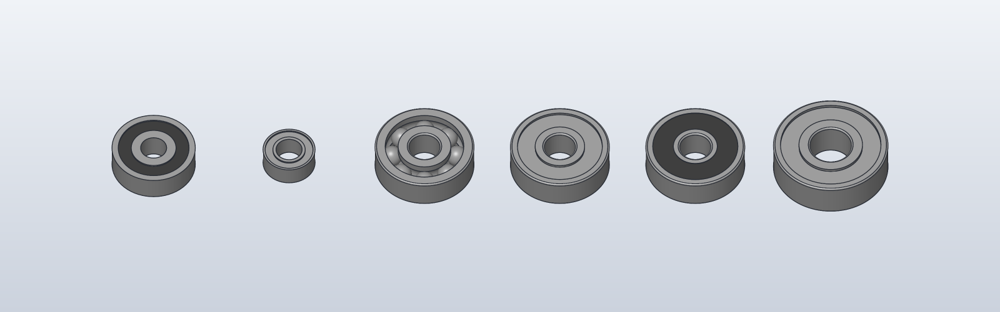

# Bearings

Place fixed OpenBuilds and MISUMI bearing products in [SolidCraft](https://github.com/tangency-labs/solidcraft), with separate steel rings and recessed rubber seals or metal shields. Choose a catalog designation instead of entering arbitrary dimensions.

## Supported bearings

Choose a designation from this table in **Bearings > make-bearing**. Dimensions
are bore × outside diameter × width, in millimetres. Part numbers are the
supplier's catalog numbers.

<!-- catalog-table:start -->

| Designation | Supplier | Part number | Bore × OD × width (mm) | Closure |
|---|---|---|---|---|
| 625 2RS | OpenBuilds | 30 | 5 × 16 × 5 | Rubber seals, both sides |
| 105ZZ | OpenBuilds | 800 | 5 × 10 × 4 | Metal shields, both sides |
| B626 | MISUMI | B626 | 6 × 19 × 6 | Open, visible balls |
| B626ZZ | MISUMI | B626ZZ | 6 × 19 × 6 | Metal shields, both sides |
| B626DDU | MISUMI | B626DDU | 6 × 19 × 6 | Rubber seals, both sides |
| B608ZZ | MISUMI | B608ZZ | 8 × 22 × 7 | Metal shields, both sides |

<!-- catalog-table:end -->

The preview follows the table order, left to right, at the same scale. Dark faces
are rubber seals, gray faces are metal shields, and the open B626 shows its balls
and raceways. See the [reference](REFERENCE.md#geometry-and-sources) for sources
and modeling limits.

## Install

Download `techsquid-bearings-0.3.0.zip` from the repository's releases. In SolidCraft, choose **Plugins > Install plugin…** and select the zip. Check the [host requirements](../../docs/parts-library.md#host-requirements) before installing version 0.3.

## Use

Select sketch points or circle centers, then run **Bearings > make-bearing**. Choose a listed supplier product: the original OpenBuilds bearings or MISUMI B626, B626ZZ, B626DDU and B608ZZ. With nothing selected, the bearing sits at the origin. Its centre plane sits on the point and its axle follows the sketch normal. Optional **Sketch** and **Sketch point** fields address points by name.

The rings and any closure faces belong to one purchased component. Later insertions reuse an unchanged definition, including bearings already inside V-wheel assemblies. Edited definitions are preserved; a new insertion builds a clean replacement. New occurrences remain free to move or join to your assembly.

The built-in bearing tool provides a simple ring envelope. This plugin shows the exterior ring and closure boundaries, with visible balls and raceways in open B626. Closed variants omit hidden balls and internals; cages are not modeled. It does not use the built-in **Change Part Size** workflow.

See the [reference](REFERENCE.md) for dimensions, part numbers, placement fields and representation limits. Shared internal definitions drive the insertion choices and verified reuse; no Catalog entry is exposed. The example design opens without the plugin installed.
