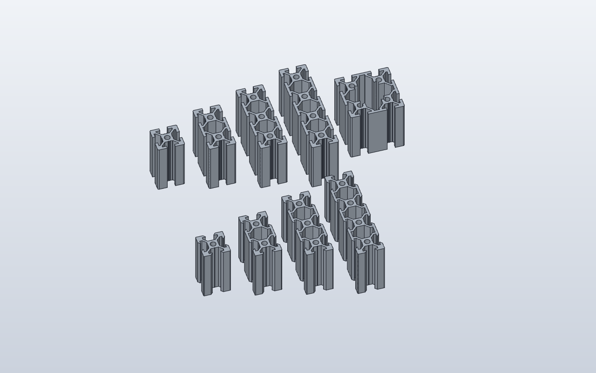
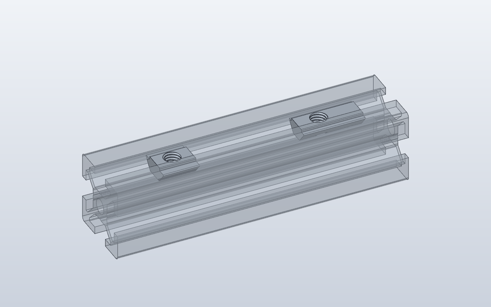

# Extrusions

Go from a sketch to a frame with configurable T-slot and V-slot rails for [SolidCraft](https://github.com/tangency-labs/solidcraft). Cut rails to length, prepare their joints and add slot nuts without modeling each profile by hand.

- Build MISUMI 5 series T-slot rails in 2020, 2040, 2060, 2080 and 4040 sizes, or OpenBuilds V-slot rails from 2020 through 2080.
- Add M5 tapped ends and screw holes for rail-to-rail connections. Edit a hole reference sketch to move both the access and clearance cuts together.
- Add MISUMI pre-assembly or post-assembly slot nuts to your rails.
- Place multiple copies at once as reusable components.

## Get started

Select one or more sketch points or circles and open **Plugins > Extrusion**. Choose a profile, size and length, then press **Run**. Leave **Sketch** and **Sketch point** blank to use your selection; with no selection, the rail starts at the origin. The default is a 500 mm T-slot 2020 rail.

For a slot nut, sketch a point at the center of the slot on the rail's face, select it and open **Plugins > Slot nut**. Set the rail direction to match the slot.

For joint dimensions, tapping limits, slot nut placement and all options, see the [extrusion reference](REFERENCE.md).

## License

[MIT](../../LICENSE)
