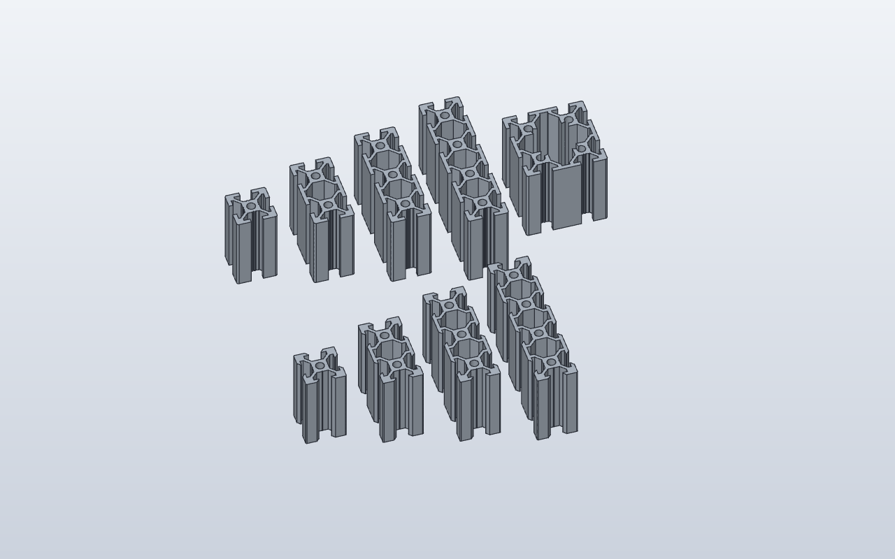
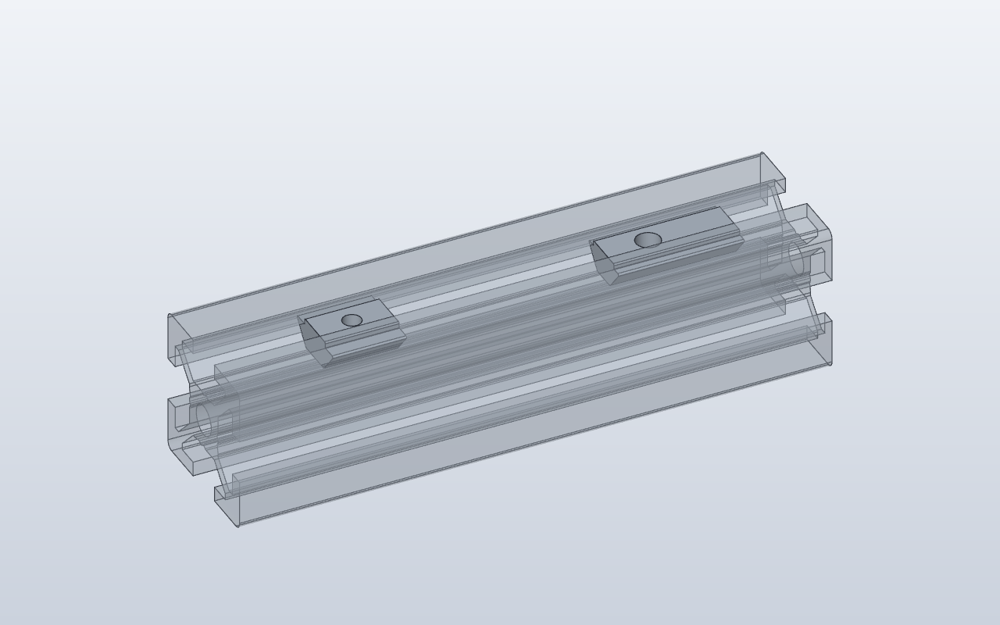

# Extrusions

20 mm series T-slot and V-slot aluminium extrusions for [SolidCraft](https://github.com/tangency-labs/solidcraft), cut to any length, and the slot nuts that go in them. Two entries: `make-extrusion` builds a rail, and `make-t-nut` puts a nut in a rail's slot. Fixed-length rails and nuts build a reusable component and place it on every point (see [Components](../../DEVELOPMENT.md#components)). Sketch-driven rails build independent bodies along source lines.

Every rail it builds, 40 mm long and standing on end: the T-slot 2020, 2040, 2060, 2080 and 4040 behind, and the V-slot 2020 to 2080 in front.

A T-slot is the MISUMI 5 series rail (HFS5, NFS5): a 6 mm slot with an Ø4.2 core bore for M5 end taps. A V-slot is the OpenBuilds rail: the same 20 mm cell and Ø4.2 bore, with the slot faces chamfered at 45° so a wheel can run on them. The two slots are close, and they are not the same. A V-slot is 6.25 mm at the throat, 11 mm wide under a 1.8 mm lip. A T-slot is 6 mm, 12 mm and 2 mm.

## Use

All sizes are millimetres. The form opens on a 2020 T-slot, 500 mm long.

In the default **Fixed length** mode, pick a sketch point, or a circle (on it or anywhere inside it), for Placement in the view. Points or circles already selected when the dialog opens fill the field. The rail's section is centred on that point, and the rail runs out of the sketch along its normal for its length. The section's width is along the sketch X and its height along the sketch Y, so a 2040 is 20 mm along X and 40 mm along Y. With nothing picked, the rail stands on the origin: the section is on the XY plane and the rail runs along +Z. The reply says which of these happened in `placed`. Pick several points or circles and each one gets a rail, as one undo step; `count` and `points` in the reply list them. A region that is not the inside of a circle is refused against Placement, and so is an edge, face or body.

| Parameter | Default | Meaning |
|---|---|---|
| `mode` | `Fixed length` | `Fixed length` places components on points; `Sketch driven` follows source lines |
| `slot` | `T-slot` | `T-slot` or `V-slot` |
| `size` | `2020` | `2020`, `2040`, `2060`, `2080` or `4040`. A V-slot comes as `2020` to `2080` |
| `length` | 500 | Fixed-length mode only. How long the rail is cut, mm, up to 6000. Kept to 0.01 mm, as the rail's name shows it |
| `end_taps` | `None` | `None`, `Start`, `End` or `Both`: the ends whose bores are tapped M5. The start is the end on the sketch point |
| `thread_modeled` | on | On cuts the thread into a tapped end. Off lists the thread and leaves the bore plain |
| `holes` | empty | Where M5 screw holes go across the rail, as distances from the start in mm: `10, 290`. A face name puts the distances after it on that face: `+X 10, 290 -Y 150` |
| `hole_face` | `+Y` | `+Y`, `-Y`, `+X` or `-X`: the face the screws go in from, for the holes that name none. Y is the section's height and X its width |
| `placement` | empty | Fixed length: the sketch points or circles each rail starts on, picked in the view; a circle, or a click inside one, means its centre. Sketch driven: 1 to 16 straight lines from one sketch. Programs pass a list of references, as the dialog does: `{"type": "external_sketch_point", "sketch": 2, "id": "p1"}` for a point, `{"type": "external_sketch_curve", "sketch": 2, "id": "c1"}` for a circle, `{"type": "profile", "sketch": 2, "index": 0}` for the inside of one. `sketch` is the sketch's feature id or its name |

In fixed-length mode, the reply gives `slot`, `size`, `length`, `width`, `height`, `area_mm2` (the area of the section), `end_taps`, `thread_modeled` and `holes`, each with its `face` and its distance `at`. It also says where the rails went: `count`, `points`, the first one's `at` and `normal`, `placed` (how the point was found) and `component`.

### Sketch-driven mode

Set `mode` to `Sketch driven` and pick 1 to 16 straight lines from one sketch for
`placement`. A program lists each line as `{"type": "external_sketch_curve", "sketch": 2, "id": "l1"}`.
Every line must be picked or listed; a sketch is not searched for its lines. A point
pick, lines from two sketches or more than 16 lines are refused against Placement.
All nine catalog profiles work in this mode; `length` is ignored.

| Parameter | Default | Meaning |
|---|---|---|
| `holes_from` | `Start` | `Start` or `End`: the endpoint used for every cross-hole distance in this run |

Each source line creates one body in the active component, with a timeline group
named `T-slot 2040 path l1` (for example). Repeated runs choose unique names. The reply
contains `mode`, `count`, `bodies`, `lines` and `area_mm2`. These bodies have independent
lengths and machining; they are not placements of one shared component definition.

The plugin draws the catalog section once, then copies its fixed geometry into an
independent section sketch for each remaining rail. A native straight-path sweep
follows each source line. Start and end planes follow the path endpoints. Side planes
follow the same path and fixed points in a **Side references** sketch. Cross-hole
centers are dimensioned from a linked projection of the path. No machining feature
references a generated body face or edge. Saving and reopening preserves these native
dependencies; the plugin does not need to keep running.

The section uses the path-normal plane's X/Y axes, rather than Weldments' world-up
roll convention. Its **Section** sketch shows the orientation. Side reference sketches
use X along the path and Y across the face; fixed-length hole sketches use the axes
described below. Start and End mean the source line's drawing direction. Edit dimensions
in a generated hole sketch to adjust offsets or diameters.

Paths can lie on any 2D sketch plane. Arcs, construction lines, projected lines and 3D
wires are rejected. There are no automatic corner joints, miters or trims between rails.
The picked line set is captured at creation: added lines require another run; deleting
a source line breaks its rail. Keep the edited paths long enough for their machining.

A run accepts at most 16 rails and four modeled taps in total. SolidCraft also limits
plugins to 256 host calls; the plugin estimates its full command count before creating
anything and requests a smaller batch when needed. Taps and holes can therefore lower
the batch size. Cosmetic taps avoid modeled-thread cost. Each initial length must be
0.01–6000 mm and meet the same machining margins as fixed-length rails.

This mode is additive: existing fixed-length rails keep their current behavior.

### Tapped ends and screw holes

Rails screw together with no bracket when one is drilled and the other tapped, which is how a Creality Ender 5 frame is held. An M5 screw goes in through a slot of the first rail, across its core, and into the end of the second. The plugin cuts both into a rail as it builds it.

- **Tapped ends.** `end_taps` taps every bore of an end M5, 12 mm deep. A rail's bore is 4.2 mm, the tap drill of M5, so only the thread is cut. That takes a few seconds for each bore, and SolidCraft gives a plugin run 30, so a thread is cut into at most four bores of one rail: both ends of a 2040, or one end of a 2080 or a 4040. With Modeled thread off the thread is listed on the hole, the bore stays plain, and any rail can have both ends tapped.
- **Screw holes.** Each distance in `holes` gets a hole from the middle of a slot on `hole_face`, straight through the rail. It is a 9.5 mm access hole through the lips, down to the slot floor, and a 5.5 mm clearance hole from there out through the far face. The head of an M5 socket head screw goes through the access hole and sits on the slot floor, 6 mm under the face of a T-slot and 6.1 mm under the face of a V-slot. A face with two slots or more gets a hole in each. A hole must be at least 5.75 mm from an end. A rail can have holes from several faces: write a face name in front of its distances. Holes from two faces meet in the core, so they must be 9.5 mm apart along the rail.

Each drilled face has a **Hole references +Y** sketch (or the other face name), inside the rail's component and timeline folder. It is hidden after the cuts are made. Show it to select or project a hole center into another sketch, or edit it to move a hole. Sketch Y measures distance from the rail's start; sketch X runs across the face. Each clearance circle `hole1`, `hole2`, and so on shares its center point with its access circle `access1`, `access2`, and so on. Both cuts follow those circles, so moving `hole1.center` moves both diameters. The circles are ordinary profiles because they drive the cuts; changing a circle's diameter changes that cut too.

The cuts select circles by their ids, so they follow edits and survive saving and reopening. Every placement of the rail shares the edited geometry. A hole is two circles in every slot it crosses, and SolidCraft gives a plugin run 256 commands, so a wide rail takes fewer holes than a narrow one: a 2080 drilled through its wide faces has room for about a dozen. A rail that asks for more is refused on `holes` before anything is built. Keep the holes within the rail and clear of one another: the plugin's end-margin and spacing checks apply when it first generates the rail, not to later sketch edits. The generated part name and description retain the original input distances. Picking these centers in a technical drawing depends on the host's drawing support and is not verified here.

**Breaking change to generated features:** new rails use one reference sketch and two extrusion cuts per drilled face, replacing the separate cylinder features for each hole. Scripts selecting the old `Hole at …` feature names must use the new names below. Existing saved rails keep their original features; they are not migrated automatically.

An M5 x 25 screw on the slot floor of a 2020 rail reaches 11 mm into the end it holds, and an M5 x 20 reaches 6 mm. Place it with the screw plugin, Create set to Screw only, on a point on the slot floor: sketch on a plane 6 mm inside the drilled rail's face, facing out. Where a rail has a screw in its end and a screw hole 10 mm from that end, the first screw must be the M5 x 20, or the two meet inside the rail.

No washer goes under the head. The slot floor is 5.9 mm wide between the webs, and the access hole cuts just enough of them for the 8.5 mm head. An M5 washer is 10 mm across, or 9 mm in the small series, and neither fits there.

A cut thread and the screw in it still overlap a little, by about 14 mm³ for each M5 screw. SolidCraft cuts each thread where its own part starts it, so the two are not in step.

A tapped or drilled rail is a part of its own. Its name says what is cut into it, such as `T-slot 2020 x 300 taps both holes -Y 10 290 +X 150`, and every placement of it has the same cuts, so two rails drilled differently are two parts.

### Slot nuts

Plugins > Slot nut puts a nut under the lips of a slot. Sketch on the rail's face, put a point in the middle of the slot where each screw goes, pick the points for Placement, and run it. The nut hangs under the lips with its tapped hole on the point: its shoulders are 2 mm below the face of a T-slot and 1.8 mm below the face of a V-slot, which is the lip of each. The form opens on an M5 pre-assembly nut in a T-slot.

An M3 pre-assembly nut on the left and an M4 post-assembly nut on the right in the top slot of a T-slot 2020, the rail drawn see-through.

The nut does not look for the slot. It goes on the point you give it, and Rail runs along says which sketch axis the slot follows, so the nut lies along it. With nothing picked the nut hangs under the origin, its hole on the Z axis and its length along X.

| Parameter | Default | Meaning |
|---|---|---|
| `type` | `Pre-assembly` | `Pre-assembly` slides in from the end of the rail. `Post-assembly` goes in through the slot and has a spring ball under it |
| `size` | `M5` | The nut's thread: `M3`, `M4` or `M5` |
| `slot` | `T-slot` | `T-slot` or `V-slot`, the rail the nut sits in. It sets how far under the face the nut hangs |
| `along` | `Sketch X` | `Sketch X` or `Sketch Y`, the sketch axis the rail runs along |
| `thread_modeled` | on | On cuts the thread into the hole. Off drills the selected thread's tap hole (2.5 mm for M3, 3.3 mm for M4, 4.2 mm for M5) and lists the thread |
| `placement` | empty | The sketch points or circles to put a nut on, picked in the view; a circle, or a click inside one, means its centre. Programs pass a list of references, as the dialog does: `{"type": "external_sketch_point", "sketch": 2, "id": "p1"}` for a point, `{"type": "external_sketch_curve", "sketch": 2, "id": "c1"}` for a circle, `{"type": "profile", "sketch": 2, "index": 0}` for the inside of one. `sketch` is the sketch's feature id or its name |

The reply gives `type`, `part` (the MISUMI part number), `thread`, `slot`, `along`, `length`, `width`, `height` and `under_face`, and where the nuts went, as a rail's reply does.

Sketch-driven mode additionally calls `solid.sweep`, `construct.plane.along_path`, `construct.plane.axis_point`, `sketch.replace`, `sketch.point`, `sketch.constraint.fix`, `sketch.constraint.coincident`, `sketch.dimension` and `sketch.project`.

The package calls `inspect.measure` (for the body names, so a new body gets a free one), `sketch.inspect`, `sketch.create`, `sketch.line`, `sketch.arc.three_point`, `sketch.circle.center`, `sketch.finish`, `solid.extrude`, `solid.hole` (a tap, and a nut's thread), `solid.cylinder` (a nut's ball recess), `browser.visibility` (hides the reference sketches after their cuts), `solid.sphere` (a nut's ball), `solid.move` (a nut whose thread is cut is made on the origin and moved aside before it is tapped), and `component.list`, `component.create`, `component.metadata`, `component.metadata.set`, `component.activate`, `occurrence.copy`, `occurrence.move` and `occurrence.reparent` to place it.

## Sizes

A rail is a grid of 20 mm cells. Each cell has a square core with a Ø4.2 bore, a 1.5 mm web from each core corner, and a slot on every side that faces out. Between two cells the webs and walls close a cavity.

| Size | Width x height | T-slot area, mm² | V-slot area, mm² |
|---|---|---:|---:|
| 2020 | 20 x 20 | 181.3 | 171.4 |
| 2040 | 20 x 40 | 322.4 | 300.0 |
| 2060 | 20 x 60 | 463.5 | 428.6 |
| 2080 | 20 x 80 | 604.6 | 557.2 |
| 4040 | 40 x 40 | 479.1 | not offered |

At 2.70 g/cm³ a T-slot 2020 weighs 0.49 kg/m and a 2040 0.87 kg/m.

In a T-slot 4040 no web runs to the middle. The four cavities are one, and each core is open to it through a 53° wedge that faces the middle of the rail, so each bore is a C. That is MISUMI's STEP model of NFS5-4040. The catalog draws the opening differently and lists 472 mm², which is 1.5% under the model.

Each T-slot floor is the one in MISUMI's STEP models: a 120° groove, 0.3 mm deep, with both edges rounded to R0.5, and beside it a shallower mark. The 2040 model also rounds the corners of its closed cavity to R0.3, which the 2060 and 2080 models do not; here they are sharp in every size.

### Slot nuts

Both nuts are MISUMI's for the 5 series slot, and both fit a V-slot as well. A nut is one section along its whole length: a 5.8 mm boss that sits in the slot's throat, shoulders that bear under the lips, and flanks that slope in to clear the rail's webs.

| Type | MISUMI part | Length | Width | Height | Hole from the end |
|---|---|---:|---:|---:|---:|
| Pre-assembly | HNTT5-3 | 10 | 10 | 4.1 | 5 |
| Pre-assembly | HNTT5-4 | 10 | 10 | 4.1 | 5 |
| Pre-assembly | HNTT5-5 | 10 | 10 | 4.1 | 5 |
| Post-assembly | HNTP5-3 | 17 | 8.3 | 3.9 | 6 |
| Post-assembly | HNTP5-4 | 17 | 8.3 | 3.9 | 6 |
| Post-assembly | HNTP5-5 | 17 | 8.3 | 3.9 | 6 |

The post-assembly nut has an R2 ball 7.5 mm past its hole, standing 0.8 mm out of the bottom. On a real nut a spring pushes it against the slot floor to hold the nut in place. Here it is part of the body, and in a T-slot it just touches the floor.

The part number includes the thread size, so each row is a distinct purchase and BOM part. BOM part numbers include the supplier prefix, such as `MISUMI HNTT5-3`. The MISUMI catalog lists M3, M4 and M5 with the same external dimensions within each carbon-steel family. The detailed section and spring-ball shape come from the M5 STEP references; M3 and M4 have no separately measured STEP model here. `thread_modeled` changes the CAD detail, not the supplier part number. These are MISUMI product identities, not a general standard for all 6 mm slot nuts.

What is not here: the closed-face rails (HFSF5, HFST5), the 30 and 40 mm series, the V-slot 40x40 and C-Beam, washers, and brackets, plates and other nuts.

## Standards

| What | Source | Test |
|---|---|---|
| T-slot: 6 slot, 2 lip, 12 cavity, 8 core, Ø4.2 bore, R1 corners, 1.5 webs | MISUMI catalog 2019 US p. 2686 to 2687, Slot Details and the HFS5-2020 and HFS5-4040 sections | `slot::tests::the_t_slot_is_the_misumi_5_series_slot` |
| T-slot floor: the 120° groove, 0.3 deep, its R0.5 roundings and the mark beside it | The same pages, Slot Bottom Details, and the MISUMI STEP models below | `slot::tests::the_t_slot_floor_is_the_misumi_floor` |
| T-slot 2020 outline vertices | MISUMI STEP model `NFS5-2020-50.stp` (PARTcommunity) | `profile::tests::the_t_slot_2020_has_the_misumi_step_vertices` |
| T-slot 2040 outline and cavity vertices | MISUMI STEP model `NFS5-2040-50.stp` | `profile::tests::the_t_slot_2040_has_the_misumi_step_vertices` |
| T-slot 2060 cavities, 143.03 mm² each | MISUMI STEP model `NFS5-2060-2060.stp` | `profile::tests::the_t_slot_2060_has_the_misumi_step_cavities` |
| T-slot 4040 outline and middle cavity vertices, and the opening of each core | MISUMI STEP model `NFS5-4040-50.stp` | `profile::tests::the_t_slot_4040_has_the_misumi_step_vertices` |
| T-slot areas 181.26, 322.44, 463.49, 604.60 and 479.13 mm² for 2020, 2040, 2060, 2080 and 4040, to within 0.03 mm² (0.1 for the 2040) | The end faces of those models and of `NFS5-2080-50.stp` | `profile::tests::the_t_slot_areas_are_the_misumi_step_areas` |
| T-slot areas 183 and 324 mm² for 2020 and 2040, to within 1% | MISUMI catalog 2019 US p. 2686 to 2687, Sectional Area | `profile::tests::the_t_slot_areas_are_near_the_misumi_catalog_areas` |
| V-slot: 6.25 throat, 9.16 mouth, 11 cavity, 1.80 lip, 1.50 webs, Ø4.20 bore | OpenBuilds drawing "V-Slot 20x20 Linear Rail" | `slot::tests::the_v_slot_is_the_openbuilds_slot` |
| V-slot outline and cavity vertices, and the area of each section | OpenBuilds `V-Slot 20x20.dxf`, `20x40.dxf`, `20x60.dxf` and `20x80.dxf` | `profile::tests::the_v_slot_outline_has_the_dxf_vertices`, `the_v_slot_2040_cavity_has_the_dxf_vertices`, `the_v_slot_areas_are_the_openbuilds_dxf_areas` |
| Pre-assembly nut: its section, 10 long, the hole in the middle | MISUMI STEP model `HNTT5-5.stp` and the drawing on its product page | `tnut::tests::the_pre_assembly_nut_is_the_misumi_hntt5` |
| Post-assembly nut: its section, 17 long, the hole 6 from the end, the ball and its recess | MISUMI STEP model `HNTP5-5.stp` and the drawing on its product page | `tnut::tests::the_post_assembly_nut_is_the_misumi_hntp5` |
| M3, M4 and M5 carbon-steel pre- and post-assembly nuts: part numbers and shared envelopes within each family | MISUMI 2019 US catalog [p. 2710](https://us.misumi-ec.com/pdf/fa/2019/2019_US_2710.pdf) and [p. 2716](https://us.misumi-ec.com/pdf/fa/2019/2019_US_2716.pdf) | `tnut::tests::both_misumi_nut_families_offer_three_threads_with_shared_envelopes`; `provider::tests::each_thread_and_nut_style_has_its_own_supplier_part_number` |
| Screw holes: 5.5 mm clearance, 9.5 mm access, and the 4.2 mm bore as the M5 tap drill | ISO 273 (medium fit) for the clearance hole, ISO 4762 for the 8.5 mm head with 0.5 mm round it, and the slot rows above for the bore | `machining::tests::the_holes_are_for_an_m5_socket_head_screw` |
| Both nuts clear the lips, walls and webs of both slots | The slot and nut rows above | `tnut::tests::both_nuts_fit_both_slots` |

The catalog's areas are a loose check: its 2040 is 0.5% over MISUMI's own model and its 4040 is 1.5% under.

## Names

| What | Name |
|---|---|
| Rail body and component | `T-slot 2040 x 500`, `V-slot 2020 x 122.5` |
| A tapped or drilled rail | `T-slot 2040 x 300 taps start`, `T-slot 2020 x 300 taps both holes -Y 10 290 +X 150` |
| Its sketch and feature | `T-slot 2040 x 500: Section`, `T-slot 2040 x 500: Rail` |
| Its taps | `: Tap start 1`, `: Tap end 2` |
| Hole placement sketch, one per drilled face | `: Hole references +Y` (or `-Y`, `+X`, `-X`); circles `hole1` and `access1` share `hole1.center` |
| Screw hole cuts, two per drilled face | `: Screw holes +Y: Access`, `: Screw holes +Y: Clearance` |
| Nut body and component | `T-nut M5 pre-assembly`, `T-nut M5 post-assembly` |
| Its sketch and features | `T-nut M5 pre-assembly: Section`, `: Bar`, `: Thread`, and `: Ball recess` and `: Ball` on a post-assembly nut |
| Timeline folder | the rail's or the nut's name, `T-slot 2040 x 500`, holding every sketch and feature of it, folded |
| The folder its placements go in | `Extrusions` |

In the bill of materials a finished rail is a custom (`normal`) part with a generated model number for its full configuration. Its description reads `20 x 40 mm T-slot aluminium extrusion, 500 mm long`. A slot nut is `purchased`, uses its MISUMI part number and describes its insertion type and slot.

## Catalog and reuse

Shared internal definitions cover nine stock profiles and the six MISUMI HNTT5/HNTP5 slot nuts listed above.
The package exposes insertion workflows only; catalog discovery is not available. A cut or machined rail is a custom finished configuration with stock-profile provenance. Slot-nut mounting orientation is placement, not a different purchase. Sketch-driven rails remain a separate workflow.

Purchasing identity is separate from cosmetic/modeled thread detail. Unchanged
representations reuse verified native definitions across runs. Renamed components
remain reusable; edited components are preserved and new insertions create clean
replacements. See [the library architecture](../../docs/parts-library.md) for BOM
rules, inspection limits and migration from legacy metadata.

The internal catalog revision is now 2. A script holding a resolved catalog selection from revision 1 must resolve it again before insertion. Ordinary dialog use and saved M5 parts do not require regeneration.

## Older field names

`sketch`, `sketch_point` and `path_lines` are retired and rejected as unsupported fields. Use `placement`, a list of picked sketch points or curves; typed comma-separated ids are gone. In Sketch driven mode, a named sketch no longer stands for all its lines: pick or list each line.
