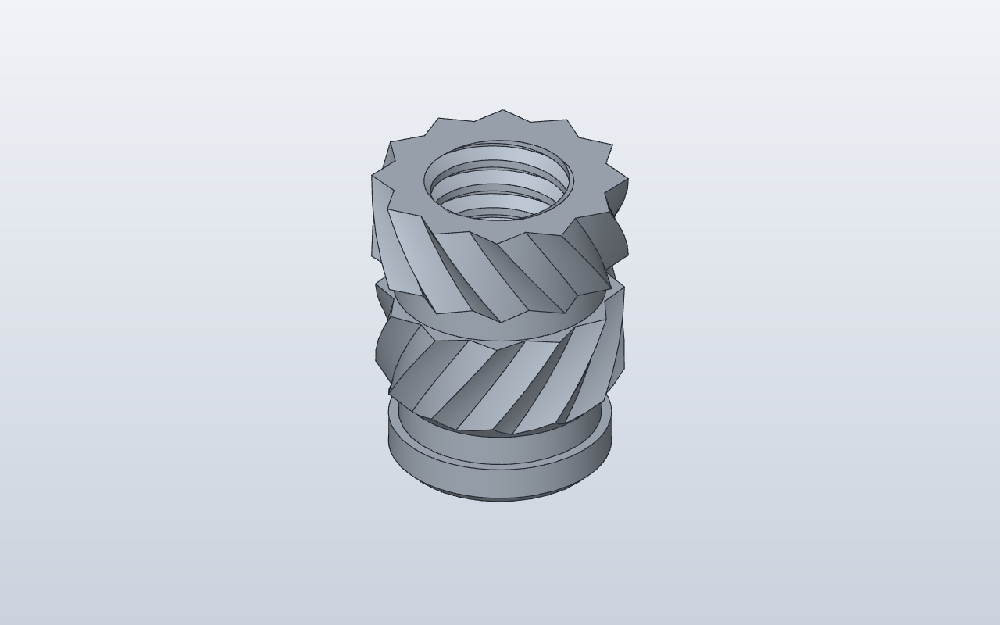

# Heat-set inserts

Check the [host requirements](../../docs/parts-library.md#host-requirements) before installing version 0.3.

Add reusable threaded connections to your printed parts. This [SolidCraft](https://github.com/tangency-labs/solidcraft) plugin places CNC Kitchen heat-set inserts and prepares their holes in one step.

- Choose from CNC Kitchen metric and UN sizes, or customize the insert dimensions and thread.
- Create inserts, holes or both at once across multiple sketch points.
- Use straight heat-set holes or stepped glue-in holes for supported sizes, with blind or through depth.
- Adjust hole diameters to suit your printer. Metric threads can be modeled or cosmetic; UN threads remain cosmetic.

## Get started

Sketch on your part's face with a point or circle for each insert. Open **Plugins > Heat-set insert**, pick the points or circles for **Placement** in the view (clicking inside a circle picks it too), choose a size and press **Run**. Points or circles already selected when the dialog opens fill the field. The default is an M3 × 5.7 insert with a straight, blind hole.

Use **Create** to make the hole and insert together, or either one separately. A hole needs a part under the picked points; with nothing picked, the plugin can place a loose insert at the origin.

For the size catalog, hole dimensions, custom options and placement details, see the [insert reference](REFERENCE.md).

## License

[MIT](../../LICENSE)

Shared internal definitions retain insert rows and source status. Custom overrides and the three unsourced rows are custom models. See [catalog and reuse rules](../../docs/parts-library.md).
