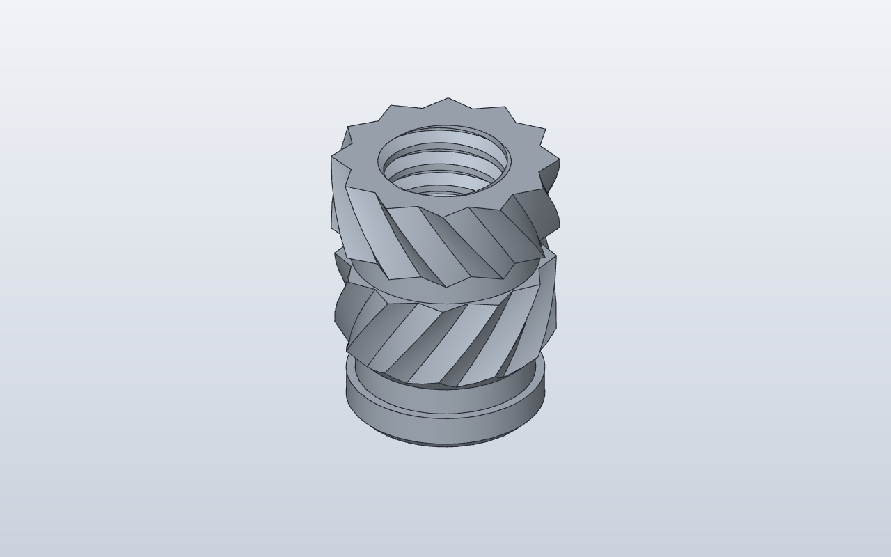

# Heat-set inserts

A heat-set insert generator for [SolidCraft](https://github.com/tangency-labs/solidcraft). The `make-insert` workflow drills the hole for every sketch point or circle you pick and builds the brass insert as a component of its own, once, placed on every point (see [Components](../../DEVELOPMENT.md#components)).

An M3 × 5.7 insert, the size the form opens on.

Sizes are [CNC Kitchen](https://cnckitchen.store/)'s. The outside follows CNC Kitchen's section drawing: three rings on a shaft. The top ring is a 12-point star across D1 that twists one way. A smooth groove follows. The middle ring is a slightly narrower star that twists the other way and ends in a large 45° chamfer. After a short neck, the bottom ring is a smooth pilot, about as wide as the plastic hole and with a small chamfer at the tip, so the insert drops into its hole before you press it in. D1 is the diameter across the points of the top ring.

## Use

Sketch on the face of the part, put a point or a circle where each insert goes, open Plugins > Heat-set insert and pick them all for Placement in the view; clicking inside a circle picks it too. Points or circles already selected when the dialog opens fill the field. Pick a Size and press Run. Each point gets the hole for that insert and a placement of the insert, as one undo step.

Create chooses what is made: `Hole and insert` (the default), `Hole only`, or `Insert only`. A hole needs a part to drill. With nothing picked, `Hole and insert` and `Insert only` put a loose insert on the origin, and `Hole only` asks you to pick the points. The reply's `note` says when no hole was drilled.

The hole is an ordinary `solid.hole` feature on the sketch points, so it follows the sketch and can be edited afterwards. No body is named: the host drills the part under each point.

- **Hole type.** `Heat-set (straight)` is the plastic hole D2 from the tables below. `Glue-in (stepped)` is CNC Kitchen's stepped hole for resin prints: D1 down to L1, D2 down to L2, then D3. It is listed for M2.5 × 4, M3 × 3 short, M3 × 5.7, M4 × 4 short, M4 × 8.1, M5 × 5.8 short, M5 × 9.5 and 1/4-20 × 12.7, and it takes no custom diameter or length.
- **Hole depth.** `Blind` is the insert length plus 1 mm. `Through` drills through the part. On a sketch that is not on a face of the part, a through hole would also drill the bodies beyond it, so that run is refused; use Blind, or sketch on the face.
- **Hole adjustment.** Added to every hole diameter, from −1 to 1 mm. Printed holes come out small, so raise it in 0.1 mm steps until the insert fits your printer. A custom diameter keeps the same interference as its row. The hole the insert grips, D2 or the middle step of a glue-in hole, has to stay narrower than the insert.

The hole goes into the material, whichever side of the sketch that is. The insert runs against the sketch normal. On a face sketch those agree. On a loose plane with the part on the normal side they do not, so sketch on the face.

All sizes are millimetres. Size lists the rows of the tables below and sets the diameter, the length and the thread together. The form opens on `M3 × 5.7`, a 4.6 mm by 5.7 mm insert with an M3 bore. Each custom field replaces one of those and leaves the others on the row: Custom diameter is across the knurl points, Custom length is the insert, and Custom thread is the screw in the bore, such as `M3` or `M8x1`. The insert has to stay larger than its thread, by enough that the knurl clears it: about (thread + 0.2 mm) / 0.97, so 3.3 mm for M3. From the command line, `M3 x 5.7` finds the same row.

Pick a sketch point, or a circle, for Placement. The face end sits on that point and the tip runs into the part. On a face sketch the normal already points out of the material, so the insert hangs into the plastic and the face end is flush with the face. With nothing picked, the insert sits on the origin: the face end is on the XY plane and the tip runs along −Z. The reply says which of these happened in `placed`. A region that is not the inside of a circle is refused against Placement, and so is an edge, face or body.

Radii are fractions of the top ring's points: the valley 0.85, the middle ring's points 0.97, the groove 0.83, the neck 0.79 and the pilot 0.875, but never wider than the plastic hole D2. Along the insert, the top ring is 0.29 of the length, the groove 0.11, the neck 0.10 and the pilot 0.135, and the middle ring and its chamfer take the rest. Both knurls run at 50° from the axis. On a long insert the twist stops at 40° so the teeth do not fold through each other. Those proportions are measured off CNC Kitchen's section drawing, and the tooth count and the hand of each knurl off their photographs. On a large insert, or a diameter set close to the thread, the valley, the groove and the neck are lifted so they stay outside the bore.

`solid.hole` bores that body and threads it. The bore targets the new body only, so it does not continue into the part underneath. Metric threads can be cosmetic or modeled. Unified and pipe sizes support cosmetic threads only; requesting modeled threads is rejected. `#2-56` is a plain bore of about 1.731 mm, because SolidCraft's tap catalogue starts at `#4-40`.

The reply gives the plastic hole diameter D2 (`plastic_hole`), the minimum wall beside that hole (`min_wall`), and a minimum blind depth of the insert length plus 1 mm (`blind_depth`). A length you type updates that blind depth, and a diameter you type leaves the hole and wall empty. The reply also lists `hole` (what was drilled), `drilled` (the bodies it went into), `count` and `points`.

| Parameter | Default | Meaning |
|---|---|---|
| `size` | `M3 × 5.7` | A row of the tables below |
| `create` | `Hole and insert` | `Hole and insert`, `Hole only` or `Insert only` |
| `hole_type` | `Heat-set (straight)` | `Heat-set (straight)` or `Glue-in (stepped)` |
| `hole_depth` | `Blind` | `Blind` (length plus 1 mm) or `Through` |
| `hole_adjust` | 0 | Added to the hole diameter, mm, −1 to 1 |
| `custom_diameter` | the row's | Outside diameter, across the knurl points, mm |
| `custom_length` | the row's | Overall length, mm. A blind hole wants at least this plus 1 mm |
| `custom_thread` | the row's | Screw size for the bore |
| `thread_modeled` | true | Cut the internal thread. False leaves a cosmetic thread, which rebuilds faster |
| `placement` | empty | The sketch points or circles to put an insert on, picked in the view; a circle, or a click inside one, means its centre. Programs pass a list of references, as the dialog does: `{"type": "external_sketch_point", "sketch": 2, "id": "p1"}` for a point, `{"type": "external_sketch_curve", "sketch": 2, "id": "c1"}` for a circle, `{"type": "profile", "sketch": 2, "index": 0}` for the inside of one. `sketch` is the sketch's feature id or its name |

The package uses the shared [verified component library](../../docs/parts-library.md). Geometry and workflow commands include `sketch.inspect`, `sketch.create`, `sketch.line`, `sketch.finish`, `solid.revolve` (the smooth core and the middle chamfer), `solid.sweep`, `browser.visibility` (to hide the knurl sketches), `solid.move` (an insert whose thread is cut is made on the origin and moved aside before its bore is tapped), `solid.hole`, and `component.list`, `component.create`, `component.metadata`, `component.metadata.set`, `component.activate`, `occurrence.copy`, `occurrence.move` and `occurrence.reparent` to place it.

`short` and `Voron` mark a second row of the same thread. D1 is the insert diameter, D2 is the plastic hole, and W is the minimum wall beside that hole.

## Product identity

Shared internal definitions retain sourced dimensions and configuration rules.
The package exposes `make-insert` only; catalog discovery is not available.
Cosmetic and modeled threads are representations of the same product. Three rows
absent from the cited dimension guide—M1.6 × 2.5, M6 × 6.8 short, and M8 × 6.8
short—use custom identity, as do explicit dimension overrides. See the
[shared part-definition and reuse rules](../../docs/parts-library.md).

## Metric inserts

| Size | Thread | Length | D1 | D2 | W |
|---|---|---:|---:|---:|---:|
| M1.6 × 2.5 | M1.6 | 2.5 | 2.5 | 2.2 | 1.3 |
| M2 × 3 | M2 | 3.0 | 3.6 | 3.2 | 1.3 |
| M2.5 × 4 | M2.5 | 4.0 | 4.6 | 4.0 | 1.6 |
| M3 × 5.7 | M3 | 5.7 | 4.6 | 4.0 | 1.6 |
| M3 × 3 short | M3 | 3.0 | 4.6 | 4.0 | 1.6 |
| M3 × 4 Voron | M3 | 4.0 | 5.0 | 4.4 | 1.6 |
| M4 × 8.1 | M4 | 8.1 | 6.3 | 5.7 | 2.1 |
| M4 × 4 short | M4 | 4.0 | 6.3 | 5.7 | 2.1 |
| M5 × 9.5 | M5 | 9.5 | 7.1 | 6.5 | 2.6 |
| M5 × 5.8 short | M5 | 5.8 | 7.1 | 6.5 | 2.6 |
| M6 × 12.7 | M6 | 12.7 | 8.7 | 8.1 | 3.3 |
| M6 × 6.8 short | M6 | 6.8 | 8.7 | 8.1 | 3.3 |
| M8 × 12.7 | M8 | 12.7 | 10.2 | 9.7 | 4.5 |
| M8 × 6.8 short | M8 | 6.8 | 10.2 | 9.7 | 4.5 |
| M10 × 12.7 | M10 | 12.7 | 12.6 | 12.0 | 6.0 |

## UN inserts

| Size | Thread | Length | D1 | D2 | W |
|---|---|---:|---:|---:|---:|
| #2-56 × 3.2 | #2-56 UNC | 3.2 | 3.6 | 3.2 | 1.3 |
| #4-40 × 5.7 | #4-40 UNC | 5.7 | 4.6 | 4.0 | 1.6 |
| #4-40 × 3.6 short | #4-40 UNC | 3.6 | 4.6 | 4.0 | 1.6 |
| #6-32 × 7.1 | #6-32 UNC | 7.1 | 5.4 | 4.8 | 1.8 |
| #6-32 × 3.8 short | #6-32 UNC | 3.8 | 5.4 | 4.8 | 1.8 |
| #8-32 × 8.2 | #8-32 UNC | 8.2 | 6.3 | 5.7 | 2.1 |
| #8-32 × 4.7 short | #8-32 UNC | 4.7 | 6.3 | 5.7 | 2.1 |
| #10-24 × 9.5 | #10-24 UNC | 9.5 | 7.1 | 6.5 | 2.6 |
| #10-32 × 9.5 | #10-32 UNF | 9.5 | 7.1 | 6.5 | 2.6 |
| 1/4-20 × 12.7 | 1/4-20 UNC | 12.7 | 8.7 | 8.1 | 3.3 |
| 1/4-20 × 6.4 short | 1/4-20 UNC | 6.4 | 8.7 | 8.1 | 3.3 |
| 5/16-18 × 12.7 | 5/16-18 UNC | 12.7 | 10.2 | 9.7 | 4.5 |
| 3/8-16 × 12.7 | 3/8-16 UNC | 12.7 | 12.5 | 12.0 | 6.0 |
| G1/8 × 12.7 | G 1/8 | 12.7 | 12.5 | 12.0 | 6.0 |

## Standards

The insert and its hole follow this catalog.

| Fastener | Dialog choice | Standard | Sizes | From the standard | Source | Test |
|---|---|---|---|---|---|---|
| Heat-set insert | Heat-set insert | CNC Kitchen catalog | M1.6 to M10, #2-56 to 3/8-16, G1/8 | insert, straight and stepped hole | CNC Kitchen [Dimensions & Design Guidelines](https://www.cnckitchen.com/s/CNCKitchen_Heat-Set-Insert-Dimensions-and-Design-Guidelines.pdf) (M1.6 and the short M6 and M8 are not in it); [cnckitchen.com](https://www.cnckitchen.com/blog/tips-and-tricks-for-heat-set-inserts) for the stepped hole | yes |

"Test: yes" means a unit test repeats the table from the source named, so the code and the source cannot drift apart unnoticed. The catalog in `src/catalog.rs` names its source in a comment.

## Names

The body, the hole and every feature say what the part is and its size, so a design with several inserts stays readable. Sizes use a plain `x`, with spaces around it so a fine pitch stays apart from the length. A second body with the same name gets a number in brackets, such as `(2)`.

| What | Name |
|---|---|
| Insert body | `Insert M3 x 5.7`, from the thread and length actually built |
| Insert hole | `Heat-set hole M3 x 5.7`, or `Glue-in hole` and `Glue-in pilot` for a stepped hole |
| Features and sketches of an insert | the insert's name, then the feature: `Insert M3 x 5.7: Upper knurl`, `Insert M3 x 5.7: Middle chamfer`, `Insert M3 x 5.7: Bore` |
| Timeline folder | the insert's name, `Insert M3 x 5.7`, holding every sketch and feature of the insert, folded |

A hole keeps its kind and size in its own name because it stays in the part, and with Hole only there is no insert body at all.

## Older field names

Breaking change: use `thread_modeled` instead of `modeled`. `sketch` and `sketch_point` are retired and rejected as unsupported fields. Use `placement`, a list of picked sketch points or curves; typed comma-separated ids are gone. Retired or unknown input fields are rejected. Explicitly requesting modeled Unified or pipe threads is an error; select cosmetic geometry. The script default is modeled for metric sizes and cosmetic for other sizes.

## License

MIT, see [LICENSE](../../LICENSE).
