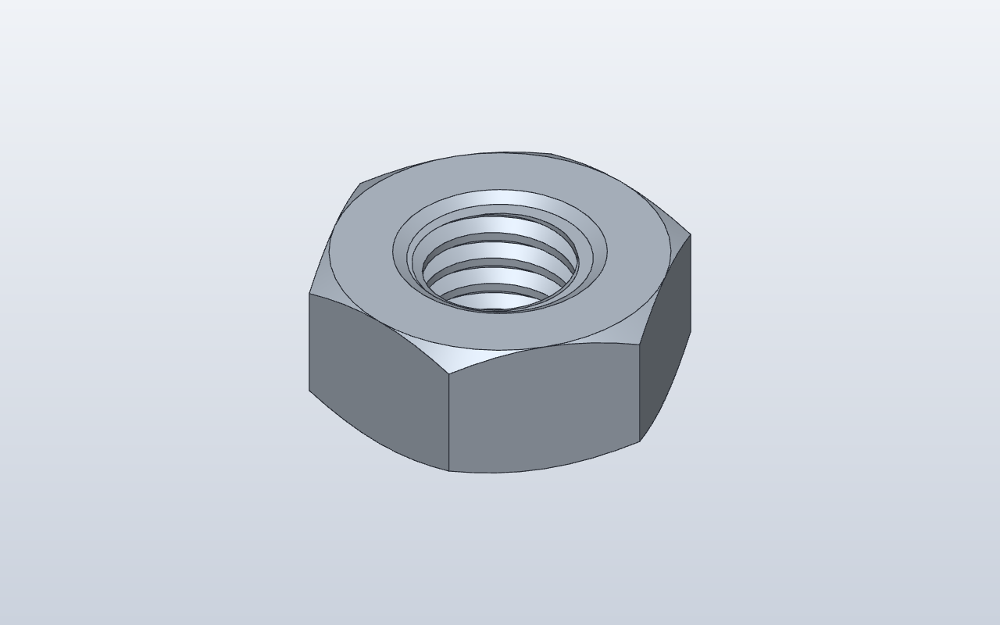

# Hexagon nuts

Add ISO 4032 hex nuts to your [SolidCraft](https://github.com/tangency-labs/solidcraft) assemblies, complete with optional pockets and bolt holes. Place several at once and keep them organized as reusable components.

- Choose a common metric size or enter a custom size and pitch.
- Create nuts, pockets or both. Pockets include a clearance hole for the bolt. Both cuts follow the selected sketch point when it moves.
- Adjust pocket clearance for your manufacturing process and customize nut width and thickness when needed.
- Use modeled threads for detail or cosmetic threads for faster rebuilds.

## Get started

Select one or more sketch points or circles and open **Plugins > Hex nut**. Choose a size and press **Run**. Leave **Sketch** and **Sketch point** blank to use your selection; with no selection, a loose nut is placed at the origin.

The default is an M3 nut. To recess it into a part, select points on the part and choose **Nut and pocket**. The pocket holds the nut flush with the surface.

For the size table, custom dimensions and placement details, see the [nut reference](REFERENCE.md). ISO 4032 and DIN 934 dimensions differ for some sizes; use custom dimensions when matching a DIN nut.

## License

[MIT](../../LICENSE)
