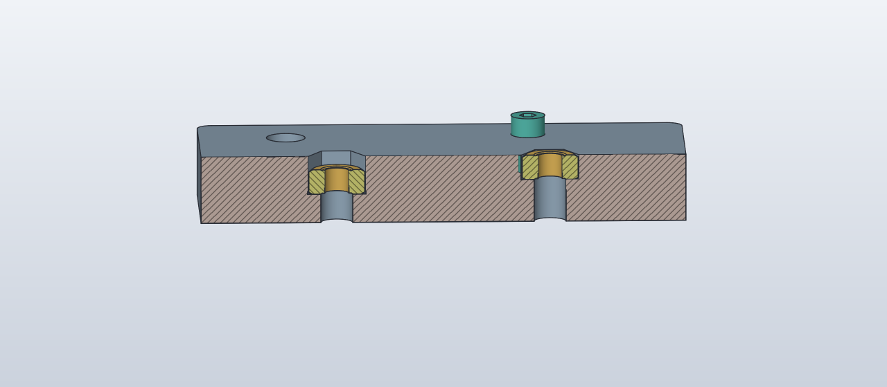
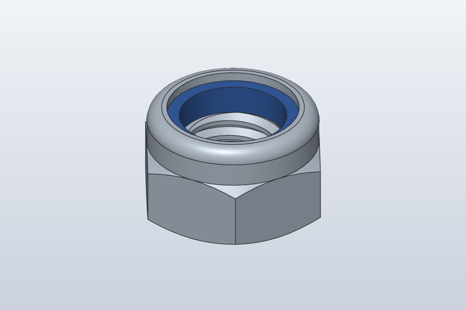

# Hexagon nuts

Check the [host requirements](../../docs/parts-library.md#host-requirements) before installing version 0.3.

Add plain ISO 4032 hex nuts and DIN 985 nylon-insert lock nuts to your [SolidCraft](https://github.com/tangency-labs/solidcraft) assemblies, complete with optional pockets and bolt holes. Place several at once and keep them organized as reusable components.

- Choose a metric size for either style, or enter a fine pitch for a supported diameter.
- Create nuts, pockets or both. Pockets include a clearance hole for the bolt. The cuts and pocketed nuts follow the picked sketch point when it moves or turns.
- Adjust pocket clearance for your manufacturing process and customize nut width and thickness when needed.
- Use modeled threads for detail or cosmetic threads for faster rebuilds.

## Get started

Open **Plugins > Hex nut** and pick one or more sketch points or circles for **Placement** in the view; clicking inside a circle picks it too. Points or circles already selected when the dialog opens fill the field. Choose a size and press **Run**. With nothing picked, a loose nut is placed at the origin.

The default is a plain M3 nut. Choose **Nut style → Nylon-insert lock nut** for a thin DIN 985 nut or the Bossard M2.5 size. Its metal bearing face sits on the picked surface and its blue nylon insert faces out. The [V-slot gantry](../../examples/v-slot-gantry/) uses four M5 lock nuts on its wheel axles.

To recess either style into a part, pick points on the part and choose **Nut and pocket**. The pocket holds the nut flush with the surface. A rigid joint keeps it centered on the bolt hole and seated on the floor as the sketch or pocket depth changes. `Nut only` placements keep their initial position.

For the size tables, custom dimensions and placement details, see the [nut reference](REFERENCE.md). When matching an older DIN 934 plain nut, check its width and height against the ISO 4032 dimensions and enter overrides as needed.

See the [pocketed-nut example](https://github.com/TechSquidTV/SolidCraft-Plugins/blob/main/DEVELOPMENT.md#pocketed-nuts-that-follow-edits) for a saved design, before-and-after sections, and commands that move the sketch centers and deepen one pocket. Linked pocket hexes keep their corners ordered during large moves, with every corner driven by one editable across-flats dimension. Regenerate previously created pockets to use these constraints.

## License

[MIT](../../LICENSE)

The package exposes its insertion tools only. [Shared part-definition and reuse rules](../../docs/parts-library.md) explain product identity, modified-part preservation and BOM grouping.
