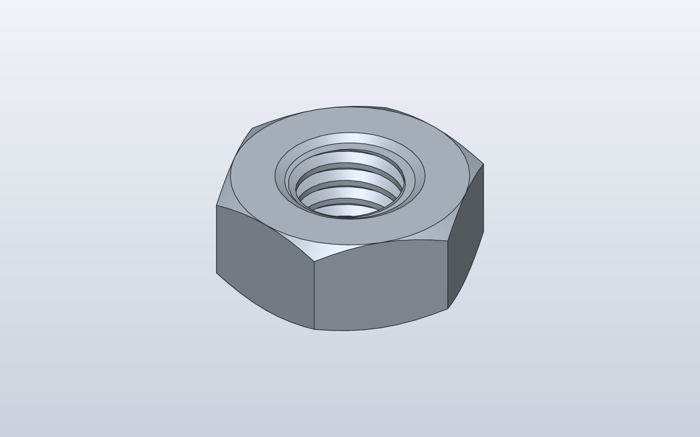
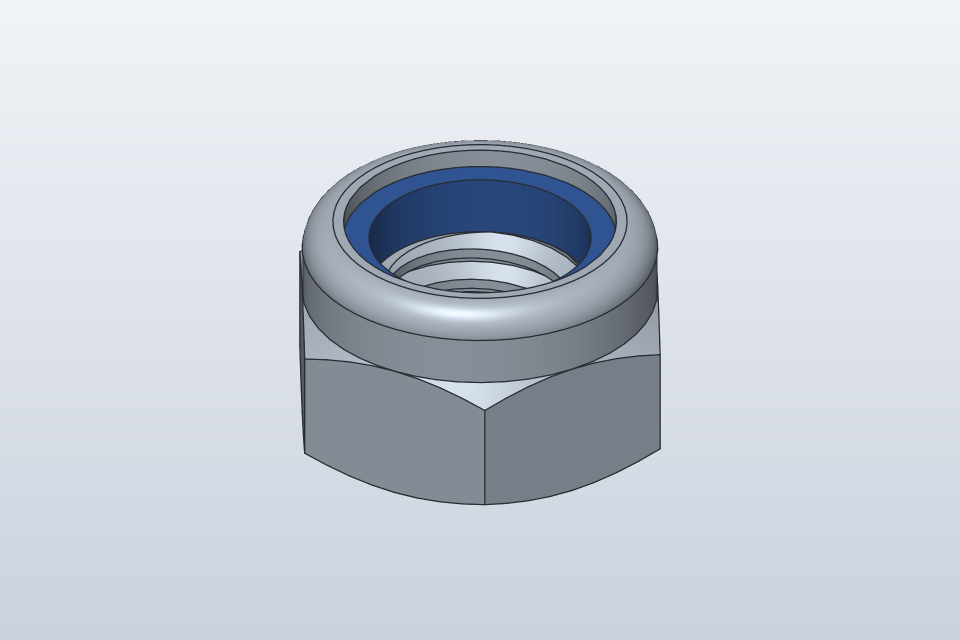

# Hexagon nuts

Plain ISO 4032 hex nuts and thin DIN 985 nylon-insert lock nuts for [SolidCraft](https://github.com/tangency-labs/solidcraft). One entry, `make-nut`. It builds the nut as a component of its own, once, and places it on every point (see [Components](../../DEVELOPMENT.md#components)). The bore is a tapped hole.

An M3 nut, the size the form opens on.

The plain nut sizes below are the ISO 4032 table, preferred and second-choice. ISO 4032 replaced DIN 934, and most sizes match, but not all: a DIN 934 nut is wider across the flats at M10 (17 mm, not 16), M12 (19, not 18), M14 (22, not 21) and narrower at M22 (32, not 34), and it is a little lower at most sizes (M6 5.0 mm, M8 6.5 mm). For a DIN 934 nut at those sizes, type its width and height in Custom width and Custom thickness, so the pocket fits it. The width across the flats is the nominal. The height is the standard maximum. Both ends are chamfered.

## Use

All dimensions are in millimetres. The form opens on a plain M3 nut. Both styles share the **Size** list. Sizes marked **(plain hex only)** are exclusive to that style. The remaining sizes also appear in the [nylon-insert size table](#nylon-insert-lock-nuts). To change pitch, enter a designation such as `M8x1` in **Custom size**.

Pick a sketch point, or a circle (on it or anywhere inside it), for Placement in the view. Points or circles already selected when the dialog opens fill the field. The bearing face sits on that point and the nut stands on the outer side of the sketch. On a face sketch the normal already points out of the material, so the nut stands off the face. With nothing picked, the nut sits on the origin: the bearing face is on the XY plane and the nut runs along +Z. The reply says which of these happened in `placed`. Pick several points or circles and each one gets a nut, as one undo step; `count` and `points` in the reply list them. A region that is not the inside of a circle is refused against Placement, and so is an edge, face or body.

Create decides whether the part gets a pocket. `Nut only`, the default, builds the nut and leaves the part alone. `Nut and pocket` first cuts a hexagonal pocket in the part under each picked point, as deep as the nut is tall, with an ISO 273 medium clearance hole for the bolt through the rest of that part, and then sets the nut in the pocket so it ends flush. `Pocket only` cuts without a nut. A pocket needs picked points on a part. With nothing picked, `Nut and pocket` puts a loose nut on the origin and its reply's `note` says no pocket was cut, and `Pocket only` asks you to pick the points. Pocket adjustment is the gap on each flat: printed pockets come out small, so raise it until the nut drops in.

The pocket, bolt hole and pocketed nut follow the same source sketch point. Move that point or change the source sketch's plane and both cuts rebuild and the nut follows them, including after saving and reopening. Each pocket profile projects the source point and constrains the hexagon's center to it. The profile's diameter dimension sets the width across flats. The pocket cuts inward from the source plane, so editing its extrusion depth moves the floor while keeping its opening on that plane; the depth can be an expression over design parameters.

To follow the source plane, each run adds two fixed construction lines to each source sketch it uses and a hidden `Nut pockets M6: Plane` feature linked to those lines. The lines are fixed in sketch coordinates, so they follow its position and orientation without changing its closed profiles. Keep these construction references and the projected point links intact. The generated pocket profiles and plane are in the pocket timeline folder. Face-attached sketches keep the selected copied or nested assembly context after insertion, so the next insertion uses that same copy. The nut’s seat joint records the exact assembly path. Cuts still change the shared part definition and therefore appear in every copy.

**Breaking change to generated pocket history:** new pocket profiles are on the source surface and extrude in the negative direction, replacing fixed profiles on the pocket floor. Existing saved pockets are not upgraded automatically. Existing saved nut placements are not attached automatically. New pocketed nuts are held by rigid seat joints; suppress or remove a seat joint before moving its nut independently. `Nut only` placements still use their initial position.

Each pocketed nut has a `Nut M6: Seat <occurrence>` rigid joint. Its position follows the bolt-hole axis where it meets the pocket floor, and its rotation follows a pocket wall. Changing pocket depth seats the nut on the new floor without a second depth setting. These references use the host's persistent face names; keep the bolt hole, floor and wall intact. A missing reference is reported by the joint. Creating an attached nut requires a complete, centered pocket with a floor and bolt hole; pockets clipped by part edges or overlapping cuts are refused. `Pocket only` can still make cuts without a hardware attachment.

Leave custom width and thickness empty to use the table dimensions, or override either one. For a plain nut with an unlisted diameter such as `M7x1`, supply both dimensions. Lock nuts always require a listed diameter, including when you override the width, height or pitch. A fine pitch such as `M8x1` keeps the M8 outer dimensions and taps that pitch. A pocket also needs an ISO 273 clearance hole for the chosen diameter.

On the plain nut, the chamfer on each end is 30° from the face, the steep side of the drawing's 15° to 30°. It runs out to the across-flats circle, and it stops at `c` max when that would be a taller chamfer than the standard allows. The bore is countersunk on both ends, about 120° included, out to `da` max. A listed size keeps that countersink, so a width you type has to stay wider than `da` and a height has to stay taller than the two countersinks. A size you type in yourself has the chamfer and no countersink.

| Parameter | Default | Meaning |
|---|---|---|
| `style` | `Plain hex` | Nut style. Choose `Nylon-insert lock nut` for the DIN 985 pattern |
| `size` | `M3` | Shown as Size. Both styles use the same list. Lock nuts accept the diameters in the nylon-insert table below |
| `create` | `Nut only` | `Nut only`, `Nut and pocket` or `Pocket only`. A pocket needs picked points on a part; with none, `Nut and pocket` makes the nut alone |
| `pocket_adjust` | 0.2 | Gap between each flat of the nut and its pocket, mm, 0 to 1 |
| `custom_size` | empty | Replaces Size with a metric designation such as `M8x1`. An unlisted diameter is available only for a plain nut with custom width and thickness |
| `custom_thickness` | standard | Nut height, mm |
| `custom_width` | standard | Width across the flats, mm |
| `placement` | empty | The sketch points or circles to put a nut on, picked in the view; a circle, or a click inside one, means its centre. Programs pass a list of references, as the dialog does: `{"type": "external_sketch_point", "sketch": 2, "id": "p1"}` for a point, `{"type": "external_sketch_curve", "sketch": 2, "id": "c1"}` for a circle, `{"type": "profile", "sketch": 2, "index": 0}` for the inside of one. `sketch` is the sketch's feature id or its name |
| `thread_modeled` | true | Cut the internal thread. False leaves a cosmetic thread, which rebuilds faster |

The package calls `select.set` and `selection.get` (seat inspection temporarily selects bodies to resolve their assembly paths, then restores the selection), `inspect.measure` (for the body names, so a new body gets a free one), `sketch.inspect`, `sketch.create`, `sketch.edit`, `sketch.project`, `sketch.constraint.fix`, `sketch.constraint.coincident`, `construct.plane.two_edges`, `browser.visibility`, `sketch.polygon.circumscribed`, `sketch.dimension`, `sketch.constraint.horizontal_vertical`, `sketch.line`, `sketch.finish`, `solid.extrude`, `solid.revolve`, `solid.hole`, `solid.move` (the nut is cut on the origin and moved aside before it is tapped), `solid.cone`, and `component.list`, `component.create`, `component.metadata`, `component.metadata.set`, `component.activate`, `occurrence.copy`, `occurrence.move` and `occurrence.reparent` to place it, plus `model.faces` and `joint.create` to attach a pocketed nut. The hexagon is the same profile a hex-head screw uses. Lock nuts also use `sketch.arc.three_point` for the rolled metal lip and `appearance.assign` for the nylon ring.

## Sizes

| Size | Pitch | Across flats | Height |
|---|---:|---:|---:|
| M1.6 | 0.35 | 3.2 | 1.3 |
| M2 | 0.4 | 4 | 1.6 |
| M2.5 | 0.45 | 5 | 2 |
| M3 | 0.5 | 5.5 | 2.4 |
| M3.5 | 0.6 | 6 | 2.8 |
| M4 | 0.7 | 7 | 3.2 |
| M5 | 0.8 | 8 | 4.7 |
| M6 | 1 | 10 | 5.2 |
| M8 | 1.25 | 13 | 6.8 |
| M10 | 1.5 | 16 | 8.4 |
| M12 | 1.75 | 18 | 10.8 |
| M14 | 2 | 21 | 12.8 |
| M16 | 2 | 24 | 14.8 |
| M18 | 2.5 | 27 | 15.8 |
| M20 | 2.5 | 30 | 18 |
| M22 | 2.5 | 34 | 19.4 |
| M24 | 3 | 36 | 21.5 |
| M27 | 3 | 41 | 23.8 |
| M30 | 3.5 | 46 | 25.6 |
| M33 | 3.5 | 50 | 28.7 |
| M36 | 4 | 55 | 31 |
| M39 | 4 | 60 | 33.4 |
| M42 | 4.5 | 65 | 34 |
| M45 | 4.5 | 70 | 36 |
| M48 | 5 | 75 | 38 |
| M52 | 5 | 80 | 42 |
| M56 | 5.5 | 85 | 45 |
| M60 | 5.5 | 90 | 48 |
| M64 | 6 | 95 | 51 |

### Nylon-insert lock nuts

Choose **Nylon-insert lock nut** in the Hex nut dialog. The table follows the DIN 985 pattern in the [Bossard BN 637 drawing](https://www.tme.eu/Document/89f67e5e26d56fab067c14b4e5fd7c28/BN637.pdf). The M2.5 row is a supplier extension with BOM number `Bossard 1143735`. The [DIN 985:1987 scope](https://webstore.ansi.org/standards/din/DINEN9851987) starts at M3. Bossard identifies DIN 985 as withdrawn. The listed sizes from M3 through M30 carry DIN 985 designations. [ISO 10511:2025](https://www.iso.org/standard/86036.html) specifies the current thin ISO family independently.

<!-- catalog-table:start -->

| Size | Across flats (mm) | Overall height (mm) | Hex height (mm) |
|---|---:|---:|---:|
| M2.5 | 5 | 3.8 | 2 |
| M3 | 5.5 | 4 | 2.4 |
| M4 | 7 | 5 | 2.9 |
| M5 | 8 | 5 | 3.2 |
| M6 | 10 | 6 | 4 |
| M8 | 13 | 8 | 5.5 |
| M10 | 17 | 10 | 6.5 |
| M12 | 19 | 12 | 8 |
| M14 | 22 | 14 | 9.5 |
| M16 | 24 | 16 | 10.5 |
| M18 | 27 | 18.5 | 13 |
| M20 | 30 | 20 | 14 |
| M22 | 32 | 22 | 15 |
| M24 | 36 | 24 | 15 |
| M27 | 41 | 27 | 17 |
| M30 | 46 | 30 | 19 |

<!-- catalog-table:end -->

The pocket uses the overall height including the collar. The threaded metal hex sits on the pocket floor with the nylon ring on the exposed end. The metal and nylon bodies belong to one component and count as one nut. A standard coarse-thread part has a number such as `DIN 985 M5`. The M2.5 supplier designation also stays the same across both thread detail settings. Thread detail affects only the metal bore. A fine pitch or an explicit width or height makes a custom lock nut. Height overrides scale the hex and collar together.

The drawing supplies the wrench size, hex height and maximum overall height. The rounded lip, ring section and blue appearance are illustrative. The nylon bore depicts the installed screw at nominal diameter. These dimensions describe the installed envelope. Locking torque and strength class require the purchased product’s specifications.

## Standards

The nut and its pocket follow these standards.

| Fastener | Dialog choice | Standard | Sizes | From the standard | Source | Test |
|---|---|---|---|---|---|---|
| Hexagon nut | Hex nut | ISO 4032 (replaces DIN 934, which is wider at M10, M12, M14) | M1.6 to M64 | width, height, chamfer, countersink | [fasteners.eu ISO 4032](https://www.fasteners.eu/standards/ISO/4032/) | yes |
| Thin nylon-insert hex nut | Nylon-insert lock nut | DIN 985 | Listed M3–M30 sizes | width, maximum overall height, hex height | [Bossard BN 637](https://www.tme.eu/Document/89f67e5e26d56fab067c14b4e5fd7c28/BN637.pdf) | yes |
| M2.5 nylon-insert nut | Nylon-insert lock nut | Supplier article 1143735 | M2.5 | width, maximum overall height, hex height | Same BN 637 drawing | yes |
| Clearance hole | Nut pocket bolt hole | ISO 273, medium | M1 to M64 | hole diameter | ISO 273:1979, Table 1 | yes |

"Test: yes" means a unit test repeats the table from the source named, so the code and the source cannot drift apart unnoticed. Each table in `crates/fasteners/src/` names its source in a comment.

## Names

The body, the hole and every feature say what the part is and its size, so a design with several fasteners stays readable. Sizes use a plain `x`, with spaces around it so a fine pitch stays apart from the length. A second body with the same name gets a number in brackets, such as `(2)`.

| What | Name |
|---|---|
| Nut body | `Nut M3`, `Nut M8x1`, `Lock nut M5` |
| Captive nylon ring | `Lock nut M5 Nylon insert` |
| Nut pocket | `Nut pocket M3` and `Bolt hole M3` |
| Pocket reference plane | `Nut pockets M3: Plane`, linked to the source sketch; later planes are numbered `(2)`, `(3)`, ... |
| Pocket profile | `Nut pocket M3 profile`, with a projected source point and a constrained hexagon; later profiles are numbered `(2)`, `(3)`, ... |
| Nut seat joint | `Nut M3: Seat <occurrence>`, holding that placement on its pocket floor and bolt-hole axis |
| Pocket folder | `Nut pockets M3`, holding one run's pockets, their sketches, reference planes and bolt holes, folded |
| Features and sketches of a nut | the nut's name, then the feature: `Nut M3: Thread` |
| Timeline folder | the nut's name, `Nut M3`, holding every sketch and feature of the nut, folded |

A pocket keeps its kind and size in its own name because it stays in the part, and with Pocket only there is no nut body at all.

Pocket planes, profiles, cuts and bolt holes reserve unused feature names across
the whole design, including other components and names that differ only by letter
case. Multi-point batches and later runs continue numbering after existing names,
including after saving and reopening. Existing features are not renamed.

## Catalog and reuse

Shared internal definitions cover the plain and lock nut tables above.
The package exposes insertion workflows only; catalog discovery is not available. Standard coarse-pitch dimensions identify standards-based configurations; fine pitches and explicit width/thickness overrides are custom, even if an override matches a table value.

A diameter that differs from a listed size by less than 0.000001 mm uses that
size for the thread, clearance hole and BOM. For example, `M5.0000001x0.8` and
`M5` share one purchasing row. A new custom nut's BOM description lists its
diameter, pitch, width across flats and overall height.

Purchasing identity is separate from cosmetic/modeled thread detail. Unchanged
representations reuse verified native definitions across runs. Renamed components
remain reusable; edited components are preserved and new insertions create clean
replacements. See [the library architecture](../../docs/parts-library.md) for BOM
rules, inspection limits and migration from legacy metadata.

## Older field names

**Installed tool migration.** Calls to `techsquid-nuts.make-nut` must include `style`. Add `"style": "Plain hex"` to existing calls or choose `"Nylon-insert lock nut"`. The Hex nut dialog opens on Plain hex, and direct `plugin.run` recipes also default to that style.

Breaking change: retired input names are rejected. Use `size` instead of `designation`, `custom_size` instead of `custom_designation`, and `custom_thickness` instead of `custom_height`. `sketch` and `sketch_point` are retired and rejected as unsupported fields. Use `placement`, a list of picked sketch points or curves; typed comma-separated ids are gone.

## License

MIT, see [LICENSE](../../LICENSE).
