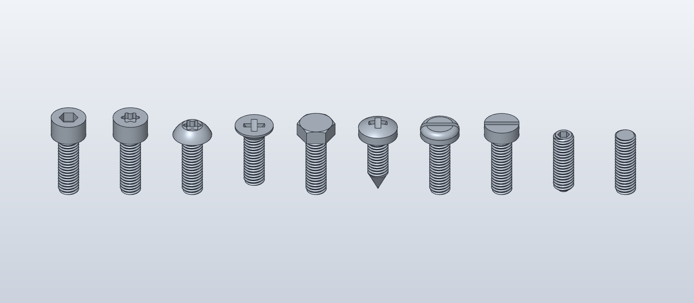

# Screws

Add the right screw to your [SolidCraft](https://github.com/tangency-labs/solidcraft) design in a few clicks—from socket heads and countersunk screws to set screws and threaded rod. Create matching holes at the same time, ready for your assembly.

- Choose from six head styles, set screws or threaded rod, with hex socket, Phillips, slotted or Torx drives.
- Start with common metric sizes or enter a custom size and pitch. Standard dimensions follow the selected head and drive where available.
- Add clearance, recessed or tapped holes, or create the holes on their own.
- Use modeled threads for detail or cosmetic threads for faster rebuilds.

## Get started

Select one or more sketch points or circles and open **Plugins > Screw**. Choose a size, length and head, then press **Run**. Leave **Sketch** and **Sketch point** blank to use your selection; with no selection, a loose screw is placed at the origin.

The default is an M3 × 12 socket-head screw. Choose **Screw and hole** to drill the part at your selected points, or **Hole only** to create just the holes. Countersunk screws, set screws and threaded rod use overall length; other headed screws are measured under the head.

For all options, supported standards, dimensions and placement details, see the [screw reference](REFERENCE.md).

## License

[MIT](../../LICENSE)
