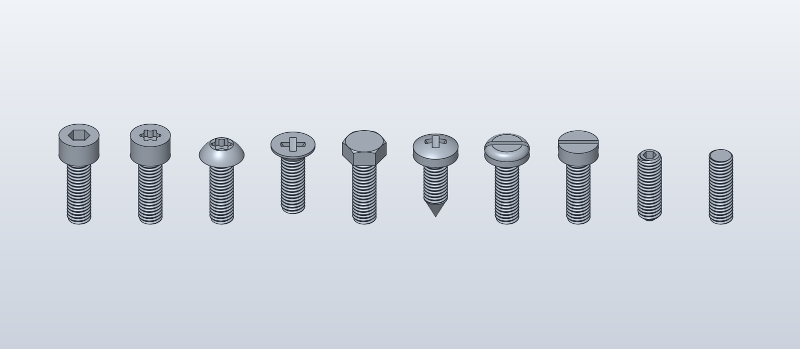

# Screws

A screw generator for [SolidCraft](https://github.com/tangency-labs/solidcraft). One entry, `make-screw`. It builds a head and a shank with ordinary SolidCraft commands, then calls `solid.thread` on the shank. The result is a normal timeline.

Ten M5 x 16 screws, left to right: a socket head with a hex socket, a socket head with a Torx recess, a button head with a Torx recess, a countersunk head with a Phillips recess, a hex head, a self-tapping pan head with a Phillips recess and a gimlet point, a pan head with a slot, a cheese head with a slot, a set screw with a hex socket and a cup point, and a threaded rod.

## Use

All sizes are millimetres. `length` is the length as the standard lists it: under the head, into the part. A countersunk screw is measured overall, head and all, as ISO 10642, ISO 2009 and ISO 7046-1 measure it, so an M3×12 countersunk screw is 12 mm from the top of the head to the tip. For a set screw or a threaded rod it is the overall length too.

Selections made before opening the dialog fill **Placement**. In **Screw only** mode, pick a bore rim or its cylindrical wall near the end where the head should sit. SolidCraft resolves the pick with its built-in fastener seating logic. The screw follows the bore axis into the part and a native rigid joint attaches it to the selected occurrence. For a countersunk screw, pick the rim where the countersink meets the bore. Picks on the same hole in one run resolve to a single seat. To put a screw at each end of a through bore, run the tool once per end.

The bore and its parent occurrences must be in their saved positions for the rigid joint to seat correctly. If you moved one of them, use **Capture Position** to keep the move, or **Revert Position** and pick the bore again. When an exploded view moves the bore, return to the assembled view and pick it there. You can leave unrelated occurrences in their pending positions.

A sketch point or circle places the top of the shank at the point or circle centre. Clicking inside a circular sketch profile also selects its centre. The head points along the sketch normal by default. With an empty selection, the screw sits on the origin with the head toward +Z and the shank toward −Z. The reply lists the placements in `points` and gives their number in `count`.

The form opens on an M3 socket-head screw, 12 mm long, with its 2.5 mm hex socket. Drive is Standard, which follows the Head, so changing the Head alone gives a sensible screw. Size lists the common machine screw sizes, M1.6 to M20, with the coarse thread. For any other metric size, such as `M8x1` or `M3.5x0.6`, type it in Custom size, which replaces Size. Leave the custom head diameter and height empty to use the standard for that size and head. Fill one and the other stays the standard, except a countersunk head, which takes both or neither. A size with no standard head here needs both. On a hex head the diameter is the width across the flats.

Blank head sizes are filled from the standard of the head and drive: socket M1.6 to M64 (DIN 912 / ISO 4762); button M3 to M16 (ISO 7380-1); countersunk with a hex socket M3 to M20 (ISO 10642, a 90° cone to a sharp edge); countersunk with a slot or a Phillips recess M1.6 to M10 (ISO 2009 and ISO 7046-1, a 90° cone with a cylindrical land above it, M3 being 5.5 by 1.65 mm); hex M1.6 to M64 (ISO 4017); pan with a slot M1.6 to M10 (ISO 1580, M3 being 5.6 by 1.8 mm); pan with a Phillips recess M1.6 to M10 (ISO 7045, the same width and taller, M3 being 5.6 by 2.4 mm); cheese M1.6 to M10 (ISO 1207).

| Parameter | Default | Meaning |
|---|---|---|
| `size` | `M3` | Shown as Size. A common machine screw size, `M1.6` to `M20` |
| `custom_size` | empty | Shown as Custom size. Any metric size, such as `M8x1`. Replaces Size when filled |
| `length` | 12 | Length under the head, mm. Overall on a countersunk head, a set screw and a threaded rod |
| `head` | `Socket head` | `Socket head`, `Button head`, `Countersunk`, `Hex head`, `Pan head`, `Cheese head`, `Set screw` or `Threaded rod` |
| `drive` | `Standard` | `Standard`, `Hex socket`, `Phillips`, `Slotted`, `Torx` or `None`. Standard is the usual drive for the head: a hex socket in a socket, button or countersunk head and in a set screw, Phillips in a pan head and in a countersunk head below M3 (ISO 10642 starts at M3), a slot in a cheese head, none in a hex head or a threaded rod |
| `drive_size` | standard | Shown as Drive size. Sizes whichever drive is chosen. Hex socket: the key size, or the key size and the depth, such as `2.5` or `2.5x1.3`. Torx: `T10`. Phillips: `PH1` or `PH2x1.7`. Slotted: width and depth, such as `0.8x0.7`. Empty uses the standard for that screw |
| `tip` | `Flat` | `Flat`, `Point` or `Cup`. Point is a gimlet one diameter long, included in the length, and it is not itself threaded. Cup is a recess in the end |
| `create` | `Screw only` | `Screw only`, `Screw and hole` or `Hole only`. A hole needs picked points on a part; with none, `Screw and hole` makes the screw alone. Hole only skips the drive, and the head unless the hole recesses it |
| `hole_type` | `Clearance` | `Clearance` (ISO 273 normal fit), `Clearance, head recessed` or `Tapped`. Used when Create drills a hole |
| `placement` | empty | Up to 32 picks. For Screw only, pick bore rims, cylindrical walls, sketch points or circles. To drill holes, pick sketch points or circles. Programs pass native selection references as shown below |
| `flip` | false | Shown as Flip direction. For Screw only. Turns each screw over at its placement |
| `head_diameter` | standard | Shown as Custom head diameter, mm. On a hex head, the width across the flats |
| `head_height` | standard | Shown as Custom head height, mm. One of the two is enough, except on a countersunk head |
| `thread_length` | standard | Threaded length from the tip of the cylinder, mm. A point is not included. Empty threads the whole shank on a short screw and the standard length `b` on a long one. Anything up to the full length threads all of the cylinder: above a point, and between the chamfers of a set screw |
| `thread_modeled` | true | Cut the thread profile. False leaves a cosmetic thread, which rebuilds faster |

An edge or face reference carries the selected world body name, topology index and world point, for example `{"type":"edge","body":"Rail","index":7,"point":[0,2.1,20]}`. A wall pick uses `"type":"face"`. Use the body, index and point from the same pick. Sketch picks name their sketch by feature id or name. Examples include `{"type":"external_sketch_point","sketch":2,"id":"p1"}`, `{"type":"external_sketch_curve","sketch":2,"id":"c1"}` and `{"type":"profile","sketch":2,"index":0}`.

A set screw and a threaded rod have no head, so both head sizes stay empty.

Create decides whether the part gets a hole. `Screw only`, the default, builds the screw and leaves the part alone. `Screw and hole` first drills the part under each picked point, and `Hole only` drills without a screw. A hole needs picked points on a part. With nothing picked, `Screw and hole` puts a loose screw on the origin and its reply's `note` says no hole was drilled, and `Hole only` asks you to pick the points; the hole is one ordinary `solid.hole` feature on those sketch points, so it follows the sketch and can be edited afterwards. Every hole is as deep as the screw reaches, so it goes through a part thinner than that.

- **Clearance.** The ISO 273 normal clearance hole for the size: 3.4 mm for an M3. The head sits on the surface. A size SolidCraft's own clearance table leaves out, such as M3.5 or M18, is drilled at its ISO 273 diameter instead.
- **Clearance, head recessed.** The same hole with a counterbore the head sits in, 0.5 mm wider than the head all round and as deep as the head is tall: 6.5 by 3 mm for an M3 socket head. A countersunk head gets a 90° countersink. The screw is set down into the recess, so the top of its head ends flush with the surface. A set screw and a rod have no head to recess.
- **Tapped.** A hole tapped for the screw's own thread, cosmetic or modeled as Modeled thread says.

Each screw made with its hole gets a native rigid joint. Clearance and recessed holes use the named bore wall and its seating face: the outer face for clearance, the floor for a counterbore, or the cone/bore junction for a countersink. Tapped holes use a native construction axis through the source sketch point, normal to that sketch's supporting plane or attached face. That axis is inserted immediately after its source sketch, in the same component, before any later thread cuts. This also works when the layout sketch was created before the solid. The previous history position and active component are restored afterwards. Sketch point edits and changes to the referenced plane move the hole and screw together. Counterbore depth edits move the screw with the floor; changing a 90° countersink's diameter changes its depth and moves the screw with its cone. These edits do not resize the screw. Save/reopen preserves the attachment without requiring the plugin.

Tapped seats currently require the mounting component’s first placement. A translated copied seat is refused because the host’s axis attachment cannot bind its exact assembly path. Clearance and recessed seats use the shared path-aware hole attachment.

Seats are resolved before hardware is built, and each occurrence gets its own joint even when it reuses an existing screw definition. Missing or ambiguous seats are refused. **Breaking change:** screws made with holes are now attached; regenerate old placements to gain these joints. In Screw only mode, sketch and origin placements are loose and bore placements are attached.

The reply names the standard the screw follows in `standard`, such as `ISO 4762`, and lists `hole` and the bodies it `drilled`. Seat joints are named after the screw followed by `Seat` and its occurrence id.

A standard head has its standard top. A button head is the ISO 7380-1 dome, leaning in from the bearing face to a flat. A Phillips pan head is the ISO 7045 shape, a cylindrical side under a spherical top, and a slotted pan head is the ISO 1580 one, flat with its edge rounded. A hex head is chamfered at 30° on top. A round head whose diameter or height you type is a plain cylinder. A typed countersunk head is a cone from the shank up to that diameter, with a land above it when it is taller than the 90° cone and a flatter cone when it is lower. A typed hex head keeps its top chamfer.

Thread length follows the standard too. Each standard draws a line in its length table: screws above it are threaded to the head, and screws below it have a plain shank and are threaded for `b` from the tip. Socket and button heads (`b` is `2d + 12`) keep a shank once they are longer than `b` plus eight and a half pitches, so an M3 socket head is threaded to the head up to 20 mm and for 18 mm from 25 mm on. A countersunk socket head (ISO 10642) starts later, at 30 mm for M3 and 50 mm for M8, counting the head. For the slotted and Phillips heads `b` is 25 mm up to M3 and 38 mm above: a Phillips pan head (ISO 7045) is threaded to the head up to 25 mm for M3 and smaller and up to 40 mm above; a slotted pan or cheese head (ISO 1580, ISO 1207) up to 30 mm and 40 mm; a flat countersunk head (ISO 2009, ISO 7046-1) up to 30 mm and 45 mm. A hex head, a set screw and a rod are threaded all the way. Type the full length in Thread length to thread a long screw to the head.

`tip` is the end of the shank. Flat is square. On a set screw it is the ISO 4026 flat point: the end is chamfered at 45° from the thread down to a flat `dp` across, 2 mm on an M3 and 4 mm on an M6, for the sizes that standard lists (M1.6 to M24). A hexagon socket set screw is also chamfered round its socket end, down to the root of the thread: at 90° included, or at 120° on the short lengths the standard shades in its table, such as M3 × 3. The 45° chamfers are chamfer features, so they can be edited or deleted afterwards; the 120° one is a revolved cut. Point is a self-tapping gimlet: a cone one major diameter long, and that cone is part of `length`, so an M3×12 point still reaches 12 mm. The thread starts where the cone meets the cylinder. Cup is a 120° recess in the end face, the usual set-screw tip, and it does not change the outside length. On a set screw it is the ISO 4029 cup point for the sizes that standard lists (M1.6 to M24): the cup is `dz` across at its mouth, 1.4 mm on an M3, and the outside of the point is chamfered at 45° down to that mouth, so the rim between them is sharp. The socket depth then follows the ISO 4029 length table, which keeps the shallower socket up to 4 mm on an M3. A cup on a headed screw, or on a size the standard does not list, is the plain recess with no chamfer. Any head can take any tip.

Torx cuts an ISO 10664 hexalobular recess into the outer face. The lobes are Table 1 `A` across the tips and `B` across the valleys, with the Annex A lobe radius `0.1 A`. The depth is the ISO 14579 minimum penetration for that socket, so an M3 socket head gets a T10 recess 1.01 mm deep. A screw size that table does not list needs a socket in Drive size, such as `T10`. A head too low for the standard depth gets a shallower recess that leaves 0.3 mm under it, down to 0.4 mm deep, and `torx_depth` in the reply gives the depth cut. A set screw takes the recess in its end, and the standard socket for a headed screw of that diameter is often too wide for the shank.

Hex socket cuts a hexagon into the outer face, and into the end of a set screw. The key size `s` and the least depth `t` come from the standard of the head: DIN 912 (ISO 4762) for a socket head, ISO 7380-1 for a button head, ISO 10642 for a countersunk head and ISO 4026 for a set screw. An M3 socket head takes a 2.5 mm key, 1.3 mm deep. ISO 4026 gives a set screw two depths: the shallower for the short lengths it shades in its table and the deeper for every longer one, so an M3 set screw is 1.2 mm deep at 3 mm long and 2 mm deep from 4 mm on. The floor is flat: the drill point under a real socket is not cut. A pan head and a hex head have no standard socket, so Hex socket on those needs a Drive size.

Slotted cuts a straight slot across the outer face, and into the end of a set screw. ISO 2380-1 sizes the screwdriver blade. The slot width is the nominal thickness from that standard, which the screw standard calls `n`. A pan head uses the ISO 1580 depth, so an M3 slot is 0.8 mm wide and 0.7 mm deep. A countersunk head uses the shallower ISO 2009 slot, 0.6 mm on an M3. A cheese head uses the deeper ISO 1207 slot, 0.85 mm on an M3. A set screw uses the smaller ISO 4766 slot, so an M3 set screw is 0.4 mm wide and 0.8 mm deep. The slot runs past both sides of the head. A size those tables do not list needs a width and depth in Drive size, such as `1.6x1.4`.

Phillips cuts an ISO 4757 type H cross recess. The wings are cut to the width the product standard gives across their tips at the face, `m`: 3 mm on an M3 pan head (ISO 7045) and 3.2 mm on an M3 countersunk head (ISO 7046-1). From there the wing tips narrow at 26°30′ to the screw axis down to the width `g`, where a 28° point closes the recess. Wing thickness is the nominal `b`, with straight walls. The side lean, the blunt point, the corner radius and the gauge are left out. The penetration in those standards is a gauge reading taken on the wings, so the recess ends deeper than it: an M3 pan head is gauged at 1.4 mm and its point ends 2.07 mm under the face. The reply gives all three as `phillips_depth`, `phillips_opening` and `phillips_reach`. In a low head the point runs on into the shank, which is allowed while the recess is narrower than the root of the thread there and is refused otherwise. A set screw and a cheese head have no Phillips table here, so they need a size such as `PH1x0.8`, and so does a size outside M1.6 to M10. A typed size such as `PH2x2.1` is taken as the penetration, and its width follows the same line the standards' rows lie on.

The package calls `parts.seats` to resolve existing bore rims and walls, `select.set` and `selection.get` (seat inspection temporarily selects bodies to resolve their assembly paths, then restores the selection), `inspect.measure` (for the body names, so a new body gets a free one), `sketch.inspect`, `solid.cylinder`, `solid.cone`, `sketch.create`, `sketch.polygon.circumscribed`, `sketch.dimension`, `sketch.constraint.horizontal_vertical`, `sketch.arc.three_point`, `sketch.rectangle.center`, `sketch.line`, `sketch.finish`, `solid.extrude`, `solid.combine`, `solid.revolve`, `solid.chamfer`, `solid.thread`, `solid.move` (a screw is made on the origin and moved aside before its thread is cut), `solid.hole`, `model.faces`, `model.edges` (only when several faces lie in the seat's plane, to find the one the hole is in), `construct.axis.normal_to_face`, `document.inspect`, `timeline.roll_to`, `timeline.inspect`, `joint.create`, and `component.list`, `component.create`, `component.metadata`, `component.metadata.set`, `component.activate`, `occurrence.copy`, `occurrence.move` and `occurrence.reparent` to place it. Each screw is a component of its own, built once and placed on every point (see [Components](../../DEVELOPMENT.md#components)). A socket or cheese head is a cylinder. A button or pan head is its half profile, revolved. A countersunk head is a cone from the shank diameter up to the head diameter, with the land a flat head has above it. A hex head is a six-sided sketch, chamfered on top with a revolved cut. Set screw chamfers are `solid.chamfer` features. A hole is a `solid.hole` feature. A point is a cone joined to a shorter shank. A cup is a cone cut into the end. A Torx recess is twelve tangent arcs, cut from a sketch just outside the outer face. A slot is a rectangle on that same sketch plane. A Phillips recess is the wing-tip cone intersected with a straight plus, then cut from the screw.

## Standards

Pick the head and the drive in the dialog and the screw follows the standard in that row: head size, head shape, drive size and depth, and thread length. Sizes outside a row still build with custom dimensions. The head follows the drive, so a slotted or Phillips pan or countersunk screw is a different standard from a hex socket one.

| Fastener | Dialog choice | Standard | Sizes | From the standard | Source | Test |
|---|---|---|---|---|---|---|
| Socket head cap screw | Socket head, Standard or Hex socket | ISO 4762 / DIN 912 | M1.6 to M64 | head, key size and depth, thread length | ARAMFIX data sheet "DIN 912"; [fasteners.eu](https://www.fasteners.eu/standards/DIN/912/) | yes |
| Button head screw | Button head, Standard or Hex socket | ISO 7380-1:2011 | M3 to M16 | head and its dome, key size and depth, thread length | the standard, Table 1 | yes |
| Countersunk socket screw | Countersunk, Standard or Hex socket | ISO 10642:2004 | M3 to M20 | head (90° cone), key size and depth, thread length | the standard, Table 1 | yes |
| Countersunk Phillips screw | Countersunk, Phillips | ISO 7046-1:2011 | M1.6 to M10 | head with its land, recess number, depth and width, thread length | the standard, Table 1 | yes |
| Countersunk slotted screw | Countersunk, Slotted | ISO 2009:2011 | M1.6 to M10 | head with its land, slot, thread length | the standard, Table 1 | yes |
| Pan head Phillips screw | Pan head, Standard or Phillips | ISO 7045:2011 | M1.6 to M10 | head and its dome, recess number, depth and width, thread length | the standard, Table 1 (the 1994 edition has the same values) | yes |
| Pan head slotted screw | Pan head, Slotted | ISO 1580:2011 | M1.6 to M10 | head and its rounded edge, slot, thread length | the standard, Table 1 | yes |
| Cheese head slotted screw | Cheese head, Standard or Slotted | ISO 1207:2011 | M1.6 to M10 | head, slot, thread length | the standard, Table 1; ARAMFIX data sheet "DIN 84" | yes |
| Socket set screw | Set screw, Standard or Hex socket | ISO 4026:2003 | M1.6 to M24 | key size, socket depth by length, flat point and its chamfer, socket end chamfer (90°, or 120° on the shaded short lengths) | the standard, Table 1 and Figure 1; [fasteners.eu](https://www.fasteners.eu/standards/iso/4026/) agrees | yes |
| Hex head screw | Hex head | ISO 4017 | M1.6 to M64 | head; the chamfer is the ISO 4032 nut's | [fasteners.eu ISO 4017](https://www.fasteners.eu/standards/ISO/4017/) | yes |
| Slotted set screw | Set screw, Slotted | ISO 4766 | M1 to M12 | slot | [fasteners.eu ISO 4766](https://www.fasteners.eu/standards/ISO/4766/) | yes |
| Cup point set screw | Set screw, Tip: Cup, Standard or Hex socket | ISO 4029:2003 | M1.6 to M24 | cup mouth and its 120° cup, 45° chamfer round it, key size, socket depth by length, socket end chamfer | the standard, Table 1 and Figure 1 | yes |
| Torx recess | any head, Torx | ISO 10664:1999 for the contour, ISO 14579 for the size and depth | T6 to T100 | across the lobes and valleys, lobe and valley radii; socket per thread and depth | ISO 10664:1999, Table 1 and annex A; [fasteners.eu ISO 14579](https://www.fasteners.eu/standards/ISO/14579/) | yes |
| Phillips recess | any head, Phillips | ISO 4757:1983 type H for the tool, ISO 7045 and ISO 7046-1 for the size, depth and width | PH0 to PH4 | wing thickness, bottom width, wing and point angles; recess number, penetration and width at the face | ISO 4757:1983, Table 1 and figure; ISO 7045:2011 and ISO 7046-1:2011, Table 1 | yes |
| Clearance hole | Create: Screw and hole or Hole only, Hole type: Clearance | ISO 273, medium | M1 to M64 | hole diameter | ISO 273:1979, Table 1 | yes |

"Test: yes" means a unit test repeats the table from the source named, so the code and the source cannot drift apart unnoticed. Each table in `crates/fasteners/src/` names its source in a comment.

The pan and countersunk rows follow the ISO documents, not the older DIN 7985, DIN 965 and DIN 963, which differ from them in head size, recess number and depth; fasteners.eu prints those DIN tables under the ISO numbers too, so it is not used for these rows. A countersunk screw's length is the overall length, head included, the way ISO 10642, ISO 2009 and ISO 7046-1 list it; every other head's length is measured under the head. Thread length follows the line each standard draws in its length table between screws threaded to the head and screws with a plain shank. ISO 4026 and ISO 4029 were reissued in 2026; the set screw rows follow the 2003 editions.

## Names

The body, the hole and every feature say what the part is and its size, so a design with several fasteners stays readable. Sizes use a plain `x`, with spaces around it so a fine pitch stays apart from the length. A second body with the same name gets a number in brackets, such as `(2)`.

| What | Name |
|---|---|
| Screw body | `Screw M3 x 12 socket`, `Screw M8x1 x 25 hex`, `Set screw M3 x 6`, `Threaded rod M8 x 100` |
| Screw hole | `Clearance hole M3`, `Counterbore M3`, `Countersink M3`, `Tapped hole M3` |
| Features and sketches of a screw | the screw's name, then the feature: `Screw M3 x 12 socket: Head` |
| Timeline folder | the screw's name, `Screw M3 x 12 socket`, holding every sketch and feature of the screw, folded |

A hole keeps its kind and size in its own name because it stays in the part, and with Hole only there is no screw body at all.

## Catalog and reuse

Shared internal definitions cover eight configurable head families.
The package exposes insertion workflows only; catalog discovery is not available. Standard dimensions identify a standards-based configuration, not guaranteed stock. Fine pitches and explicit geometry/drive overrides use custom identity and generated model numbers.

Purchasing identity is separate from cosmetic/modeled thread detail. Unchanged
representations reuse verified native definitions across runs. Renamed components
remain reusable; edited components are preserved and new insertions create clean
replacements. See [the library architecture](../../docs/parts-library.md) for BOM
rules, inspection limits and migration from legacy metadata.

## Older field names

Breaking change: retired input names are rejected. Use `size` instead of `designation`, `custom_size` instead of `custom_designation`, `head_diameter` / `head_height` instead of `custom_head_diameter` / `custom_head_height`, and `drive_size` instead of the separate `hex`, `torx`, `slot` or `phillips` input fields. `sketch` and `sketch_point` are retired and rejected as unsupported fields. Use `placement`, a list of picked sketch points or curves; typed comma-separated ids are gone. Reply fields retain their documented names.

## License

MIT, see [LICENSE](../../LICENSE).
