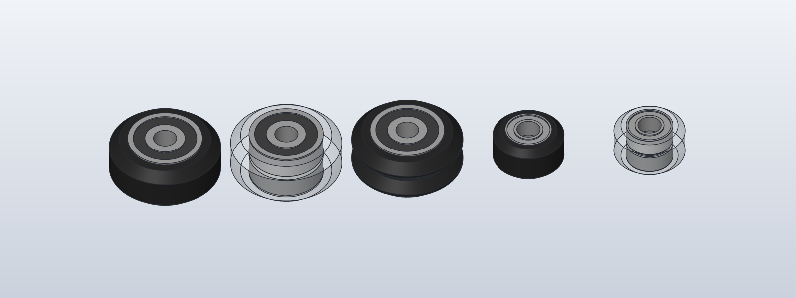

# V-wheels

Add OpenBuilds V-slot wheels to [SolidCraft](https://github.com/tangency-labs/solidcraft), either bare or with two bearings and the internal precision shim. Fixed supplier profiles keep the tread and bearing seats consistent with the source parts.

## Install

Download `techsquid-v-wheels-0.3.0.zip` from the repository's releases. In SolidCraft, choose **Plugins > Install plugin…** and select the zip. Check the [host requirements](../../docs/parts-library.md#host-requirements) before installing version 0.3. The Bearings and Extrusions plugins are optional; this package contains the shared bearing builder.

## Use

Select sketch points or circle centers, then run **V-wheels > make-v-wheel**. Choose a wheel and leave **Include bearings and internal shim** enabled for a wheel core assembly. Disable it for the bare wheel. With no selection, the centre is at the origin. The axle follows the selected sketch's normal.

The list includes Solid, Xtreme Solid, grooved Delrin, Delrin Mini and Xtreme Mini wheels. The black Delrin and clear polycarbonate variants remain different purchases even where they share a profile. These are OpenBuilds product families, not a universal dimensional standard for every wheel advertised as “V-slot compatible.”

An assembly contains one wheel, two bearing occurrences and one internal shim. It does not include an axle, eccentric spacer, external washers or a nut. Its bill of materials lists the separate purchases rather than treating the assembly as a retail kit. Unchanged bearings and wheels are reused across later insertions and the standalone Bearings tool.

See the [reference](REFERENCE.md) for dimensions, component placement, sources and limits. The [catalog contract](../../docs/catalog-contract.md) describes discovery for scripts and future browsers.
